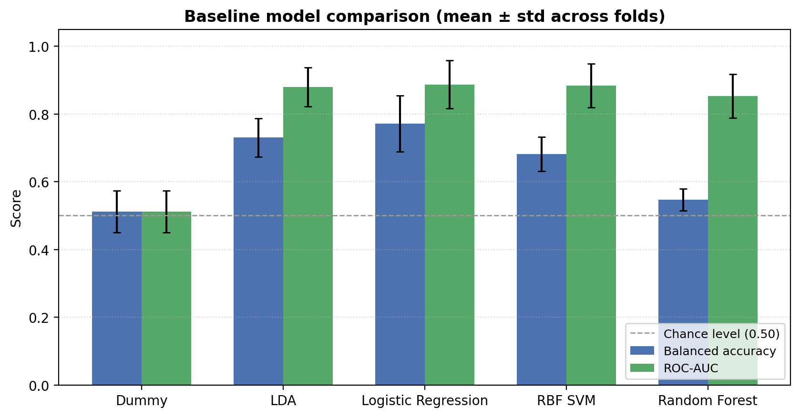
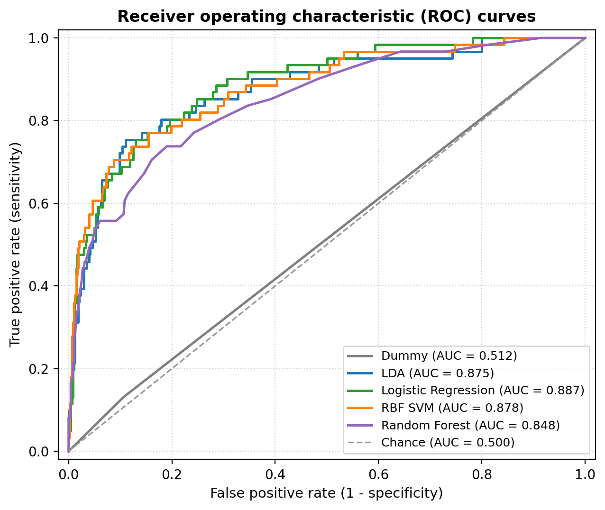

# Báo cáo Nghiên cứu: Phân tích & Phân loại Sóng P300 trên Tín hiệu EEG

Dự án Oddball Paradigm (GigaDB Dataset 100990) – Nhóm Nghiên cứu EEG.

---

## 1. Tổng quan & Mục tiêu Nghiên cứu

Nghiên cứu sóng não P300 (Event-Related Potential - ERP) là một trong những chủ đề kinh điển và quan trọng nhất trong lĩnh vực Khoa học Thần kinh Nhận thức (Cognitive Neuroscience) và Giao tiếp Não - Máy tính (Brain-Computer Interface - BCI). 

Dự án này tập trung vào:
1. **Phân tích hình thái & điện sinh lý**: Đánh giá sự phân bố không gian và động học thời gian của các phân nhánh sóng P300 (**P3a** và **P3b**) dựa trên nền tảng lý thuyết của **John Polich (2007)**.
2. **Quy trình tiền xử lý chuẩn mực**: Triển khai pipeline chuẩn trên 42 đối tượng với 128 kênh điện cực (Colin27 10-05 montage), kết hợp lọc thông dải, nội suy kênh hỏng, và khử nhiễu tự động bằng Picard ICA + ICLabel.
3. **Mô hình hóa dự đoán**: Trích xuất đặc trưng miền thời gian - tần số và xây dựng các mô hình phân loại học máy (SVM, LDA, RF) cùng mô hình học sâu chuyên biệt (EEGNet).

---

## 2. Cơ sở Lý thuyết: Mô hình Tích hợp P300 của Polich (2007)

Theo nghiên cứu bước ngoặt *"Updating P300: An integrative theory of P3a and P3b"* (Polich, 2007):

```
                        KÍCH THÍCH (Stimulus)
                                  │
         ┌────────────────────────┴────────────────────────┐
         ▼                                                 ▼
KÍCH THÍCH XAO NHÃNG (Distractor)                 KÍCH THÍCH ĐÍCH (Target)
- Không có nhiệm vụ, gây bất ngờ                  - Có nhiệm vụ, cần chú ý & phản hồi
- Kích hoạt chú ý không chủ ý                     - Cập nhật biểu tượng bộ nhớ làm việc
         │                                                 │
         ▼                                                 ▼
        P3a                                               P3b
- Cực đại vùng Trán/Trung tâm (Fz, Cz > Pz)       - Cực đại vùng Đỉnh/Chẩm-đỉnh (Pz > Cz > Fz)
- Độ trễ sớm (~300 - 450 ms)                      - Độ trễ dài hơn (~300 - 600 ms)
- Suy giảm nhanh theo thời gian (Habituation)     - Biên độ tỷ lệ nghịch với xác suất kích thích
```

### Phương pháp Sóng Hiệu số (Difference Waves)
Để bộc lộ chính xác thành phần nội sinh P300 mà không bị chồng lấn bởi các sóng cảm giác sớm (P1 ~100 ms, N1 ~150 ms, P2 ~200 ms), ta thực hiện phép trừ đại số giữa các điều kiện:
- $\Delta_{\text{Target}} = \text{Target} - \text{Standard}$: Cô lập hoàn toàn thành phần **P3b**.
- $\Delta_{\text{Distractor}} = \text{Distractor} - \text{Standard}$: Cô lập thành phần **P3a**.

---

## 3. Hệ thống Tiêu chuẩn Kiểm chứng P300 (Verification Rules)

Áp dụng cho từng đối tượng trong cửa sổ phân tích trọng tâm $[300, 500]\text{ ms}$ (mở rộng kiểm tra đến $600\text{ ms}$):
1. **Parietal Gradient (Gradient vùng đỉnh)**:
   $$\text{Amplitude}(Pz) > \text{Amplitude}(Fz)$$
   Đối với Target, điện thế tại Pz phải vượt trội so với Fz, khẳng định đặc tính P3b.
2. **Oddball Effect (Hiệu ứng chênh lệch kích thích)**:
   $$\text{Amplitude}(Pz, \text{Target}) - \text{Amplitude}(Pz, \text{Standard}) \ge 1.5\,\mu\text{V}$$
   Khẳng định có sự phân biệt nhận thức rõ ràng giữa kích thích đích và kích thích nền.
3. **Physiological Latency Window (Cửa sổ độ trễ sinh lý)**:
   $$300\text{ ms} \le \text{Peak Latency}(Pz) \le 500\text{ ms}$$
   Đỉnh cực đại của P3b xuất hiện chuẩn xác trong cửa sổ kích hoạt nhận thức chuẩn 300–500 ms.
4. **Fronto-Central Tendency của P3a (Xu hướng vùng trán của Distractor)**:
   Phân bố năng lượng của Distractor dịch chuyển rõ rệt về phía trước (Fz/Cz) so với Target.

---

## 4. Danh mục Trực quan hóa & Hình ảnh Báo cáo / Slide (Vai trò V3 – Trương Huy Hoàng)

Tất cả hình ảnh chất lượng cao (300 DPI, tối ưu cho slide thuyết trình và chèn báo cáo) được lưu tại `results/figures/` và `report/figures/`:
1. `{sub}_fz_pz_erp.png`: Dạng sóng ERP chuẩn 2 kênh mốc **Fz** và **Pz** với cửa sổ 300–500 ms tô sáng, font lớn chuẩn slide.
2. `grand_average_fz_pz.png`: Dạng sóng **Grand Average ERP (Fz, Pz)** trung bình toàn thể.
3. `grand_average_39subs.png`: Biểu đồ Grand Average tổng hợp 39 đối tượng chuẩn (từ pipeline tiền xử lý).
4. `{sub}_midline_erp.png`: Dạng sóng ERP 3 kênh đường giữa Fz, Cz, Pz kèm dải sai số chuẩn (SEM).
5. `{sub}_difference_waves.png`: Sóng hiệu số bóc tách trực diện P3a và P3b.
6. `{sub}_scalp_topomap.png`: Bản đồ địa hình da đầu 128 kênh (Scalp map) diễn tiến từ 150 ms đến 550 ms.
7. `{sub}_p300_summary_topomap.png`: Scalp map trung bình toàn cửa sổ P300 (300–500 ms) chỉ rõ tiêu điểm dương tính vùng đỉnh (Parietal Positivity).
8. `population_p300_summary.png`: Phân tích thống kê quần thể 42 đối tượng kiểm chứng ảnh hưởng của nhóm hiểu sai nhiệm vụ.

---

## 5. Trích xuất Đặc trưng (Vai trò V4 – Nguyễn Công Kiên)

### 5.1 Dữ liệu đầu vào
- Epoch đã tiền xử lý (pipeline v1) của **39 đối tượng** (loại sub-02, sub-14, sub-17 do hiểu sai nhiệm vụ), chỉ giữ các trial trả lời đúng.
- Bài toán hai lớp: **standard (0)** và **target (1)**. Tổng cộng **21.878 trial** (18.927 standard, 2.951 target, tức 13,5% target).
- Mỗi trial gồm 128 kênh × 301 mẫu (−200 đến +1000 ms, 250 Hz).
- Đặc trưng được tính trên **từng trial đơn lẻ** (single-trial). Laton et al. (2014) tính trên ERP đã lấy trung bình, còn nhóm tính trên từng trial vì bài toán là phân loại từng trial.

### 5.2 Kênh và cửa sổ thời gian
- **12 kênh**: đường giữa (Fz, FCz, Cz, CPz, Pz, Oz) và hai bên (F3/F4, C3/C4, P3/P4), là nơi P3a (trán – trung tâm) và P3b (đỉnh) có biên độ lớn nhất (Polich, 2007).
- **5 cửa sổ thời gian**:

| Cửa sổ | Khoảng (ms) | Ý nghĩa |
|---|---|---|
| `early` | 100–200 | Thành phần cảm giác sớm (N1, P2) |
| `p3a` | 250–400 | P3a, chú ý tự động |
| `p3b` | 400–600 | P3b, cập nhật bộ nhớ làm việc |
| `p3_window` | 300–600 | Toàn bộ P300 |
| `late` | 600–800 | Phần đuôi của phản ứng |

- **Lý do chọn cửa sổ P300 là 300–600 ms** (rộng hơn cửa sổ 300–500 ms dùng cho hình ERP ở mục 3–4):
  - Paper dataset (Dzianok et al., 2022) nêu P3 đạt đỉnh trong khoảng 300–600 ms. Laton et al. (2014) tìm đỉnh P300 thị giác trong 350–600 ms.
  - Kiểm tra trên 10 đối tượng: với cửa sổ 300–500 ms, 5/10 người có đỉnh P300 ở Pz rơi vào 560–690 ms, nên đặc trưng bị cắt mất đỉnh. Khi mở rộng tới 600 ms, AUC của `Pz_p3_window_mean` tăng từ 0,77 lên 0,81 (tốt hơn ở 9/10 người).

### 5.3 Danh mục đặc trưng (402 đặc trưng / trial)

| Nhóm | Đặc trưng | Kênh | Số cột |
|---|---|---|---|
| Biên độ theo cửa sổ | Trung bình và độ lệch chuẩn trong 5 cửa sổ | 12 | 120 |
| Đỉnh P300 | Biên độ, latency của đỉnh dương trong 300–600 ms; diện tích dưới đường cong | 12 | 36 |
| Đỉnh sớm (Laton et al., 2014) | Biên độ, latency của N100 [50, 200], P200 [150, 300], N200 [200, 400] ms | Fz, Cz, Pz | 18 |
| Đỉnh - đỉnh | Hiệu cực đại - cực tiểu trong 200–700 ms | 12 | 12 |
| Hjorth | Activity, mobility, complexity (tính trên cả epoch) | 12 | 36 |
| Phổ (Welch, tính trên cả epoch) | Band power tuyệt đối và tương đối của delta (0,5–4), theta (4–8), alpha (8–13), beta (13–30 Hz); tỉ số θ/α, δ/θ; spectral entropy | 12 | 132 |
| Wavelet (db4, 4 mức) | Năng lượng các dải 0–8, 8–16, 16–31 Hz trong 300–600 ms; biên độ trung bình của dải 0–8 Hz | 12 | 48 |

**Phương pháp tìm đỉnh** (theo Laton et al., 2014):
- Đỉnh là điểm có biên độ lớn hơn (đỉnh dương) hoặc nhỏ hơn (đỉnh âm) hai điểm lân cận. Nếu cửa sổ có nhiều đỉnh, lấy đỉnh cực trị nhất.
- Nếu cửa sổ không có đỉnh nào (chỉ là một sườn dốc), lấy điểm có đạo hàm gần 0 nhất (tùy chọn *force*).
- Nhờ vậy, đỉnh không bị gán vào mép cửa sổ khi sóng vẫn đang đi lên. Ở Pz, chỉ còn 2,5% trial target có đỉnh P3 ở mép 600 ms.

**Wavelet**: dùng phân tích đa phân giải (multiresolution analysis) với wavelet db4, 4 mức, để tách tín hiệu thành các dải tần mà vẫn giữ trục thời gian. Khác với band power (tính trên cả epoch), wavelet cho phép đo năng lượng từng dải **đúng trong cửa sổ P300**.

### 5.4 Mức phân biệt của đặc trưng
Mỗi đặc trưng được đánh giá bằng AUC giữa target và standard. AUC tính riêng trong từng người rồi lấy trung bình trên 39 người: 0,5 là không phân biệt được, 1 là phân biệt hoàn toàn. Với đặc trưng mà target **thấp hơn** standard (AUC < 0,5), mức phân biệt được quy đổi thành 1 − AUC. Bảng dưới ghi mức phân biệt này. Bảng đầy đủ nằm trong `results/tables/v4_feature_auc.csv` (tạo bằng `src/features/rank_features.py`; cột `auc` là AUC gốc, cột `strength` là mức phân biệt).

| Nhóm đặc trưng | Mức phân biệt tốt nhất | Đặc trưng tốt nhất |
|---|---|---|
| Biên độ theo cửa sổ | **0,836** | `Pz_p3b_mean` (Pz, 400–600 ms) |
| Diện tích dưới đường cong | 0,802 | `Pz_p3_auc` |
| Wavelet | 0,802 | `Pz_wav_delta_theta_p3_mean` |
| Hjorth | 0,780 | `Pz_hjorth_complexity` |
| Band power | 0,741 | `CPz_bp_delta` |
| Biên độ đỉnh P300 | 0,733 | `CPz_p3_peak_amp` |
| Spectral entropy | 0,679 | `CPz_spectral_entropy` (target thấp hơn, AUC 0,321) |
| Latency đỉnh P300 | 0,624 | `CPz_p3_peak_lat` |
| Đỉnh - đỉnh | 0,614 | `Cz_ptp` |
| Đỉnh sớm N1/P2/N2 | 0,605 | `Fz_n2_lat` |

Có 32/402 đặc trưng đạt mức phân biệt ≥ 0,7 và 156/402 đặc trưng đạt mức phân biệt ≥ 0,6.

**Nhận xét:**
1. **Đặc trưng mạnh nhất là biên độ trung bình ở vùng đỉnh (Pz, CPz) trong 400–600 ms**, đúng phân bố không gian và thời gian của P3b theo Polich (2007). Biên độ trung bình ổn định hơn biên độ đỉnh (0,836 so với 0,733) vì trên một trial đơn lẻ, đỉnh dễ bị nhiễu làm lệch.
2. **Thông tin thời gian giúp ích**: năng lượng 0–8 Hz đo bằng wavelet trong cửa sổ P300 (AUC 0,760 ở Pz) tốt hơn band power delta tính trên cả epoch (0,734). Năng lượng alpha (8–16 Hz) trong cửa sổ P300 **thấp hơn** ở target (AUC 0,352), phù hợp với hiện tượng giảm alpha khi tập trung chú ý.
3. **Hjorth mobility thấp hơn ở target** (AUC 0,228 ở Pz, tức mức phân biệt 0,772): sóng P300 chậm, biên độ lớn làm giảm tần số trung bình của tín hiệu. Tương tự, spectral entropy cũng thấp hơn ở target (AUC 0,321 ở CPz): năng lượng dồn về dải tần thấp nên phổ "có trật tự" hơn.
4. **Latency và các đỉnh sớm phân biệt yếu** (AUC ≤ 0,62), vì hai lý do:
   - Latency trên từng trial đơn lẻ dao động nhiều (Laton et al. cũng lưu ý điều này khi lấy trung bình).
   - Các thành phần cảm giác sớm (N1, P2, N2) gần như giống nhau ở cả hai loại kích thích thị giác.

   Các đặc trưng này vẫn được giữ lại, vì theo Laton et al. (2014), đặc trưng yếu khi đứng riêng có thể hữu ích khi kết hợp.

### 5.5 Lưu ý cho bước phân loại (V5)
- **Chưa chuẩn hóa**: z-score (Laton et al. dùng z-score kèm sigmoid) phải được fit trên tập train của từng fold, ví dụ đặt `StandardScaler` trong `Pipeline`, để tránh rò rỉ dữ liệu.
- **Chia tập theo người**: dùng `groups` do `load_features()` trả về (Leave-One-Subject-Out hoặc `GroupKFold`).
- **Nhiễu do bấm nút**: người tham gia bấm nút khoảng 540 ms sau target, nằm trong cửa sổ `p3b` và `p3_window`. Vì vậy một phần thông tin có thể đến từ hoạt động vận động. Có thể kiểm tra bằng phân loại distractor - standard (cả hai đều không bấm nút).
- **Không chọn đặc trưng dựa trên bảng AUC ở trên trước khi train**: bảng được tính trên toàn bộ dữ liệu, nên dùng nó để chọn đặc trưng sẽ gây rò rỉ thông tin từ tập test.

### Tài liệu tham khảo (mục 5)
- Laton J, Van Schependom J, Gielen J, Decoster J, Moons T, De Keyser J, De Hert M, Nagels G. Single-subject classification of schizophrenia patients based on a combination of oddball and mismatch evoked potential paradigms. *J Neurol Sci* 2014;347:262–267. doi:10.1016/j.jns.2014.10.015
- Dzianok P, Antonova I, Wojciechowski J, Dreszer J, Kublik E. The Nencki-Symfonia electroencephalography/event-related potential dataset: Multiple cognitive tasks and resting-state data collected in a sample of healthy adults. *GigaScience* 2022;11:giac015. doi:10.1093/gigascience/giac015
- Polich J. Updating P300: An integrative theory of P3a and P3b. *Clin Neurophysiol* 2007;118:2128–2148.
- Hjorth B. EEG analysis based on time domain properties. *Electroencephalogr Clin Neurophysiol* 1970;29:306–310.

---

## 6. Mô hình Học máy Truyền thống Baseline (Vai trò V5)

### 6.1 Thiết lập bài toán & Xử lý mất cân bằng lớp
- **Bài toán phân loại đơn trial (Single-trial classification)**: Phân loại nhị phân giữa kích thích Thường (Standard - 0) và Đích (Target - 1). Kích thích xao nhãng (Distractor) được loại khỏi bài toán nhị phân này để tập trung vào cơ chế P3b phục vụ giao tiếp não - máy tính (BCI).
- **Mất cân bằng lớp nghiêm trọng**: Tỷ lệ trial Target chỉ chiếm khoảng 11,3% - 13,5% (tỷ lệ xấp xỉ 1:7).
- **Chiến lược khắc phục**:
  - Không sử dụng độ chính xác thô (Raw Accuracy) vì mô hình dự đoán toàn bộ là Standard vẫn đạt ~88,7% accuracy nhưng hoàn toàn vô dụng cho việc nhận diện sóng P300.
  - Sử dụng tham số `class_weight="balanced"` trên các mô hình Logistic Regression, RBF SVM và `balanced_subsample` trên Random Forest.
  - Đánh giá đa chiều qua bộ chỉ số: **Balanced Accuracy**, **ROC-AUC**, **PR-AUC (Average Precision)**, **F1-macro**, **Sensitivity (Target Recall)** và **Specificity**.

### 6.2 Kiểm định không rò rỉ dữ liệu (Cross-Validation Scheme)
- **Chuẩn hóa trong fold (Inside-fold Scaling)**: Đóng gói `StandardScaler` bên trong `Pipeline` của `scikit-learn`. Quá trình tính toán trung bình và độ lệch chuẩn chỉ được thực hiện trên fold huấn luyện (train fold) và ánh xạ sang fold kiểm thử (test fold), loại bỏ hoàn toàn nguy cơ rò rỉ thông tin tập test.
- **Cơ chế phân chia theo đối tượng (Subject-wise CV)**:
  - Khi chạy trên toàn bộ tập dữ liệu (39 người), sử dụng `GroupKFold(n_splits=5)` theo `subject_id` để kiểm chứng khả năng tổng quát hóa xuyên đối tượng (Cross-subject generalization).
  - Khi chạy thử nghiệm trên đối tượng đơn lẻ (`sub-01`), sử dụng `StratifiedKFold(n_splits=5)` nhằm bảo toàn tỷ lệ lớp trong từng fold.

### 6.3 Danh mục mô hình baseline
1. **Dummy (Stratified Chance Level)**: Mô hình ngẫu nhiên làm mốc so sánh cơ sở (Balanced Accuracy 50%, ROC-AUC 0,500, PR-AUC bằng đúng prevalence 11,3%).
2. **Linear Discriminant Analysis (LDA)**: Mô hình tiêu chuẩn vàng (Gold standard) trong các nghiên cứu BCI P300 kinh điển, sử dụng bộ giải `lsqr` kết hợp tự động điều chuẩn độ co rút (`shrinkage="auto"`).
3. **Logistic Regression**: Mô hình tuyến tính với điều chuẩn L2, tối ưu hóa phân loại xác suất với trọng số lớp cân bằng.
4. **Support Vector Machine (RBF SVM)**: Mô hình nhân phi tuyến (Radial Basis Function) với trọng số lớp cân bằng.
5. **Random Forest**: Mô hình tập hợp (Ensemble) 100 cây quyết định với cân bằng lớp trên từng cây con (`balanced_subsample`).

### 6.4 Kết quả thực nghiệm (Dữ liệu thử nghiệm sub-01: 540 trials, 402 đặc trưng)

| Mô hình | Balanced Accuracy | ROC-AUC | PR-AUC (AP) | F1-Macro | Sensitivity | Specificity |
|---|:---:|:---:|:---:|:---:|:---:|:---:|
| Dummy | 0,512 ± 0,062 | 0,512 ± 0,062 | 0,126 ± 0,023 | 0,512 ± 0,063 | 0,129 ± 0,107 | 0,894 ± 0,017 |
| Random Forest | 0,547 ± 0,033 | 0,853 ± 0,065 | 0,593 ± 0,130 | 0,555 ± 0,057 | 0,097 ± 0,067 | **0,996 ± 0,006** |
| RBF SVM | 0,682 ± 0,050 | 0,884 ± 0,065 | **0,679 ± 0,143** | 0,730 ± 0,063 | 0,378 ± 0,099 | 0,985 ± 0,023 |
| LDA | 0,731 ± 0,057 | 0,880 ± 0,057 | 0,621 ± 0,136 | 0,740 ± 0,058 | 0,512 ± 0,120 | 0,950 ± 0,032 |
| **Logistic Regression** | **0,772 ± 0,083** | **0,887 ± 0,071** | 0,627 ± 0,157 | **0,755 ± 0,065** | **0,610 ± 0,173** | 0,933 ± 0,034 |



### 6.5 Phân tích & Nhận xét chuyên môn
1. **Ưu thế của các mô hình tuyến tính có điều chuẩn (Logistic Regression và LDA)**:
   - Logistic Regression đạt Balanced Accuracy cao nhất (0,772), ROC-AUC 0,887 và Sensitivity 61,0% ở ngưỡng quyết định 0,5.
   - LDA thể hiện tính ổn định cao với ROC-AUC 0,880 và Balanced Accuracy 0,731. Trong không gian 402 chiều với số lượng trial hữu hạn, tính chất chiếu tuyến tính của LDA và Logistic Regression giúp kiểm soát hiện tượng quá khớp (overfitting) hiệu quả hơn các mô hình phi tuyến phức tạp.
2. **Khả năng phân tách xác suất (Ranking Quality)**:
   - Cả ba mô hình LDA, Logistic Regression và RBF SVM đều đạt ROC-AUC rất cao (> 0,88), vượt trội hoàn toàn so với mức ngẫu nhiên (0,50).
   - Đồ thị Precision-Recall chỉ ra PR-AUC của các mô hình đạt từ 0,59 đến 0,68, cao gấp 5 đến 6 lần so với đường cơ sở xác suất nền (Prevalence = 11,3%). RBF SVM đạt PR-AUC cao nhất (0,679), chứng minh khả năng xếp hạng độ tin cậy của các trial target rất tốt khi áp dụng ngưỡng xác suất cao.
3. **Hiện tượng của Random Forest trên dữ liệu bảng EEG**:
   - Mặc dù ROC-AUC của Random Forest đạt 0,853, độ nhạy (Sensitivity) ở ngưỡng xác suất 0,5 bị suy giảm (0,097) trong khi Specificity đạt gần như tuyệt đối (0,996). Nguyên nhân do không gian đặc trưng chứa nhiều kênh và cửa sổ có tương quan cao (multicollinearity); việc lấy mẫu ngẫu nhiên đặc trưng tại mỗi nhánh cây khiến các đặc trưng P300 mạnh bị loãng, dẫn đến xác suất dự đoán của Random Forest bị nén về phía lớp đa số.




### Tài liệu tham khảo bổ sung (mục 6)
- Blankertz B, Lemm S, Treder M, Haufe S, Müller KR. Single-trial analysis and classification of ERP components -- a tutorial. *NeuroImage* 2011;56(2):814–825.
- Lotte F, Bougrain L, Cichocki A, Clerc M, Congedo M, Chouvellon A, Yger F. A review of classification algorithms for EEG-based brain-computer interfaces: a 10 year update. *J Neural Eng* 2018;15(3):031005.


