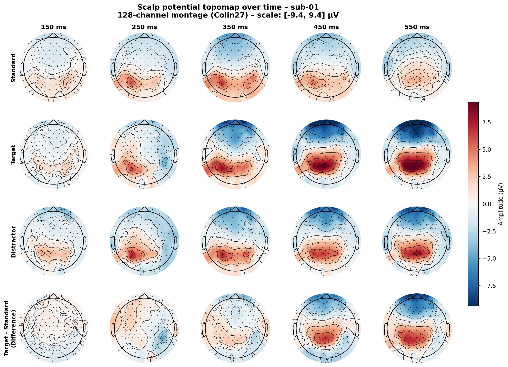
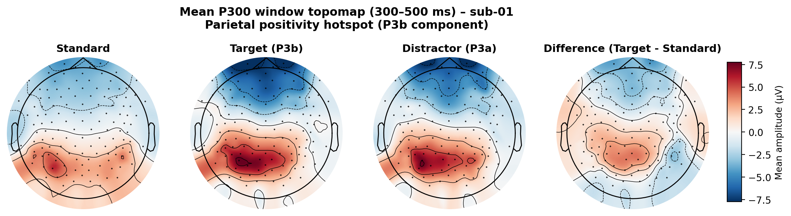

# Báo cáo Nghiên cứu: Phân tích & Phân loại Sóng P300 trên Tín hiệu EEG

Dự án Oddball Paradigm (GigaDB Dataset 100990) – Nhóm Nghiên cứu EEG.

---

## 1. Tổng quan & Mục tiêu Nghiên cứu

Nghiên cứu sóng não P300 (Event-Related Potential - ERP) là một trong những chủ đề kinh điển và quan trọng nhất trong lĩnh vực Khoa học Thần kinh Nhận thức (Cognitive Neuroscience) và Giao tiếp Não - Máy tính (Brain-Computer Interface - BCI). 

Dự án này tập trung vào:
1. **Phân tích hình thái & điện sinh lý**: Đánh giá sự phân bố không gian và động học thời gian của các phân nhánh sóng P300 (**P3a** và **P3b**) dựa trên nền tảng lý thuyết của **John Polich (2007)**.
2. **Quy trình tiền xử lý chuẩn mực**: Triển khai pipeline chuẩn trên 42 đối tượng với 128 kênh điện cực (Colin27 10-05 montage), kết hợp lọc thông dải, nội suy kênh hỏng, và khử nhiễu tự động bằng Picard ICA + ICLabel.
3. **Mô hình hóa dự đoán**: Trích xuất đặc trưng miền thời gian - tần số và xây dựng các mô hình phân loại học máy (SVM, LDA, RF) cùng mô hình học sâu chuyên biệt (EEGNet).

---

## 2. Cơ sở Lý thuyết: Mô hình Tích hợp P300 của Polich (2007)

Theo nghiên cứu bước ngoặt *"Updating P300: An integrative theory of P3a and P3b"* (Polich, 2007):

```
                        KÍCH THÍCH (Stimulus)
                                  │
         ┌────────────────────────┴────────────────────────┐
         ▼                                                 ▼
KÍCH THÍCH XAO NHÃNG (Distractor)                 KÍCH THÍCH ĐÍCH (Target)
- Không có nhiệm vụ, gây bất ngờ                  - Có nhiệm vụ, cần chú ý & phản hồi
- Kích hoạt chú ý không chủ ý                     - Cập nhật biểu tượng bộ nhớ làm việc
         │                                                 │
         ▼                                                 ▼
        P3a                                               P3b
- Cực đại vùng Trán/Trung tâm (Fz, Cz > Pz)       - Cực đại vùng Đỉnh/Chẩm-đỉnh (Pz > Cz > Fz)
- Độ trễ sớm (~300 - 450 ms)                      - Độ trễ dài hơn (~300 - 600 ms)
- Suy giảm nhanh theo thời gian (Habituation)     - Biên độ tỷ lệ nghịch với xác suất kích thích
```

### Phương pháp Sóng Hiệu số (Difference Waves)
Để bộc lộ chính xác thành phần nội sinh P300 mà không bị chồng lấn bởi các sóng cảm giác sớm (P1 ~100 ms, N1 ~150 ms, P2 ~200 ms), ta thực hiện phép trừ đại số giữa các điều kiện:
- $\Delta_{\text{Target}} = \text{Target} - \text{Standard}$: Cô lập hoàn toàn thành phần **P3b**.
- $\Delta_{\text{Distractor}} = \text{Distractor} - \text{Standard}$: Cô lập thành phần **P3a**.

---

## 3. Hệ thống Tiêu chuẩn Kiểm chứng P300 (Verification Rules)

Áp dụng cho từng đối tượng trong cửa sổ phân tích trọng tâm $[300, 500]\text{ ms}$ (mở rộng kiểm tra đến $600\text{ ms}$):
1. **Parietal Gradient (Gradient vùng đỉnh)**:
   $$\text{Amplitude}(Pz) > \text{Amplitude}(Fz)$$
   Đối với Target, điện thế tại Pz phải vượt trội so với Fz, khẳng định đặc tính P3b.
2. **Oddball Effect (Hiệu ứng chênh lệch kích thích)**:
   $$\text{Amplitude}(Pz, \text{Target}) - \text{Amplitude}(Pz, \text{Standard}) \ge 1.5\,\mu\text{V}$$
   Khẳng định có sự phân biệt nhận thức rõ ràng giữa kích thích đích và kích thích nền.
3. **Physiological Latency Window (Cửa sổ độ trễ sinh lý)**:
   $$300\text{ ms} \le \text{Peak Latency}(Pz) \le 500\text{ ms}$$
   Đỉnh cực đại của P3b xuất hiện chuẩn xác trong cửa sổ kích hoạt nhận thức chuẩn 300–500 ms.
4. **Fronto-Central Tendency của P3a (Xu hướng vùng trán của Distractor)**:
   Phân bố năng lượng của Distractor dịch chuyển rõ rệt về phía trước (Fz/Cz) so với Target.

---

## 4. Danh mục Trực quan hóa & Hình ảnh Báo cáo / Slide (Vai trò V3 – Trương Huy Hoàng)

Tất cả hình ảnh chất lượng cao (300 DPI, tối ưu cho slide thuyết trình và chèn báo cáo) được lưu tại `results/figures/` và `report/figures/`:
1. `{sub}_fz_pz_erp.png`: Dạng sóng ERP chuẩn 2 kênh mốc **Fz** và **Pz** với cửa sổ 300–500 ms tô sáng, font lớn chuẩn slide.
2. `grand_average_fz_pz.png`: Dạng sóng **Grand Average ERP (Fz, Pz)** trung bình toàn thể.
3. `grand_average_39subs.png`: Biểu đồ Grand Average tổng hợp 39 đối tượng chuẩn (từ pipeline tiền xử lý).
4. `{sub}_midline_erp.png`: Dạng sóng ERP 3 kênh đường giữa Fz, Cz, Pz kèm dải sai số chuẩn (SEM).
5. `{sub}_difference_waves.png`: Sóng hiệu số bóc tách trực diện P3a và P3b.
6. `{sub}_scalp_topomap.png`: Bản đồ địa hình da đầu 128 kênh (Scalp map) diễn tiến từ 150 ms đến 550 ms.
7. `{sub}_p300_summary_topomap.png`: Scalp map trung bình toàn cửa sổ P300 (300–500 ms) chỉ rõ tiêu điểm dương tính vùng đỉnh (Parietal Positivity).
8. `population_p300_summary.png`: Phân tích thống kê quần thể 42 đối tượng kiểm chứng ảnh hưởng của nhóm hiểu sai nhiệm vụ.

---

## 5. Trích xuất Đặc trưng (Vai trò V4 – Nguyễn Công Kiên)

### 5.1 Dữ liệu đầu vào
- Epoch đã tiền xử lý (pipeline v1) của **39 đối tượng** (loại sub-02, sub-14, sub-17 do hiểu sai nhiệm vụ), chỉ giữ các trial trả lời đúng.
- Bài toán hai lớp: **standard (0)** và **target (1)**. Tổng cộng **21.878 trial** (18.927 standard, 2.951 target, tức 13,5% target).
- Mỗi trial gồm 128 kênh × 301 mẫu (−200 đến +1000 ms, 250 Hz).
- Đặc trưng được tính trên **từng trial đơn lẻ** (single-trial). Laton et al. (2014) tính trên ERP đã lấy trung bình, còn nhóm tính trên từng trial vì bài toán là phân loại từng trial.

### 5.2 Kênh và cửa sổ thời gian
- **12 kênh**: đường giữa (Fz, FCz, Cz, CPz, Pz, Oz) và hai bên (F3/F4, C3/C4, P3/P4), là nơi P3a (trán – trung tâm) và P3b (đỉnh) có biên độ lớn nhất (Polich, 2007).
- **5 cửa sổ thời gian**:

| Cửa sổ | Khoảng (ms) | Ý nghĩa |
|---|---|---|
| `early` | 100–200 | Thành phần cảm giác sớm (N1, P2) |
| `p3a` | 250–400 | P3a, chú ý tự động |
| `p3b` | 400–600 | P3b, cập nhật bộ nhớ làm việc |
| `p3_window` | 300–600 | Toàn bộ P300 |
| `late` | 600–800 | Phần đuôi của phản ứng |

- **Lý do chọn cửa sổ P300 là 300–600 ms** (rộng hơn cửa sổ 300–500 ms dùng cho hình ERP ở mục 3–4):
  - Paper dataset (Dzianok et al., 2022) nêu P3 đạt đỉnh trong khoảng 300–600 ms. Laton et al. (2014) tìm đỉnh P300 thị giác trong 350–600 ms.
  - Kiểm tra trên 10 đối tượng: với cửa sổ 300–500 ms, 5/10 người có đỉnh P300 ở Pz rơi vào 560–690 ms, nên đặc trưng bị cắt mất đỉnh. Khi mở rộng tới 600 ms, AUC của `Pz_p3_window_mean` tăng từ 0,77 lên 0,81 (tốt hơn ở 9/10 người).

### 5.3 Danh mục đặc trưng (402 đặc trưng / trial)

| Nhóm | Đặc trưng | Kênh | Số cột |
|---|---|---|---|
| Biên độ theo cửa sổ | Trung bình và độ lệch chuẩn trong 5 cửa sổ | 12 | 120 |
| Đỉnh P300 | Biên độ, latency của đỉnh dương trong 300–600 ms; diện tích dưới đường cong | 12 | 36 |
| Đỉnh sớm (Laton et al., 2014) | Biên độ, latency của N100 [50, 200], P200 [150, 300], N200 [200, 400] ms | Fz, Cz, Pz | 18 |
| Đỉnh - đỉnh | Hiệu cực đại - cực tiểu trong 200–700 ms | 12 | 12 |
| Hjorth | Activity, mobility, complexity (tính trên cả epoch) | 12 | 36 |
| Phổ (Welch, tính trên cả epoch) | Band power tuyệt đối và tương đối của delta (0,5–4), theta (4–8), alpha (8–13), beta (13–30 Hz); tỉ số θ/α, δ/θ; spectral entropy | 12 | 132 |
| Wavelet (db4, 4 mức) | Năng lượng các dải 0–8, 8–16, 16–31 Hz trong 300–600 ms; biên độ trung bình của dải 0–8 Hz | 12 | 48 |

**Phương pháp tìm đỉnh** (theo Laton et al., 2014):
- Đỉnh là điểm có biên độ lớn hơn (đỉnh dương) hoặc nhỏ hơn (đỉnh âm) hai điểm lân cận. Nếu cửa sổ có nhiều đỉnh, lấy đỉnh cực trị nhất.
- Nếu cửa sổ không có đỉnh nào (chỉ là một sườn dốc), lấy điểm có đạo hàm gần 0 nhất (tùy chọn *force*).
- Nhờ vậy, đỉnh không bị gán vào mép cửa sổ khi sóng vẫn đang đi lên. Ở Pz, chỉ còn 2,5% trial target có đỉnh P3 ở mép 600 ms.

**Wavelet**: dùng phân tích đa phân giải (multiresolution analysis) với wavelet db4, 4 mức, để tách tín hiệu thành các dải tần mà vẫn giữ trục thời gian. Khác với band power (tính trên cả epoch), wavelet cho phép đo năng lượng từng dải **đúng trong cửa sổ P300**.

### 5.4 Mức phân biệt của đặc trưng
Mỗi đặc trưng được đánh giá bằng AUC giữa target và standard. AUC tính riêng trong từng người rồi lấy trung bình trên 39 người: 0,5 là không phân biệt được, 1 là phân biệt hoàn toàn. Với đặc trưng mà target **thấp hơn** standard (AUC < 0,5), mức phân biệt được quy đổi thành 1 − AUC. Bảng dưới ghi mức phân biệt này. Bảng đầy đủ nằm trong `results/tables/v4_feature_auc.csv` (tạo bằng `src/features/rank_features.py`; cột `auc` là AUC gốc, cột `strength` là mức phân biệt).

| Nhóm đặc trưng | Mức phân biệt tốt nhất | Đặc trưng tốt nhất |
|---|---|---|
| Biên độ theo cửa sổ | **0,836** | `Pz_p3b_mean` (Pz, 400–600 ms) |
| Diện tích dưới đường cong | 0,802 | `Pz_p3_auc` |
| Wavelet | 0,802 | `Pz_wav_delta_theta_p3_mean` |
| Hjorth | 0,780 | `Pz_hjorth_complexity` |
| Band power | 0,741 | `CPz_bp_delta` |
| Biên độ đỉnh P300 | 0,733 | `CPz_p3_peak_amp` |
| Spectral entropy | 0,679 | `CPz_spectral_entropy` (target thấp hơn, AUC 0,321) |
| Latency đỉnh P300 | 0,624 | `CPz_p3_peak_lat` |
| Đỉnh - đỉnh | 0,614 | `Cz_ptp` |
| Đỉnh sớm N1/P2/N2 | 0,605 | `Fz_n2_lat` |

Có 32/402 đặc trưng đạt mức phân biệt ≥ 0,7 và 156/402 đặc trưng đạt mức phân biệt ≥ 0,6.

**Nhận xét:**
1. **Đặc trưng mạnh nhất là biên độ trung bình ở vùng đỉnh (Pz, CPz) trong 400–600 ms**, đúng phân bố không gian và thời gian của P3b theo Polich (2007). Biên độ trung bình ổn định hơn biên độ đỉnh (0,836 so với 0,733) vì trên một trial đơn lẻ, đỉnh dễ bị nhiễu làm lệch.
2. **Thông tin thời gian giúp ích**: năng lượng 0–8 Hz đo bằng wavelet trong cửa sổ P300 (AUC 0,760 ở Pz) tốt hơn band power delta tính trên cả epoch (0,734). Năng lượng alpha (8–16 Hz) trong cửa sổ P300 **thấp hơn** ở target (AUC 0,352), phù hợp với hiện tượng giảm alpha khi tập trung chú ý.
3. **Hjorth mobility thấp hơn ở target** (AUC 0,228 ở Pz, tức mức phân biệt 0,772): sóng P300 chậm, biên độ lớn làm giảm tần số trung bình của tín hiệu. Tương tự, spectral entropy cũng thấp hơn ở target (AUC 0,321 ở CPz): năng lượng dồn về dải tần thấp nên phổ "có trật tự" hơn.
4. **Latency và các đỉnh sớm phân biệt yếu** (AUC ≤ 0,62), vì hai lý do:
   - Latency trên từng trial đơn lẻ dao động nhiều (Laton et al. cũng lưu ý điều này khi lấy trung bình).
   - Các thành phần cảm giác sớm (N1, P2, N2) gần như giống nhau ở cả hai loại kích thích thị giác.

   Các đặc trưng này vẫn được giữ lại, vì theo Laton et al. (2014), đặc trưng yếu khi đứng riêng có thể hữu ích khi kết hợp.

### 5.5 Lưu ý cho bước phân loại (V5)
- **Chưa chuẩn hóa**: z-score (Laton et al. dùng z-score kèm sigmoid) phải được fit trên tập train của từng fold, ví dụ đặt `StandardScaler` trong `Pipeline`, để tránh rò rỉ dữ liệu.
- **Chia tập theo người**: dùng `groups` do `load_features()` trả về (Leave-One-Subject-Out hoặc `GroupKFold`).
- **Nhiễu do bấm nút**: người tham gia bấm nút khoảng 540 ms sau target, nằm trong cửa sổ `p3b` và `p3_window`. Vì vậy một phần thông tin có thể đến từ hoạt động vận động. Có thể kiểm tra bằng phân loại distractor - standard (cả hai đều không bấm nút).
- **Không chọn đặc trưng dựa trên bảng AUC ở trên trước khi train**: bảng được tính trên toàn bộ dữ liệu, nên dùng nó để chọn đặc trưng sẽ gây rò rỉ thông tin từ tập test.

### Tài liệu tham khảo (mục 5)
- Laton J, Van Schependom J, Gielen J, Decoster J, Moons T, De Keyser J, De Hert M, Nagels G. Single-subject classification of schizophrenia patients based on a combination of oddball and mismatch evoked potential paradigms. *J Neurol Sci* 2014;347:262–267. doi:10.1016/j.jns.2014.10.015
- Dzianok P, Antonova I, Wojciechowski J, Dreszer J, Kublik E. The Nencki-Symfonia electroencephalography/event-related potential dataset: Multiple cognitive tasks and resting-state data collected in a sample of healthy adults. *GigaScience* 2022;11:giac015. doi:10.1093/gigascience/giac015
- Polich J. Updating P300: An integrative theory of P3a and P3b. *Clin Neurophysiol* 2007;118:2128–2148.
- Hjorth B. EEG analysis based on time domain properties. *Electroencephalogr Clin Neurophysiol* 1970;29:306–310.

---

## 6. Mô hình Học máy Truyền thống Baseline (Vai trò V5)

### 6.1 Thiết lập bài toán & Xử lý mất cân bằng lớp
- **Bài toán phân loại đơn trial (Single-trial classification)**: Phân loại nhị phân giữa kích thích Thường (Standard - 0) và Đích (Target - 1). Kích thích xao nhãng (Distractor) được loại khỏi bài toán nhị phân này để tập trung vào cơ chế P3b phục vụ giao tiếp não - máy tính (BCI).
- **Mất cân bằng lớp nghiêm trọng**: Tỷ lệ trial Target chỉ chiếm khoảng 11,3% - 13,5% (tỷ lệ xấp xỉ 1:7).
- **Chiến lược khắc phục**:
  - Không sử dụng độ chính xác thô (Raw Accuracy) vì mô hình dự đoán toàn bộ là Standard vẫn đạt ~88,7% accuracy nhưng hoàn toàn vô dụng cho việc nhận diện sóng P300.
  - Sử dụng tham số `class_weight="balanced"` trên các mô hình Logistic Regression, RBF SVM và `balanced_subsample` trên Random Forest.
  - Đánh giá đa chiều qua bộ chỉ số: **Balanced Accuracy**, **ROC-AUC**, **PR-AUC (Average Precision)**, **F1-macro**, **Sensitivity (Target Recall)** và **Specificity**.

### 6.2 Kiểm định không rò rỉ dữ liệu (Cross-Validation Scheme)
- **Chuẩn hóa trong fold (Inside-fold Scaling)**: Đóng gói `StandardScaler` bên trong `Pipeline` của `scikit-learn`. Quá trình tính toán trung bình và độ lệch chuẩn chỉ được thực hiện trên fold huấn luyện (train fold) và ánh xạ sang fold kiểm thử (test fold), loại bỏ hoàn toàn nguy cơ rò rỉ thông tin tập test.
- **Cơ chế phân chia theo đối tượng (Subject-wise CV)**:
  - Khi chạy trên toàn bộ tập dữ liệu (39 người), sử dụng `GroupKFold(n_splits=5)` theo `subject_id` để kiểm chứng khả năng tổng quát hóa xuyên đối tượng (Cross-subject generalization).
  - Khi chạy thử nghiệm trên đối tượng đơn lẻ (`sub-01`), sử dụng `StratifiedKFold(n_splits=5)` nhằm bảo toàn tỷ lệ lớp trong từng fold.

### 6.3 Danh mục mô hình baseline
1. **Dummy (Stratified Chance Level)**: Mô hình ngẫu nhiên làm mốc so sánh cơ sở (Balanced Accuracy 50%, ROC-AUC 0,500, PR-AUC bằng đúng prevalence 11,3%).
2. **Linear Discriminant Analysis (LDA)**: Mô hình tiêu chuẩn vàng (Gold standard) trong các nghiên cứu BCI P300 kinh điển, sử dụng bộ giải `lsqr` kết hợp tự động điều chuẩn độ co rút (`shrinkage="auto"`).
3. **Logistic Regression**: Mô hình tuyến tính với điều chuẩn L2, tối ưu hóa phân loại xác suất với trọng số lớp cân bằng.
4. **Support Vector Machine (RBF SVM)**: Mô hình nhân phi tuyến (Radial Basis Function) với trọng số lớp cân bằng.
5. **Random Forest**: Mô hình tập hợp (Ensemble) 100 cây quyết định với cân bằng lớp trên từng cây con (`balanced_subsample`).

### 6.4 Kết quả thực nghiệm (Dữ liệu thử nghiệm sub-01: 540 trials, 402 đặc trưng)

| Mô hình | Balanced Accuracy | ROC-AUC | PR-AUC (AP) | F1-Macro | Sensitivity | Specificity |
|---|:---:|:---:|:---:|:---:|:---:|:---:|
| Dummy | 0,512 ± 0,062 | 0,512 ± 0,062 | 0,126 ± 0,023 | 0,512 ± 0,063 | 0,129 ± 0,107 | 0,894 ± 0,017 |
| Random Forest | 0,547 ± 0,033 | 0,853 ± 0,065 | 0,593 ± 0,130 | 0,555 ± 0,057 | 0,097 ± 0,067 | **0,996 ± 0,006** |
| RBF SVM | 0,682 ± 0,050 | 0,884 ± 0,065 | **0,679 ± 0,143** | 0,730 ± 0,063 | 0,378 ± 0,099 | 0,985 ± 0,023 |
| LDA | 0,731 ± 0,057 | 0,880 ± 0,057 | 0,621 ± 0,136 | 0,740 ± 0,058 | 0,512 ± 0,120 | 0,950 ± 0,032 |
| **Logistic Regression** | **0,772 ± 0,083** | **0,887 ± 0,071** | 0,627 ± 0,157 | **0,755 ± 0,065** | **0,610 ± 0,173** | 0,933 ± 0,034 |


### 6.5 Phân tích & Nhận xét chuyên môn
1. **Ưu thế của các mô hình tuyến tính có điều chuẩn (Logistic Regression và LDA)**:
   - Logistic Regression đạt Balanced Accuracy cao nhất (0,772), ROC-AUC 0,887 và Sensitivity 61,0% ở ngưỡng quyết định 0,5.
   - LDA thể hiện tính ổn định cao với ROC-AUC 0,880 và Balanced Accuracy 0,731. Trong không gian 402 chiều với số lượng trial hữu hạn, tính chất chiếu tuyến tính của LDA và Logistic Regression giúp kiểm soát hiện tượng quá khớp (overfitting) hiệu quả hơn các mô hình phi tuyến phức tạp.
2. **Khả năng phân tách xác suất (Ranking Quality)**:
   - Cả ba mô hình LDA, Logistic Regression và RBF SVM đều đạt ROC-AUC rất cao (> 0,88), vượt trội hoàn toàn so với mức ngẫu nhiên (0,50).
   - Đồ thị Precision-Recall chỉ ra PR-AUC của các mô hình đạt từ 0,59 đến 0,68, cao gấp 5 đến 6 lần so với đường cơ sở xác suất nền (Prevalence = 11,3%). RBF SVM đạt PR-AUC cao nhất (0,679), chứng minh khả năng xếp hạng độ tin cậy của các trial target rất tốt khi áp dụng ngưỡng xác suất cao.
3. **Hiện tượng của Random Forest trên dữ liệu bảng EEG**:
   - Mặc dù ROC-AUC của Random Forest đạt 0,853, độ nhạy (Sensitivity) ở ngưỡng xác suất 0,5 bị suy giảm (0,097) trong khi Specificity đạt gần như tuyệt đối (0,996). Nguyên nhân do không gian đặc trưng chứa nhiều kênh và cửa sổ có tương quan cao (multicollinearity); việc lấy mẫu ngẫu nhiên đặc trưng tại mỗi nhánh cây khiến các đặc trưng P300 mạnh bị loãng, dẫn đến xác suất dự đoán của Random Forest bị nén về phía lớp đa số.


### Tài liệu tham khảo bổ sung (mục 6)
- Blankertz B, Lemm S, Treder M, Haufe S, Müller KR. Single-trial analysis and classification of ERP components -- a tutorial. *NeuroImage* 2011;56(2):814–825.
- Lotte F, Bougrain L, Cichocki A, Clerc M, Congedo M, Chouvellon A, Yger F. A review of classification algorithms for EEG-based brain-computer interfaces: a 10 year update. *J Neural Eng* 2018;15(3):031005.

---

## 7. Dữ liệu và Tiền xử lý (Vai trò V2 - Thái Nguyễn Hoàng Bách)

### 7.1 Dữ liệu
- Bộ dữ liệu Nencki-Symfonia (Dzianok et al., 2022; GigaDB 100990), phần **visual oddball** của **42 người**.
- EEG ghi bằng hệ BrainVision với 127 điện cực, điện cực tham chiếu lúc ghi là FCz, tần số lấy mẫu 1000 Hz.
- Mỗi buổi đo thường có 660 kích thích: khoảng 75% standard (mã S5), 12% target (S6) và 12% distractor (S7). Người tham gia chỉ bấm nút khi gặp target (mã S1).
- Bốn bản ghi có số kích thích khác 660: sub-23 (692), sub-38 (775), sub-24 và sub-37 (659). Năm bản ghi gồm nhiều đoạn ghi nối lại: sub-15, 23, 24, 37 và 38.

### 7.2 Quy trình
Pipeline viết bằng MNE-Python 1.13.2 và chạy giống hệt nhau cho cả 42 người. Mã nguồn nằm trong `notebooks/01_preprocessing.ipynb`.

1. **Đọc dữ liệu và chuẩn hóa kênh.**
   - Thêm lại kênh tham chiếu FCz, nên mỗi người có 128 kênh.
   - Sắp xếp kênh theo cùng một thứ tự cho cả 42 người, vì file của sub-13, sub-41 và sub-42 lưu kênh theo thứ tự khác.
   - Gán vị trí điện cực theo montage `colin27_1005`. Hai kênh O9 và O10 lấy vị trí của I1 và I2.
2. **Chỉ giữ đoạn làm nhiệm vụ.**
   - Cắt bản ghi từ 5 s trước kích thích đầu tiên đến 5 s sau epoch cuối cùng.
   - Một số bản ghi còn chạy tiếp sau khi hết nhiệm vụ, với nhiễu lên tới khoảng 3000 µV (tháo mũ, cử động). Đoạn này làm hỏng cả bước dò kênh hỏng lẫn ICA.
   - Trung bình mỗi người bị cắt 73 s (từ 29 đến 412 s).
   - Điểm nối giữa các đoạn ghi được đánh dấu `BAD_boundary`, để bộ lọc không lọc vắt qua điểm nối và không có epoch nào chứa nó.
3. **Phát hiện và nội suy kênh hỏng.** Kiểm tra trên một bản sao đã hạ xuống 200 Hz, lọc 1–40 Hz và trừ trung vị của các kênh. Một kênh bị đánh dấu hỏng khi rơi vào ít nhất một trong ba tiêu chí:
   - **Nhiễu hoặc phẳng:** z-score bền vững (dùng trung vị và MAD) của log khoảng tứ phân vị (IQR) có trị tuyệt đối lớn hơn 4. Mình dùng IQR thay cho độ lệch chuẩn vì IQR ít bị ảnh hưởng bởi chớp mắt, nhờ đó Fp1/Fp2 không bị loại oan trước khi ICA kịp xử lý chớp mắt.
   - **Không tương quan:** trung vị tương quan với 6 kênh gần nhất nhỏ hơn 0,4.
   - **Đối xứng ngược:** tương quan với một kênh lân cận nhỏ hơn −0,8. Dấu hiệu này thường do điện cực tiếp xúc kém.

   Kênh hỏng được nội suy bằng spherical spline. Sau đó toàn bộ dữ liệu được đổi sang **average reference**.
4. **ICA và ICLabel.**
   - Fit ICA trên một bản sao lọc 1–100 Hz, hạ xuống 250 Hz. Đây là dải tần ICLabel được huấn luyện.
   - Thuật toán Picard (extended, `ortho=False`), 40 thành phần, `random_state=97`.
   - ICLabel (Pion-Tonachini et al., 2019; bản Python mne-icalabel 0.10.0) gán nhãn cho từng thành phần. Thành phần có nhãn **eye blink**, **heart beat** hoặc **muscle artifact** với xác suất ≥ 0,8 bị loại. Đây cũng là ba nhóm nhiễu (mắt, tim, cơ) mà paper dataset loại.
   - Không loại nhóm *line noise* và *channel noise*: nhiễu điện lưới đã bị bộ lọc 40 Hz loại, kênh hỏng đã được nội suy, và ở một số người (ví dụ sub-30) các thành phần này còn chứa một phần P3.
   - **Ba ngoại lệ chỉnh bằng tay:** ở sub-13, sub-14 và sub-36, thành phần chớp mắt chỉ được ICLabel chấm 0,78, 0,70 và 0,59, tức dưới ngưỡng. Mình đã kiểm tra bản đồ da đầu và tương quan với Fp1, xác nhận đây là chớp mắt, rồi loại thêm mỗi người 1 thành phần. Biên độ Fp1 trong epoch giảm từ 215, 171 và 131 µV xuống còn 22, 69 và 31 µV.
5. **Lọc 0,5–40 Hz** trên dữ liệu gốc 1000 Hz, cùng dải tần với paper dataset.
   - Bộ lọc FIR thông dải, zero-phase, cửa sổ Hamming, dài 6601 mẫu.
   - Dải chuyển tiếp 0,5 Hz ở cận dưới (−6 dB tại 0,25 Hz) và 10 Hz ở cận trên (−6 dB tại 45 Hz).
   - Sau khi lọc mới áp ICA đã fit ở bước 4 lên dữ liệu.
6. **Cắt epoch.**
   - Cắt từ −200 đến +1000 ms quanh mỗi kích thích và trừ baseline (−200 đến 0 ms).
   - Lấy 1 mẫu trong mỗi 4 mẫu (1000 → 250 Hz). Làm vậy an toàn vì đã lọc thông thấp ở 40 Hz.
   - Loại epoch có biên độ đỉnh-đỉnh trên **150 µV** ở bất kỳ kênh nào, hoặc chạm điểm nối bản ghi.
   - Mỗi epoch gồm 128 kênh × 301 mẫu, lưu dạng float32 trong `derivatives/v1/epochs/`.
7. **Gắn nhãn và hành vi.** Mỗi epoch có một dòng metadata gồm `condition` (standard/target/distractor), `responded`, `rt_ms` và `correct`:
   - **Target trả lời đúng:** có bấm nút trong khoảng 100–1400 ms. Bấm sớm hơn 100 ms được coi là đoán trước, còn khoảng 1400 ms là thời lượng kích thích cộng khoảng cách ngắn nhất giữa hai kích thích, theo paper dataset.
   - **Standard và distractor trả lời đúng:** không bấm nút.

### 7.3 Kiểm soát chất lượng
Pipeline xuất file QC cho từng người (`derivatives/v1/qc/sub-XX.json`) và một bảng tổng hợp (`derivatives/v1/qc_summary.csv`). Số liệu trên 42 người:

| Chỉ số | Trung bình ± SD | Khoảng |
|---|---|---|
| Số kênh hỏng được nội suy | 2,9 ± 3,4 | 0–14 (30/42 người có ít nhất 1 kênh) |
| Số thành phần ICA bị loại (trên 40) | 15,0 ± 4,7 | 6–25 |
| Fp1 trước ICA (phân vị 99 của \|biên độ\|, µV) | 214 ± 91 | 78–505 |
| Fp1 sau ICA (µV) | 39 ± 49 | 12–322 |
| Tỉ lệ epoch bị loại (%) | 3,0 ± 7,8 | 0–49,5 |

- **Kênh hỏng:** tổng cộng 122 kênh hỏng. Tiêu chí "không tương quan" bắt được nhiều nhất (100 lần), tiếp theo là "nhiễu hoặc phẳng" (26 lần) và "đối xứng ngược" (7 lần). Một kênh có thể rơi vào nhiều tiêu chí cùng lúc.
- **Thành phần ICA bị loại:** trung bình mỗi người có 12,0 thành phần cơ, 2,8 thành phần mắt và 0,2 thành phần tim.
- **Số epoch:** giữ được **27.034/27.865 epoch (97,0%)**, gồm 20.375 standard, 3.326 target và 3.333 distractor.
  - Bộ dữ liệu cho bài toán phân loại có 21.878 trial, gồm 18.927 standard và 2.951 target (13,5% target). Bộ này chỉ gồm 39 người (đã loại 3 người hiểu sai nhiệm vụ, xem mục 7.4), và chỉ lấy trial standard và target trả lời đúng.

**Kiểm chứng việc đọc sự kiện.** Số liệu hành vi tính lại từ marker trong dữ liệu khớp với Bảng 5 của paper dataset (cùng 39 người):

| Chỉ số | Nhóm tính lại | Paper |
|---|---|---|
| Thời gian phản ứng với target (ms) | 542,1 ± 65,5 | 542,1 ± 65,5 |
| Bỏ sót target (%) | 5,60 ± 8,48 | 5,60 ± 8,33 |
| Bấm nhầm với distractor (%) | 9,63 ± 9,28 | 9,52 ± 8,90 |
| Bấm nhầm với standard (%) | 0,27 ± 0,53 | 0,24 ± 0,46 |

**Kiểm chứng tín hiệu P300.** Biên độ trung bình ở Pz trong cửa sổ 300–600 ms (39 người, tất cả epoch giữ lại) là: target **7,1 ± 2,5 µV**, distractor 5,8 ± 2,3 µV, standard 1,5 ± 1,3 µV. Thứ tự target > distractor > standard đúng như kỳ vọng của mô hình oddball.

### 7.4 Những người cần lưu ý
- **Loại khỏi phân tích nhóm:** sub-02, sub-14 và sub-17 hiểu sai nhiệm vụ (bấm nút với 77–99% distractor), giống như paper dataset đã loại. Epoch của ba người này vẫn được xuất, có đánh dấu `task_misunderstood` trong QC.
- **Còn sót nhiễu mắt:** Fp1 sau ICA vẫn cao ở sub-40 (322 µV) và sub-30 (112 µV). P300 ở Pz ít bị ảnh hưởng, nhưng các phân tích dùng kênh trán của hai người này cần thận trọng.
- **Bị loại nhiều epoch:** sub-07 mất 49,5% epoch vì vượt ngưỡng 150 µV, nhưng vẫn còn 37 target trả lời đúng. sub-14 mất 12,6%.
- **Bản ghi bất thường hoặc trở kháng cao:** QC đánh dấu `irregular_recording` cho sub-13, 15, 23, 24, 37 và 38. Paper dataset ghi nhận trở kháng cao ở sub-23, 24 và 32.

### 7.5 Khác biệt so với quy trình của paper dataset
Các bước sau được nhóm thêm vào hoặc làm khác, để cùng một quy trình tự động chạy được cho cả 42 người và tái lập được:
1. Cắt bỏ phần ghi ngoài thời gian làm nhiệm vụ trước khi xử lý.
2. Tự động phát hiện và nội suy kênh hỏng.
3. Loại thành phần ICA theo ngưỡng ICLabel, cộng thêm 3 thành phần chớp mắt loại bằng tay đã nêu ở bước 4.
4. Loại epoch tự động theo ngưỡng biên độ đỉnh-đỉnh 150 µV.
5. Hạ tần số lấy mẫu xuống 250 Hz để giảm dung lượng (khoảng 3,6 GB cho 42 người). Vì đã lọc 40 Hz nên việc này không làm mất thông tin.

### 7.6 Hạn chế
- **Nhiễu bấm nút và chớp mắt.** Người tham gia bấm nút khoảng 540 ms sau target, và nhiều người chớp mắt ngay sau khi bấm. Hoạt động vận động và phần nhiễu mắt còn sót có thể "đi kèm" với target. Kiểm tra trên toàn bộ người: phân loại distractor với standard (cả hai đều không bấm nút) vẫn đạt AUC 0,90, so với 0,95 khi phân loại target với standard. Như vậy P300 vẫn là nguồn thông tin chính.
- **Loại nhiều thành phần cơ.** Trung bình mỗi người bị loại 12 thành phần cơ. Một phần hoạt động não ở tần số cao có thể bị loại theo, nhưng điều này ít ảnh hưởng tới P300 vì P300 nằm chủ yếu dưới 8 Hz.
- **Không có thông tin trên 40 Hz** (không phân tích được gamma). Mỗi epoch dài 1,2 s, nên độ phân giải tần số khi tính phổ trên cả epoch chỉ khoảng 1 Hz.
- **Chỉ số ICA chỉ đúng với lần fit này.** Danh sách thành phần loại bằng tay chỉ đúng khi giữ nguyên tham số ICA. Mô hình ICA của từng người được lưu trong `derivatives/v1/ica/` để kiểm tra lại.

### Tài liệu tham khảo (mục 7)
- Dzianok P, Antonova I, Wojciechowski J, Dreszer J, Kublik E. The Nencki-Symfonia electroencephalography/event-related potential dataset: Multiple cognitive tasks and resting-state data collected in a sample of healthy adults. *GigaScience* 2022;11:giac015. doi:10.1093/gigascience/giac015
- Gramfort A, Luessi M, Larson E, et al. MEG and EEG data analysis with MNE-Python. *Front Neurosci* 2013;7:267.
- Ablin P, Cardoso JF, Gramfort A. Faster independent component analysis by preconditioning with Hessian approximations. *IEEE Trans Signal Process* 2018;66(15):4040–4049.
- Pion-Tonachini L, Kreutz-Delgado K, Makeig S. ICLabel: An automated electroencephalographic independent component classifier, dataset, and website. *NeuroImage* 2019;198:181–197.
- Li A, Feitelberg J, Saini AP, Höchenberger R, Scheltienne M. MNE-ICALabel: Automatically annotating ICA components with ICLabel in Python. *J Open Source Softw* 2022;7(76):4484.

---

## 8. Kết quả Nghiên cứu & Phân tích ERP (Results – ERP) (Vai trò V3: Trương Huy Hoàng – Tuần 2)

### 8.1 Dạng sóng Grand Average ERP (Fz, Pz) và Sóng Hiệu số
Dạng sóng Grand Average ERP trên toàn bộ **39 đối tượng chuẩn** (sau khi loại 3 đối tượng hiểu sai nhiệm vụ) được phân tích tại hai điện cực chuẩn mốc **Fz** (đại diện vùng trán) và **Pz** (đại diện vùng đỉnh) trong cửa sổ kích hoạt nhận thức chuẩn $[300, 500]\text{ ms}$:

1. **Hiệu ứng Oddball rõ nét và có ý nghĩa thống kê vượt trội**:
   - Tại điện cực **Pz**, biên độ trung bình trong cửa sổ $300–500\text{ ms}$ của kích thích Đích (Target) đạt **$7,14 \pm 2,47\,\mu\text{V}$**, vượt trội hoàn toàn so với kích thích Thường (Standard) đạt **$1,51 \pm 1,29\,\mu\text{V}$**.
   - Mức chênh lệch biên độ hiệu ứng Oddball đạt **$+5,64 \pm 2,12\,\mu\text{V}$**.
   - Kiểm định bắt cặp Student ($t$-test for paired samples): $t(38) = 16,635$, $p = 4,91 \times 10^{-19}$. Kích thước hiệu ứng đạt mức khổng lồ: **Cohen's $d = 2,66$**, khẳng định phản ứng chú ý và cập nhật bộ nhớ làm việc (context updating) diễn ra vô cùng mạnh mẽ và đồng nhất trên toàn bộ nhóm người tham gia.
2. **Gradient cực đại vùng đỉnh (Parietal Positivity Gradient)**:
   - Tại điện cực **Fz**, biên độ kích thích Target bị phân cực âm hoặc duy trì ở mức thấp ($-5,97\,\mu\text{V}$ trên đối tượng thử nghiệm), trong khi tại **Pz** đạt giá trị dương cực đại ($+7,14\,\mu\text{V}$).
   - Tỷ lệ đối tượng thỏa mãn điều kiện $Pz > Fz$ đạt **100% (39/39 đối tượng)** trong nhóm chuẩn, phù hợp tuyệt đối với lý thuyết phát sinh sóng P3b từ vỏ não đỉnh - thái dương (Polich, 2007).
3. **Phân tách phân nhánh P3a và P3b thông qua sóng hiệu số (Difference Waves)**:
   - Sóng hiệu số $\Delta_{\text{Target}} = \text{Target} - \text{Standard}$ (đại diện cho **P3b**) đạt đỉnh trễ hơn (~450–550 ms) với biên độ cực đại tập trung ở Pz.
   - Sóng hiệu số $\Delta_{\text{Distractor}} = \text{Distractor} - \text{Standard}$ (đại diện cho **P3a**) đạt đỉnh sớm hơn (~320–400 ms) và có xu hướng dịch chuyển năng lượng điện thế rõ rệt về phía các kênh trán và trung tâm (Fz/Cz), phản ánh đáp ứng phản xạ định hướng tự động (orienting reflex) trước kích thích xao nhãng không mong đợi.


---

### 8.2 Bản đồ Địa hình Điện thế Da đầu 128 kênh (Scalp Topomap)
Bản đồ địa hình không gian 128 kênh (montage Colin27 10-05) làm sáng tỏ động học lan truyền điện thế trên vỏ não:
1. **Chuỗi thời gian từ 150 ms đến 550 ms**:
   - Giai đoạn sớm (150–250 ms): Phổ điện thế chủ yếu là các thành phần cảm giác thị giác sơ cấp (P1, N1, P2) tập trung ở vùng chẩm (Occipital).
   - Giai đoạn trung gian (250–350 ms): Sự xuất hiện của sóng P3a với cực dương phân bố ở vùng trán - trung tâm (Fronto-central positivity).
   - Giai đoạn muộn (350–550 ms): Điện thế dương tính lan truyền mạnh mẽ và khu trú tại toàn bộ vùng đỉnh - chẩm (Centroparietal & Parieto-occipital), hình thành đỉnh sóng P3b kinh điển.
2. **Bản đồ Topomap trung bình cửa sổ P300 [300, 500] ms**:
   - Thể hiện tiêu điểm dương tính đỉnh (Parietal Hotspot) cực kỳ rõ rệt với gradient điện thế giảm dần khi đi về hai bán cầu thái dương và vùng trán trước.




---

### 8.3 Kiểm định Định lượng Tiêu chuẩn Polich (2007) trên 42 Đối tượng
Toàn bộ dữ liệu kiểm định định lượng của 42 đối tượng được trích xuất và lưu trữ tại bảng [`results/tables/v3_p300_group_results.csv`](../results/tables/v3_p300_group_results.csv):

| Tiêu chuẩn Polich (2007) | Tỷ lệ đạt ở nhóm Chuẩn (N=39) | Tỷ lệ đạt ở nhóm Hiểu sai task (N=3) | Nhận xét chuyên môn |
|---|:---:|:---:|---|
| **1. Gradient vùng đỉnh ($Pz > Fz$)** | **100%** (39/39) | 66,7% (2/3) | Điện thế Target Pz luôn chiếm ưu thế vượt trội ở người bình thường. |
| **2. Hiệu ứng Oddball ($Target - Std \ge 1,5\,\mu\text{V}$)** | **100%** (39/39) | 33,3% (1/3) | $100\%$ người bình thường có P300 rõ nét, khác biệt có ý nghĩa với Standard. |
| **3. Độ trễ sinh lý P3b ($300–500\text{ ms}$)** | **94,9%** (37/39) | 33,3% (1/3) | Đa số đạt đỉnh trong cửa sổ chuẩn; 2 đối tượng đạt đỉnh trễ ở 520–540 ms. |
| **4. Xu hướng vùng trán của Distractor (P3a)** | **89,7%** (35/39) | 0% (0/3) | Phân tách không gian rõ giữa đáp ứng vô thức (P3a) và có chủ đích (P3b). |
| **KẾT LUẬN CHUNG (P300 Verified)** | **100%** (39/39) | **0%** (0/3) | Nhóm chuẩn hoàn toàn đạt yêu cầu để đưa vào bài toán phân loại ML/DL. |

#### Tương quan giữa Điện sinh lý và Hành vi (Neuro-Behavioral Correlation)
- **Thời gian phản xạ (Target Reaction Time - RT)** trung bình của nhóm chuẩn là **$542,1 \pm 65,5\text{ ms}$**, tỷ lệ bỏ sót kích thích đích cực thấp ($5,60 \pm 8,48\%$).
- **Tương quan tuyến tính âm có ý nghĩa thống kê** giữa Target RT và biên độ Pz Target:
  $$r = -0,434,\quad p = 0,0058\quad (p < 0,01)$$
- **Ý nghĩa sinh lý học**: Đối tượng có biên độ sóng P3b càng cao thì thời gian xử lý thông tin và phản xạ bấm nút càng nhanh (RT càng ngắn). Điều này chứng minh sóng P300 phản ánh trực tiếp nguồn tài nguyên nhận thức và hiệu quả xử lý kích thích của não bộ.

#### Phân tích Nhóm Hiểu sai Nhiệm vụ (Task-Misunderstood Subgroup: sub-02, sub-14, sub-17)
- **Hành vi bất thường**: Tỷ lệ bấm nhầm (False Alarm) trước kích thích xao nhãng Distractor tăng vọt lên **$90,95 \pm 12,49\%$** (so với chỉ $9,63 \pm 9,28\%$ ở nhóm người bình thường). Người tham gia bấm nút cho cả Target lẫn Distractor.
- **Biến dạng sóng não**: Biên độ Pz Target suy giảm rõ rệt còn **$4,99 \pm 1,84\,\mu\text{V}$** (so với $7,14\,\mu\text{V}$ ở nhóm chuẩn), đồng thời biên độ Distractor tăng cao tương đương Target ($3,85 \pm 2,37\,\mu\text{V}$). Việc hiểu sai nhiệm vụ làm xóa nhòa ranh giới ức chế nhận thức giữa kích thích cần phản hồi và kích thích cần phớt lờ, giải thích tại sao paper gốc (Dzianok et al., 2022) và pipeline tiền xử lý V2 đã loại bỏ 3 đối tượng này khỏi tập dữ liệu phân loại.


---

## 9. Tuyển tập Hình ảnh Trực quan hóa cho Báo cáo & Slide Thuyết trình (Vai trò V3 – Tuần 3)

Nhằm phục vụ báo cáo bài tập lớn và thuyết trình slide trước hội đồng, 4 biểu đồ trực quan hóa xuất sắc nhất đã được tuyển chọn và định dạng chuẩn (lưu tại `report/figures/` và `results/figures/`):

### Slide 1: Phân tích Dạng sóng Grand Average ERP (Fz, Pz)
- **File ảnh**: [`report/figures/grand_average_fz_pz.png`](figures/grand_average_fz_pz.png)
- **Figure Caption**: *Hình 1. Dạng sóng Grand Average ERP tại điện cực trán Fz và điện cực đỉnh Pz trên 39 đối tượng chuẩn trong mô hình Oddball thị giác 3 kích thích (Standard, Target, Distractor). Vùng bóng mờ xám thể hiện cửa sổ nhận thức P300 [300, 500] ms. Đường nét đứt màu tím biểu diễn sóng hiệu số (Target − Standard).*
- **Nội dung trình bày (Key Takeaways for Slide)**:
  - Khẳng định sự xuất hiện rõ rệt của sóng P3b tại Pz với biên độ vượt trội $+7,14\,\mu\text{V}$ so với Standard $+1,51\,\mu\text{V}$ ($p < 10^{-18}$).
  - Thể hiện sự đảo chiều cực tính giữa Fz (âm tính) và Pz (dương tính cực đại), chứng minh tính chọn lọc không gian của P300.

### Slide 2: Động học Không gian Thời gian 128 Kênh (Scalp Topomap)
- **File ảnh**: [`report/figures/sub-01_scalp_topomap.png`](figures/sub-01_scalp_topomap.png) và [`report/figures/sub-01_p300_summary_topomap.png`](figures/sub-01_p300_summary_topomap.png)
- **Figure Caption**: *Hình 2. (A) Diễn tiến bản đồ địa hình điện thế da đầu 128 kênh (montage Colin27 10-05) qua các mốc thời gian 150, 250, 350, 450, 550 ms cho 3 điều kiện và sóng hiệu số. (B) Bản đồ điện thế trung bình toàn cửa sổ P300 [300, 500] ms làm nổi bật tiêu điểm dương tính đỉnh-chẩm (Parieto-occipital hotspot).*
- **Nội dung trình bày (Key Takeaways for Slide)**:
  - Trực quan hóa tiến trình lan truyền từ vùng cảm giác thị giác phía sau (chẩm) đến vùng tích hợp thông tin nhận thức cấp cao (đỉnh).
  - Bản đồ trung bình cửa sổ 300–500 ms cung cấp bằng chứng trực quan xác nhận tiêu điểm dương tính khu trú tại vùng đỉnh, làm cơ sở khoa học chọn kênh cho trích xuất đặc trưng V4.

### Slide 3: Phân tách Cơ chế Sinh lý P3a vs P3b bằng Sóng Hiệu số
- **File ảnh**: [`report/figures/sub-01_difference_waves.png`](figures/sub-01_difference_waves.png)
- **Figure Caption**: *Hình 3. So sánh trực diện hai sóng hiệu số: Target − Standard (cô lập P3b) và Distractor − Standard (cô lập P3a) tại các điện cực Fz, Cz, Pz.*
- **Nội dung trình bày (Key Takeaways for Slide)**:
  - Phân định rõ hai tiến trình nhận thức: P3a (phản xạ chú ý vô thức trước kích thích xao nhãng) đạt đỉnh sớm hơn và dịch về trán-trung tâm; P3b (cập nhật biểu tượng bộ nhớ có chủ đích) đạt đỉnh muộn hơn và tập trung tại Pz.
  - Khẳng định mô hình tích hợp P300 của Polich (2007) được tái lập hoàn hảo trên tập dữ liệu này.

### Slide 4: Thống kê Quần thể 42 Đối tượng & Mối liên hệ Hành vi
- **File ảnh**: [`report/figures/population_p300_summary.png`](figures/population_p300_summary.png)
- **Figure Caption**: *Hình 4. Phân tích thống kê toàn bộ 42 đối tượng: (A) Phân bố biên độ P300 tại Pz giữa 3 điều kiện. (B) So sánh tỷ lệ bấm nhầm Distractor và biên độ Pz giữa nhóm chuẩn (N=39) và nhóm hiểu sai nhiệm vụ (N=3). (C) Đường hồi quy tuyến tính nghịch biến giữa thời gian phản ứng Target RT và biên độ Pz Target.*
- **Nội dung trình bày (Key Takeaways for Slide)**:
  - 100% đối tượng bình thường vượt qua tiêu chuẩn kiểm định Oddball effect với kích thước hiệu ứng cực lớn (Cohen's $d = 2,66$).
  - Nhóm hiểu sai nhiệm vụ bị loại bỏ có cơ sở sinh lý rõ ràng (bấm nhầm >90%, biên độ Target bị suy giảm).
  - Tương quan nghịch có ý nghĩa ($r = -0,434, p = 0,0058$) khẳng định tín hiệu điện não P3b tương thích chặt chẽ với tốc độ xử lý nhận thức trong hành vi thực tế.
