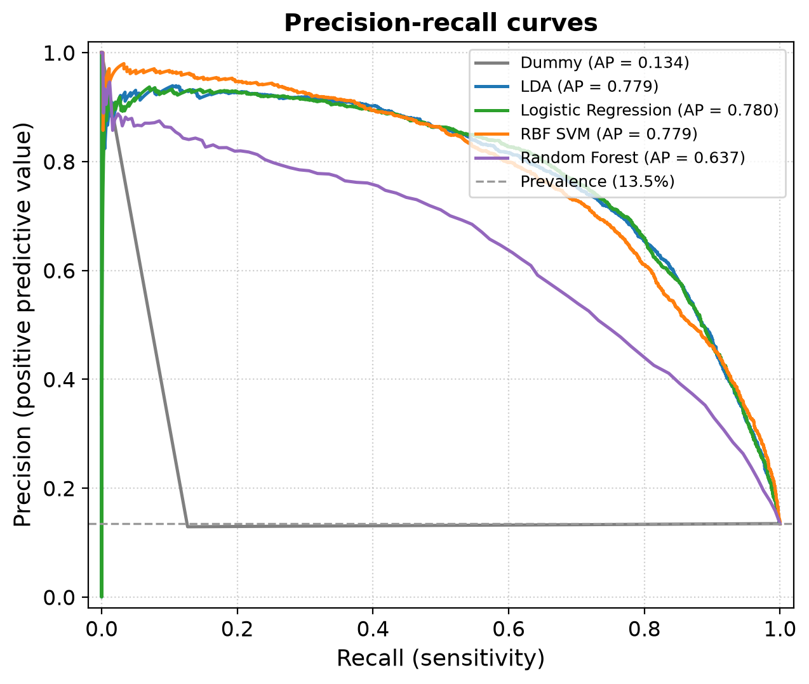
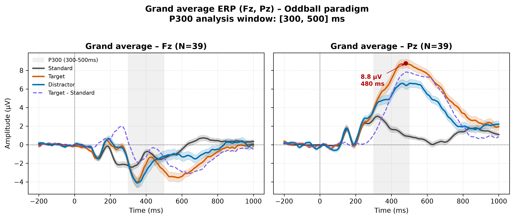
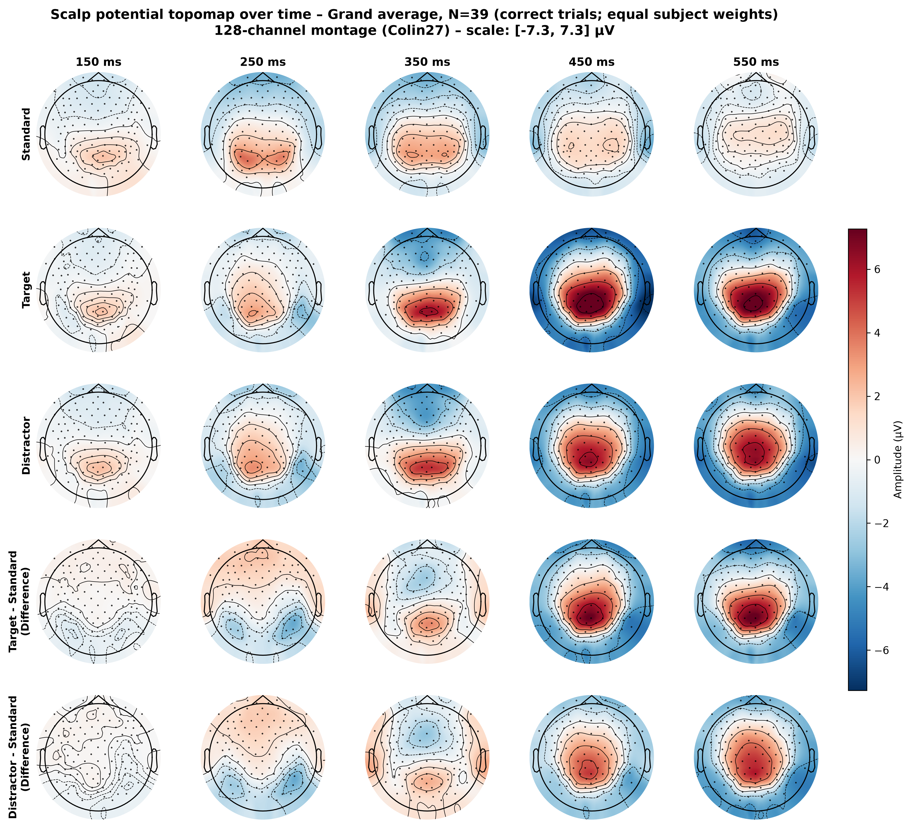
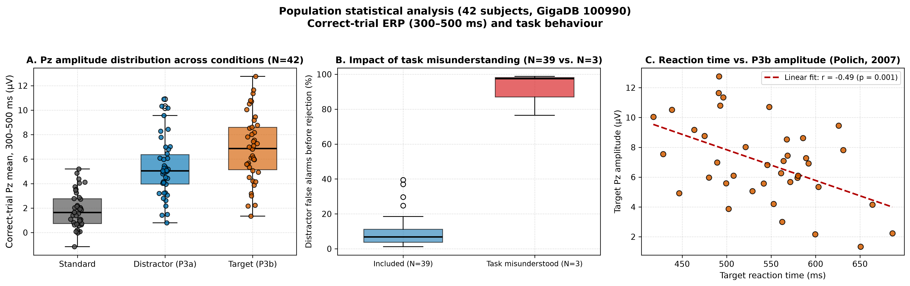
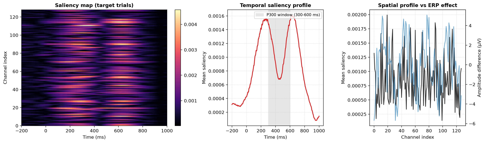
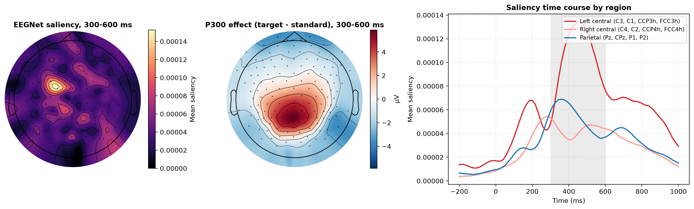
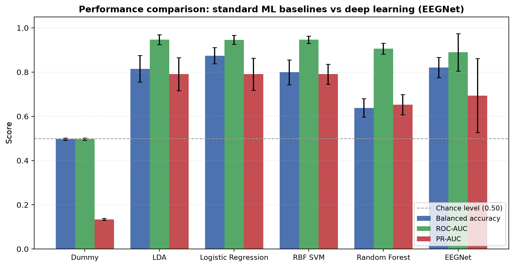

# Báo cáo Nghiên cứu: Phân tích & Phân loại Sóng P300 trên Tín hiệu EEG

Dự án Oddball Paradigm (GigaDB Dataset 100990) – Nhóm Nghiên cứu EEG.

Bản tiếng Anh chính thức để nộp: [`REPORT_EN.md`](REPORT_EN.md). Phân công và tỷ lệ đóng góp: [`docs/contributions.md`](../docs/contributions.md).

---

## 1. Tổng quan & Mục tiêu Nghiên cứu

Nghiên cứu sóng não P300 (Event-Related Potential - ERP) là một trong những chủ đề kinh điển và quan trọng nhất trong lĩnh vực Khoa học Thần kinh Nhận thức (Cognitive Neuroscience) và Giao tiếp Não - Máy tính (Brain-Computer Interface - BCI). 

Dự án này tập trung vào:
1. **Phân tích hình thái & điện sinh lý**: Đánh giá sự phân bố không gian và động học thời gian của các phân nhánh sóng P300 (**P3a** và **P3b**) dựa trên nền tảng lý thuyết của **John Polich (2007)**.
2. **Quy trình tiền xử lý chuẩn mực**: Triển khai pipeline chuẩn trên 42 đối tượng với 128 kênh điện cực (Colin27 10-05 montage), kết hợp lọc thông dải, nội suy kênh hỏng, và khử nhiễu tự động bằng Picard ICA + ICLabel.
3. **Mô hình hóa dự đoán**: Trích xuất đặc trưng miền thời gian - tần số và xây dựng các mô hình phân loại học máy (SVM, LDA, RF) cùng mô hình học sâu chuyên biệt (EEGNet).

---

## 2. Cơ sở Lý thuyết: Mô hình Tích hợp P300 của Polich (2007)

Theo nghiên cứu bước ngoặt *"Updating P300: An integrative theory of P3a and P3b"* (Polich, 2007):

```
                        KÍCH THÍCH (Stimulus)
                                  │
         ┌────────────────────────┴────────────────────────┐
         ▼                                                 ▼
KÍCH THÍCH XAO NHÃNG (Distractor)                 KÍCH THÍCH ĐÍCH (Target)
- Không có nhiệm vụ, gây bất ngờ                  - Có nhiệm vụ, cần chú ý & phản hồi
- Kích hoạt chú ý không chủ ý                     - Cập nhật biểu tượng bộ nhớ làm việc
         │                                                 │
         ▼                                                 ▼
        P3a                                               P3b
- Cực đại vùng Trán/Trung tâm (Fz, Cz > Pz)       - Cực đại vùng Đỉnh/Chẩm-đỉnh (Pz > Cz > Fz)
- Độ trễ sớm (~300 - 450 ms)                      - Độ trễ dài hơn (~300 - 600 ms)
- Suy giảm nhanh theo thời gian (Habituation)     - Biên độ tỷ lệ nghịch với xác suất kích thích
```

### Phương pháp Sóng Hiệu số (Difference Waves)
Để bộc lộ chính xác thành phần nội sinh P300 mà không bị chồng lấn bởi các sóng cảm giác sớm (P1 ~100 ms, N1 ~150 ms, P2 ~200 ms), ta thực hiện phép trừ đại số giữa các điều kiện:
- $\Delta_{\text{Target}} = \text{Target} - \text{Standard}$: Làm nổi bật đáp ứng liên quan Target/P3b, không cô lập hoàn toàn nguồn thần kinh.
- $\Delta_{\text{Distractor}} = \text{Distractor} - \text{Standard}$: Làm nổi bật đáp ứng liên quan Distractor/P3a.

---

## 3. Tiêu chí kiểm chứng P300 của dự án

Các tiêu chí dưới đây do dự án định nghĩa dựa trên khung P3a/P3b; không phải chuẩn chẩn
đoán hay ngưỡng số do Polich quy định. Chỉ dùng trial trả lời đúng, tính ERP từng người,
rồi lấy trung bình với trọng số bằng nhau cho 39 người không hiểu sai nhiệm vụ.

1. Target Pz > Fz, tính biên độ trung bình trong **300–500 ms**.
2. Target − Standard tại Pz ≥ **1,5 µV** trong cùng cửa sổ.
3. Tìm cực đại dương Target Pz trong **200–800 ms**, sau đó kiểm tra latency thuộc
   **300–500 ms**. Không tìm đỉnh ngay trong cửa sổ chấp nhận vì sẽ tạo kiểm tra vòng tròn.
4. Xu hướng trán tương đối của Distractor: (Fz − Pz) của Distractor lớn hơn Target.
   Đây là chỉ số mô tả P3a riêng, không thuộc ba tiêu chí lõi P3b.

`p300_detected` yêu cầu đồng thời tiêu chí 1–3; `p300_verified` còn yêu cầu không thuộc
nhóm hiểu sai nhiệm vụ. Tính bằng số đầy đủ, chỉ làm tròn khi trình bày. Phân tích bổ sung
**300–600 ms** thay cả cửa sổ trung bình và cửa sổ chấp nhận latency, giữ nguyên tìm đỉnh
200–800 ms. Không loại thêm người khỏi ML/DL theo kết quả kiểm chứng ERP.

QC V2 dùng 300–600 ms trên **tất cả epoch giữ lại**, kể cả trial sai; không dùng trực tiếp
các biên độ này thay cho ERP 300–500 ms trên trial đúng.

---

## 4. Danh mục Trực quan hóa & Hình ảnh Báo cáo / Slide (Vai trò V3 – Trương Huy Hoàng)

Tất cả hình ảnh chất lượng cao (300 DPI, tối ưu cho slide thuyết trình và chèn báo cáo) được lưu tại `results/figures/` và `report/figures/`:
1. `{sub}_fz_pz_erp.png`: Dạng sóng ERP chuẩn 2 kênh mốc **Fz** và **Pz** với cửa sổ 300–500 ms tô sáng, font lớn chuẩn slide.
2. `grand_average_fz_pz.png`: Dạng sóng **Grand Average ERP (Fz, Pz)** trung bình toàn thể.
3. `grand_average_39subs.png`: Biểu đồ Grand Average tổng hợp 39 đối tượng chuẩn (từ pipeline tiền xử lý).
4. `{sub}_midline_erp.png`: Dạng sóng ERP 3 kênh đường giữa Fz, Cz, Pz kèm dải sai số chuẩn (SEM).
5. `{sub}_difference_waves.png`: Sóng hiệu số bóc tách trực diện P3a và P3b.
6. `{sub}_scalp_topomap.png`: Bản đồ địa hình da đầu 128 kênh (Scalp map) diễn tiến từ 150 ms đến 550 ms.
7. `{sub}_p300_summary_topomap.png`: Scalp map trung bình toàn cửa sổ P300 (300–500 ms) chỉ rõ tiêu điểm dương tính vùng đỉnh (Parietal Positivity).
8. `population_p300_summary.png`: Phân tích thống kê quần thể 42 đối tượng kiểm chứng ảnh hưởng của nhóm hiểu sai nhiệm vụ.
9. `eegnet_roc_pr_real.png`, `eegnet_saliency_real.png`, `eegnet_saliency_topomap_real.png`, `ml_vs_dl_comparison.png`: Kết quả EEGNet trên 39 đối tượng và so sánh ML vs DL (V6).

---

## 5. Trích xuất Đặc trưng (Vai trò V4 – Nguyễn Công Kiên)

### 5.1 Dữ liệu đầu vào
- Epoch đã tiền xử lý (pipeline v1) của **39 đối tượng** (loại sub-02, sub-14, sub-17 do hiểu sai nhiệm vụ), chỉ giữ các trial trả lời đúng.
- Bài toán hai lớp: **standard (0)** và **target (1)**. Tổng cộng **21.878 trial** (18.927 standard, 2.951 target, tức 13,5% target).
- Mỗi trial gồm 128 kênh × 301 mẫu (−200 đến +1000 ms, 250 Hz).
- Đặc trưng được tính trên **từng trial đơn lẻ** (single-trial). Laton et al. (2014) tính trên ERP đã lấy trung bình, còn nhóm tính trên từng trial vì bài toán là phân loại từng trial.

### 5.2 Kênh và cửa sổ thời gian
- **12 kênh**: đường giữa (Fz, FCz, Cz, CPz, Pz, Oz) và hai bên (F3/F4, C3/C4, P3/P4), là nơi P3a (trán – trung tâm) và P3b (đỉnh) có biên độ lớn nhất (Polich, 2007).
- **5 cửa sổ thời gian**:

| Cửa sổ | Khoảng (ms) | Ý nghĩa |
|---|---|---|
| `early` | 100–200 | Thành phần cảm giác sớm (N1, P2) |
| `p3a` | 250–400 | P3a, chú ý tự động |
| `p3b` | 400–600 | P3b, cập nhật bộ nhớ làm việc |
| `p3_window` | 300–600 | Toàn bộ P300 |
| `late` | 600–800 | Phần đuôi của phản ứng |

- **Lý do chọn cửa sổ P300 là 300–600 ms** (rộng hơn cửa sổ 300–500 ms dùng cho hình ERP ở mục 3–4):
  - Paper dataset (Dzianok et al., 2022) nêu P3 đạt đỉnh trong khoảng 300–600 ms. Laton et al. (2014) tìm đỉnh P300 thị giác trong 350–600 ms.
  - Kiểm tra trên 10 đối tượng: với cửa sổ 300–500 ms, 5/10 người có đỉnh P300 ở Pz rơi vào 560–690 ms, nên đặc trưng bị cắt mất đỉnh. Khi mở rộng tới 600 ms, AUC của `Pz_p3_window_mean` tăng từ 0,77 lên 0,81 (tốt hơn ở 9/10 người).

### 5.3 Danh mục đặc trưng (402 đặc trưng / trial)

| Nhóm | Đặc trưng | Kênh | Số cột |
|---|---|---|---|
| Biên độ theo cửa sổ | Trung bình và độ lệch chuẩn trong 5 cửa sổ | 12 | 120 |
| Đỉnh P300 | Biên độ, latency của đỉnh dương trong 300–600 ms; diện tích dưới đường cong | 12 | 36 |
| Đỉnh sớm (Laton et al., 2014) | Biên độ, latency của N100 [50, 200], P200 [150, 300], N200 [200, 400] ms | Fz, Cz, Pz | 18 |
| Đỉnh - đỉnh | Hiệu cực đại - cực tiểu trong 200–700 ms | 12 | 12 |
| Hjorth | Activity, mobility, complexity (tính trên cả epoch) | 12 | 36 |
| Phổ (Welch, tính trên cả epoch) | Band power tuyệt đối và tương đối của delta (0,5–4), theta (4–8), alpha (8–13), beta (13–30 Hz); tỉ số θ/α, δ/θ; spectral entropy | 12 | 132 |
| Wavelet (db4, 4 mức) | Năng lượng các dải 0–8, 8–16, 16–31 Hz trong 300–600 ms; biên độ trung bình của dải 0–8 Hz | 12 | 48 |

**Phương pháp tìm đỉnh** (theo Laton et al., 2014):
- Đỉnh là điểm có biên độ lớn hơn (đỉnh dương) hoặc nhỏ hơn (đỉnh âm) hai điểm lân cận. Nếu cửa sổ có nhiều đỉnh, lấy đỉnh cực trị nhất.
- Nếu cửa sổ không có đỉnh nào (chỉ là một sườn dốc), lấy điểm có đạo hàm gần 0 nhất (tùy chọn *force*).
- Nhờ vậy, đỉnh không bị gán vào mép cửa sổ khi sóng vẫn đang đi lên. Ở Pz, chỉ còn 2,5% trial target có đỉnh P3 ở mép 600 ms.

**Wavelet**: dùng phân tích đa phân giải (multiresolution analysis) với wavelet db4, 4 mức, để tách tín hiệu thành các dải tần mà vẫn giữ trục thời gian. Khác với band power (tính trên cả epoch), wavelet cho phép đo năng lượng từng dải **đúng trong cửa sổ P300**.

### 5.4 Mức phân biệt của đặc trưng
Mỗi đặc trưng được đánh giá bằng AUC giữa target và standard. AUC tính riêng trong từng người rồi lấy trung bình trên 39 người: 0,5 là không phân biệt được, 1 là phân biệt hoàn toàn. Với đặc trưng mà target **thấp hơn** standard (AUC < 0,5), mức phân biệt được quy đổi thành 1 − AUC. Bảng dưới ghi mức phân biệt này. Bảng đầy đủ nằm trong `results/tables/v4_feature_auc.csv` (tạo bằng `src/features/rank_features.py`; cột `auc` là AUC gốc, cột `strength` là mức phân biệt).

| Nhóm đặc trưng | Mức phân biệt tốt nhất | Đặc trưng tốt nhất |
|---|---|---|
| Biên độ theo cửa sổ | **0,836** | `Pz_p3b_mean` (Pz, 400–600 ms) |
| Diện tích dưới đường cong | 0,802 | `Pz_p3_auc` |
| Wavelet | 0,802 | `Pz_wav_delta_theta_p3_mean` |
| Hjorth | 0,780 | `Pz_hjorth_complexity` |
| Band power | 0,741 | `CPz_bp_delta` |
| Biên độ đỉnh P300 | 0,733 | `CPz_p3_peak_amp` |
| Spectral entropy | 0,679 | `CPz_spectral_entropy` (target thấp hơn, AUC 0,321) |
| Latency đỉnh P300 | 0,624 | `CPz_p3_peak_lat` |
| Đỉnh - đỉnh | 0,614 | `Cz_ptp` |
| Đỉnh sớm N1/P2/N2 | 0,605 | `Fz_n2_lat` |

Có 32/402 đặc trưng đạt mức phân biệt ≥ 0,7 và 156/402 đặc trưng đạt mức phân biệt ≥ 0,6.

**Nhận xét:**
1. **Đặc trưng mạnh nhất là biên độ trung bình ở vùng đỉnh (Pz, CPz) trong 400–600 ms**, đúng phân bố không gian và thời gian của P3b theo Polich (2007). Biên độ trung bình ổn định hơn biên độ đỉnh (0,836 so với 0,733) vì trên một trial đơn lẻ, đỉnh dễ bị nhiễu làm lệch.
2. **Thông tin thời gian giúp ích**: năng lượng 0–8 Hz đo bằng wavelet trong cửa sổ P300 (AUC 0,760 ở Pz) tốt hơn band power delta tính trên cả epoch (0,734). Năng lượng alpha (8–16 Hz) trong cửa sổ P300 **thấp hơn** ở target (AUC 0,352), phù hợp với hiện tượng giảm alpha khi tập trung chú ý.
3. **Hjorth mobility thấp hơn ở target** (AUC 0,228 ở Pz, tức mức phân biệt 0,772): sóng P300 chậm, biên độ lớn làm giảm tần số trung bình của tín hiệu. Tương tự, spectral entropy cũng thấp hơn ở target (AUC 0,321 ở CPz): năng lượng dồn về dải tần thấp nên phổ "có trật tự" hơn.
4. **Latency và các đỉnh sớm phân biệt yếu** (AUC ≤ 0,62), vì hai lý do:
   - Latency trên từng trial đơn lẻ dao động nhiều (Laton et al. cũng lưu ý điều này khi lấy trung bình).
   - Các thành phần cảm giác sớm (N1, P2, N2) gần như giống nhau ở cả hai loại kích thích thị giác.

   Các đặc trưng này vẫn được giữ lại, vì theo Laton et al. (2014), đặc trưng yếu khi đứng riêng có thể hữu ích khi kết hợp.

### 5.5 Lưu ý cho bước phân loại (V5)
- **Chưa chuẩn hóa**: z-score (Laton et al. dùng z-score kèm sigmoid) phải được fit trên tập train của từng fold, ví dụ đặt `StandardScaler` trong `Pipeline`, để tránh rò rỉ dữ liệu.
- **Chia tập theo người**: dùng `groups` do `load_features()` trả về (Leave-One-Subject-Out hoặc `GroupKFold`).
- **Nhiễu do bấm nút**: người tham gia bấm nút khoảng 540 ms sau target, nằm trong cửa sổ `p3b` và `p3_window`. Vì vậy một phần thông tin có thể đến từ hoạt động vận động. Có thể kiểm tra bằng phân loại distractor - standard (cả hai đều không bấm nút).
- **Không chọn đặc trưng dựa trên bảng AUC ở trên trước khi train**: bảng được tính trên toàn bộ dữ liệu, nên dùng nó để chọn đặc trưng sẽ gây rò rỉ thông tin từ tập test.

### Tài liệu tham khảo (mục 5)
- Laton J, Van Schependom J, Gielen J, Decoster J, Moons T, De Keyser J, De Hert M, Nagels G. Single-subject classification of schizophrenia patients based on a combination of oddball and mismatch evoked potential paradigms. *J Neurol Sci* 2014;347:262–267. doi:10.1016/j.jns.2014.10.015
- Dzianok P, Antonova I, Wojciechowski J, Dreszer J, Kublik E. The Nencki-Symfonia electroencephalography/event-related potential dataset: Multiple cognitive tasks and resting-state data collected in a sample of healthy adults. *GigaScience* 2022;11:giac015. doi:10.1093/gigascience/giac015
- Polich J. Updating P300: An integrative theory of P3a and P3b. *Clin Neurophysiol* 2007;118:2128–2148.
- Hjorth B. EEG analysis based on time domain properties. *Electroencephalogr Clin Neurophysiol* 1970;29:306–310.

---

## 6. Mô hình Học máy Truyền thống Baseline (Vai trò V5)

### 6.1 Thiết lập bài toán & Xử lý mất cân bằng lớp
- **Bài toán phân loại đơn trial (Single-trial classification)**: Phân loại nhị phân giữa kích thích Thường (Standard - 0) và Đích (Target - 1). Kích thích xao nhãng (Distractor) được loại khỏi bài toán nhị phân này để tập trung vào cơ chế P3b phục vụ giao tiếp não - máy tính (BCI).
- **Mất cân bằng lớp nghiêm trọng**: Tỷ lệ trial Target chỉ chiếm khoảng 11,3% - 13,5% (tỷ lệ xấp xỉ 1:7).
- **Chiến lược khắc phục**:
  - Không sử dụng độ chính xác thô (Raw Accuracy) vì mô hình dự đoán toàn bộ là Standard vẫn đạt ~88,7% accuracy nhưng hoàn toàn vô dụng cho việc nhận diện sóng P300.
  - Sử dụng tham số `class_weight="balanced"` trên các mô hình Logistic Regression, RBF SVM và `balanced_subsample` trên Random Forest.
  - Đánh giá đa chiều qua bộ chỉ số: **Balanced Accuracy**, **ROC-AUC**, **PR-AUC (Average Precision)**, **F1-macro**, **Sensitivity (Target Recall)** và **Specificity**.

### 6.2 Kiểm định không rò rỉ dữ liệu (Cross-Validation Scheme)
- **Chuẩn hóa trong fold (Inside-fold Scaling)**: Đóng gói `StandardScaler` bên trong `Pipeline` của `scikit-learn`. Quá trình tính toán trung bình và độ lệch chuẩn chỉ được thực hiện trên fold huấn luyện (train fold) và ánh xạ sang fold kiểm thử (test fold), loại bỏ hoàn toàn nguy cơ rò rỉ thông tin tập test.
- **Cơ chế phân chia theo đối tượng (Subject-wise CV)**:
  - Khi chạy trên toàn bộ tập dữ liệu (39 người), sử dụng `GroupKFold(n_splits=5)` theo `subject_id` để kiểm chứng khả năng tổng quát hóa xuyên đối tượng (Cross-subject generalization).
  - Khi chạy thử nghiệm trên đối tượng đơn lẻ (`sub-01`), sử dụng `StratifiedKFold(n_splits=5)` nhằm bảo toàn tỷ lệ lớp trong từng fold.

### 6.3 Danh mục mô hình baseline
1. **Dummy (Stratified Chance Level)**: Mô hình ngẫu nhiên làm mốc so sánh cơ sở (Balanced Accuracy 50%, ROC-AUC 0,500, PR-AUC bằng đúng prevalence 11,3%).
2. **Linear Discriminant Analysis (LDA)**: Mô hình tiêu chuẩn vàng (Gold standard) trong các nghiên cứu BCI P300 kinh điển, sử dụng bộ giải `lsqr` kết hợp tự động điều chuẩn độ co rút (`shrinkage="auto"`).
3. **Logistic Regression**: Mô hình tuyến tính với điều chuẩn L2, tối ưu hóa phân loại xác suất với trọng số lớp cân bằng.
4. **Support Vector Machine (RBF SVM)**: Mô hình nhân phi tuyến (Radial Basis Function) với trọng số lớp cân bằng.
5. **Random Forest**: Mô hình tập hợp (Ensemble) 100 cây quyết định với cân bằng lớp trên từng cây con (`balanced_subsample`).

### 6.4 Kết quả thực nghiệm (Đánh giá trên toàn bộ 39 đối tượng: 21.878 trials, 402 đặc trưng)

Đánh giá bằng kiểm định chéo 5-fold xuyên đối tượng (`GroupKFold` theo `subject_id`, 39 đối tượng chuẩn, 21.878 trials, 402 đặc trưng miền thời gian - tần số):

| Mô hình | Balanced Accuracy | ROC-AUC | PR-AUC (AP) | F1-Macro | Sensitivity | Specificity |
|---|:---:|:---:|:---:|:---:|:---:|:---:|
| Dummy | 0,497 ± 0,005 | 0,497 ± 0,005 | 0,134 ± 0,004 | 0,497 ± 0,005 | 0,127 ± 0,009 | 0,867 ± 0,002 |
| Random Forest | 0,638 ± 0,041 | 0,907 ± 0,025 | 0,652 ± 0,046 | 0,678 ± 0,053 | 0,289 ± 0,087 | **0,988 ± 0,005** |
| RBF SVM | 0,799 ± 0,056 | 0,946 ± 0,016 | **0,791 ± 0,045** | 0,824 ± 0,043 | 0,625 ± 0,120 | 0,973 ± 0,011 |
| LDA | 0,815 ± 0,060 | **0,947 ± 0,022** | **0,791 ± 0,075** | **0,835 ± 0,045** | 0,659 ± 0,126 | 0,971 ± 0,013 |
| **Logistic Regression** | **0,874 ± 0,037** | 0,946 ± 0,021 | **0,791 ± 0,073** | 0,816 ± 0,029 | **0,841 ± 0,087** | 0,908 ± 0,027 |


### 6.5 Phân tích & Nhận xét chuyên môn
1. **Ưu thế vượt trội của các mô hình tuyến tính có điều chuẩn (Logistic Regression và LDA)**:
   - Logistic Regression với trọng số lớp cân bằng (`class_weight='balanced'`) đạt Balanced Accuracy cao nhất (**87,4% ± 3,7%**), độ nhạy Sensitivity đạt **84,1% ± 8,7%** và độ đặc hiệu Specificity đạt **90,8% ± 2,7%**. Đây là chỉ số lý tưởng cho bài toán giao tiếp não - máy tính (BCI), cân bằng tối ưu giữa việc phát hiện kích thích đích và hạn chế báo động giả.
   - LDA (sử dụng bộ giải LSQR với tự động co rút hiệp phương sai shrinkage theo Ledoit-Wolf) đạt ROC-AUC cao nhất (**0,947 ± 0,022**), PR-AUC **0,791 ± 0,075** và F1-macro **0,835 ± 0,045**. Trong không gian 402 chiều đặc trưng, tính chất chiếu tuyến tính kết hợp điều chuẩn co rút giúp LDA kháng nhiễu và kiểm soát hiện tượng biến thiên giữa các cá nhân (inter-subject variability) xuất sắc.
2. **Khả năng phân tách xác suất (Ranking Quality)**:
   - Cả ba mô hình LDA, Logistic Regression và RBF SVM đều đạt ROC-AUC rất cao (~0,946 - 0,947), vượt xa mức cơ sở ngẫu nhiên (0,497).
   - Đồ thị Precision-Recall (PR curve) chỉ ra PR-AUC của cả ba mô hình đều đạt xấp xỉ **0,791**, cao gấp gần 6 lần so với tỷ lệ hiện diện tự nhiên của lớp đích (Prevalence = 13,4%). Điều này khẳng định độ tin cậy cực cao của các dự đoán dương tính khi ứng dụng trong bài toán BCI Speller.
3. **Hiện tượng suy giảm độ nhạy của Random Forest trên không gian đặc trưng bảng EEG**:
   - Random Forest đạt ROC-AUC cao (0,907) và Specificity gần như tuyệt đối (0,988), nhưng độ nhạy Sensitivity ở ngưỡng xác suất 0,5 bị sụt giảm xuống còn 28,9%. Nguyên nhân là do không gian 402 đặc trưng EEG chứa nhiều kênh và cửa sổ có tương quan cao; cơ chế lấy mẫu ngẫu nhiên tập con đặc trưng (feature bagging) tại mỗi nút phân nhánh của Random Forest khiến các đặc trưng P300 cốt lõi (như `Pz_p3b_mean`) bị pha loãng bởi các đặc trưng ít phân biệt, dẫn đến việc phân bố xác suất dự đoán bị nén thiên lệch về phía lớp đa số (Standard).




### Tài liệu tham khảo bổ sung (mục 6)
- Blankertz B, Lemm S, Treder M, Haufe S, Müller KR. Single-trial analysis and classification of ERP components -- a tutorial. *NeuroImage* 2011;56(2):814–825.
- Lotte F, Bougrain L, Cichocki A, Clerc M, Congedo M, Chouvellon A, Yger F. A review of classification algorithms for EEG-based brain-computer interfaces: a 10 year update. *J Neural Eng* 2018;15(3):031005.

---

## 7. Dữ liệu và Tiền xử lý (Vai trò V2 - Thái Nguyễn Hoàng Bách)

### 7.1 Dữ liệu
- Bộ dữ liệu Nencki-Symfonia (Dzianok et al., 2022; GigaDB 100990), phần **visual oddball** của **42 người**.
- EEG ghi bằng hệ BrainVision với 127 điện cực, điện cực tham chiếu lúc ghi là FCz, tần số lấy mẫu 1000 Hz.
- Mỗi buổi đo thường có 660 kích thích: khoảng 75% standard (mã S5), 12% target (S6) và 12% distractor (S7). Người tham gia chỉ bấm nút khi gặp target (mã S1).
- Bốn bản ghi có số kích thích khác 660: sub-23 (692), sub-38 (775), sub-24 và sub-37 (659). Năm bản ghi gồm nhiều đoạn ghi nối lại: sub-15, 23, 24, 37 và 38.

### 7.2 Quy trình
Pipeline viết bằng MNE-Python 1.13.2 và chạy giống hệt nhau cho cả 42 người. Mã nguồn nằm trong `notebooks/01_preprocessing.ipynb`.

1. **Đọc dữ liệu và chuẩn hóa kênh.**
   - Thêm lại kênh tham chiếu FCz, nên mỗi người có 128 kênh.
   - Sắp xếp kênh theo cùng một thứ tự cho cả 42 người, vì file của sub-13, sub-41 và sub-42 lưu kênh theo thứ tự khác.
   - Gán vị trí điện cực theo montage `colin27_1005`. Hai kênh O9 và O10 lấy vị trí của I1 và I2.
2. **Chỉ giữ đoạn làm nhiệm vụ.**
   - Cắt bản ghi từ 5 s trước kích thích đầu tiên đến 5 s sau epoch cuối cùng.
   - Một số bản ghi còn chạy tiếp sau khi hết nhiệm vụ, với nhiễu lên tới khoảng 3000 µV (tháo mũ, cử động). Đoạn này làm hỏng cả bước dò kênh hỏng lẫn ICA.
   - Trung bình mỗi người bị cắt 73 s (từ 29 đến 412 s).
   - Điểm nối giữa các đoạn ghi được đánh dấu `BAD_boundary`, để bộ lọc không lọc vắt qua điểm nối và không có epoch nào chứa nó.
3. **Phát hiện và nội suy kênh hỏng.** Kiểm tra trên một bản sao đã hạ xuống 200 Hz, lọc 1–40 Hz và trừ trung vị của các kênh. Một kênh bị đánh dấu hỏng khi rơi vào ít nhất một trong ba tiêu chí:
   - **Nhiễu hoặc phẳng:** z-score bền vững (dùng trung vị và MAD) của log khoảng tứ phân vị (IQR) có trị tuyệt đối lớn hơn 4. Mình dùng IQR thay cho độ lệch chuẩn vì IQR ít bị ảnh hưởng bởi chớp mắt, nhờ đó Fp1/Fp2 không bị loại oan trước khi ICA kịp xử lý chớp mắt.
   - **Không tương quan:** trung vị tương quan với 6 kênh gần nhất nhỏ hơn 0,4.
   - **Đối xứng ngược:** tương quan với một kênh lân cận nhỏ hơn −0,8. Dấu hiệu này thường do điện cực tiếp xúc kém.

   Kênh hỏng được nội suy bằng spherical spline. Sau đó toàn bộ dữ liệu được đổi sang **average reference**.
4. **ICA và ICLabel.**
   - Fit ICA trên một bản sao lọc 1–100 Hz, hạ xuống 250 Hz. Đây là dải tần ICLabel được huấn luyện.
   - Thuật toán Picard (extended, `ortho=False`), 40 thành phần, `random_state=97`.
   - ICLabel (Pion-Tonachini et al., 2019; bản Python mne-icalabel 0.10.0) gán nhãn cho từng thành phần. Thành phần có nhãn **eye blink**, **heart beat** hoặc **muscle artifact** với xác suất ≥ 0,8 bị loại. Đây cũng là ba nhóm nhiễu (mắt, tim, cơ) mà paper dataset loại.
   - Không loại nhóm *line noise* và *channel noise*: nhiễu điện lưới đã bị bộ lọc 40 Hz loại, kênh hỏng đã được nội suy, và ở một số người (ví dụ sub-30) các thành phần này còn chứa một phần P3.
   - **Ba ngoại lệ chỉnh bằng tay:** ở sub-13, sub-14 và sub-36, thành phần chớp mắt chỉ được ICLabel chấm 0,78, 0,70 và 0,59, tức dưới ngưỡng. Mình đã kiểm tra bản đồ da đầu và tương quan với Fp1, xác nhận đây là chớp mắt, rồi loại thêm mỗi người 1 thành phần. Biên độ Fp1 trong epoch giảm từ 215, 171 và 131 µV xuống còn 22, 69 và 31 µV.
5. **Lọc 0,5–40 Hz** trên dữ liệu gốc 1000 Hz, cùng dải tần với paper dataset.
   - Bộ lọc FIR thông dải, zero-phase, cửa sổ Hamming, dài 6601 mẫu.
   - Dải chuyển tiếp 0,5 Hz ở cận dưới (−6 dB tại 0,25 Hz) và 10 Hz ở cận trên (−6 dB tại 45 Hz).
   - Sau khi lọc mới áp ICA đã fit ở bước 4 lên dữ liệu.
6. **Cắt epoch.**
   - Cắt từ −200 đến +1000 ms quanh mỗi kích thích và trừ baseline (−200 đến 0 ms).
   - Lấy 1 mẫu trong mỗi 4 mẫu (1000 → 250 Hz). Làm vậy an toàn vì đã lọc thông thấp ở 40 Hz.
   - Loại epoch có biên độ đỉnh-đỉnh trên **150 µV** ở bất kỳ kênh nào, hoặc chạm điểm nối bản ghi.
   - Mỗi epoch gồm 128 kênh × 301 mẫu, lưu dạng float32 trong `derivatives/v1/epochs/`.
7. **Gắn nhãn và hành vi.** Mỗi epoch có một dòng metadata gồm `condition` (standard/target/distractor), `responded`, `rt_ms` và `correct`:
   - **Target trả lời đúng:** có bấm nút trong khoảng 100–1400 ms. Bấm sớm hơn 100 ms được coi là đoán trước, còn khoảng 1400 ms là thời lượng kích thích cộng khoảng cách ngắn nhất giữa hai kích thích, theo paper dataset.
   - **Standard và distractor trả lời đúng:** không bấm nút.

### 7.3 Kiểm soát chất lượng
Pipeline xuất file QC cho từng người (`derivatives/v1/qc/sub-XX.json`) và một bảng tổng hợp (`derivatives/v1/qc_summary.csv`). Số liệu trên 42 người:

| Chỉ số | Trung bình ± SD | Khoảng |
|---|---|---|
| Số kênh hỏng được nội suy | 2,9 ± 3,4 | 0–14 (30/42 người có ít nhất 1 kênh) |
| Số thành phần ICA bị loại (trên 40) | 15,0 ± 4,7 | 6–25 |
| Fp1 trước ICA (phân vị 99 của \|biên độ\|, µV) | 214 ± 91 | 78–505 |
| Fp1 sau ICA (µV) | 39 ± 49 | 12–322 |
| Tỉ lệ epoch bị loại (%) | 3,0 ± 7,8 | 0–49,5 |

- **Kênh hỏng:** tổng cộng 122 kênh hỏng. Tiêu chí "không tương quan" bắt được nhiều nhất (100 lần), tiếp theo là "nhiễu hoặc phẳng" (26 lần) và "đối xứng ngược" (7 lần). Một kênh có thể rơi vào nhiều tiêu chí cùng lúc.
- **Thành phần ICA bị loại:** trung bình mỗi người có 12,0 thành phần cơ, 2,8 thành phần mắt và 0,2 thành phần tim.
- **Số epoch:** giữ được **27.034/27.865 epoch (97,0%)**, gồm 20.375 standard, 3.326 target và 3.333 distractor.
  - Bộ dữ liệu cho bài toán phân loại có 21.878 trial, gồm 18.927 standard và 2.951 target (13,5% target). Bộ này chỉ gồm 39 người (đã loại 3 người hiểu sai nhiệm vụ, xem mục 7.4), và chỉ lấy trial standard và target trả lời đúng.

**Kiểm chứng việc đọc sự kiện.** Số liệu hành vi tính lại từ marker trong dữ liệu khớp với Bảng 5 của paper dataset (cùng 39 người):

| Chỉ số | Nhóm tính lại | Paper |
|---|---|---|
| Thời gian phản ứng với target (ms) | 542,1 ± 65,5 | 542,1 ± 65,5 |
| Bỏ sót target (%) | 5,60 ± 8,48 | 5,60 ± 8,33 |
| Bấm nhầm với distractor (%) | 9,63 ± 9,28 | 9,52 ± 8,90 |
| Bấm nhầm với standard (%) | 0,27 ± 0,53 | 0,24 ± 0,46 |

**Kiểm chứng tín hiệu P300.** Biên độ trung bình ở Pz trong cửa sổ 300–600 ms (39 người, tất cả epoch giữ lại) là: target **7,1 ± 2,5 µV**, distractor 5,8 ± 2,3 µV, standard 1,5 ± 1,3 µV. Thứ tự target > distractor > standard đúng như kỳ vọng của mô hình oddball.

### 7.4 Những người cần lưu ý
- **Loại khỏi phân tích nhóm:** sub-02, sub-14 và sub-17 hiểu sai nhiệm vụ (bấm nút với 77–99% distractor), giống như paper dataset đã loại. Epoch của ba người này vẫn được xuất, có đánh dấu `task_misunderstood` trong QC.
- **Còn sót nhiễu mắt:** Fp1 sau ICA vẫn cao ở sub-40 (322 µV) và sub-30 (112 µV). P300 ở Pz ít bị ảnh hưởng, nhưng các phân tích dùng kênh trán của hai người này cần thận trọng.
- **Bị loại nhiều epoch:** sub-07 mất 49,5% epoch vì vượt ngưỡng 150 µV, nhưng vẫn còn 37 target trả lời đúng. sub-14 mất 12,6%.
- **Bản ghi bất thường hoặc trở kháng cao:** QC đánh dấu `irregular_recording` cho sub-13, 15, 23, 24, 37 và 38. Paper dataset ghi nhận trở kháng cao ở sub-23, 24 và 32.

### 7.5 Khác biệt so với quy trình của paper dataset
Các bước sau được nhóm thêm vào hoặc làm khác, để cùng một quy trình tự động chạy được cho cả 42 người và tái lập được:
1. Cắt bỏ phần ghi ngoài thời gian làm nhiệm vụ trước khi xử lý.
2. Tự động phát hiện và nội suy kênh hỏng.
3. Loại thành phần ICA theo ngưỡng ICLabel, cộng thêm 3 thành phần chớp mắt loại bằng tay đã nêu ở bước 4.
4. Loại epoch tự động theo ngưỡng biên độ đỉnh-đỉnh 150 µV.
5. Hạ tần số lấy mẫu xuống 250 Hz để giảm dung lượng (khoảng 3,6 GB cho 42 người). Vì đã lọc 40 Hz nên việc này không làm mất thông tin.

### 7.6 Hạn chế
- **Nhiễu bấm nút và chớp mắt.** Người tham gia bấm nút khoảng 540 ms sau target, và nhiều người chớp mắt ngay sau khi bấm. Hoạt động vận động và phần nhiễu mắt còn sót có thể "đi kèm" với target. Kiểm tra trên toàn bộ người: phân loại distractor với standard (cả hai đều không bấm nút) vẫn đạt AUC 0,90, so với 0,95 khi phân loại target với standard. Như vậy P300 vẫn là nguồn thông tin chính.
- **Loại nhiều thành phần cơ.** Trung bình mỗi người bị loại 12 thành phần cơ. Một phần hoạt động não ở tần số cao có thể bị loại theo, nhưng điều này ít ảnh hưởng tới P300 vì P300 nằm chủ yếu dưới 8 Hz.
- **Không có thông tin trên 40 Hz** (không phân tích được gamma). Mỗi epoch dài 1,2 s, nên độ phân giải tần số khi tính phổ trên cả epoch chỉ khoảng 1 Hz.
- **Chỉ số ICA chỉ đúng với lần fit này.** Danh sách thành phần loại bằng tay chỉ đúng khi giữ nguyên tham số ICA. Cần tải thêm mô hình ICA vào `derivatives/v1/ica/` và dữ liệu thô để kiểm tra lại; chúng chưa có trong bản làm việc này.

### Tài liệu tham khảo (mục 7)
- Dzianok P, Antonova I, Wojciechowski J, Dreszer J, Kublik E. The Nencki-Symfonia electroencephalography/event-related potential dataset: Multiple cognitive tasks and resting-state data collected in a sample of healthy adults. *GigaScience* 2022;11:giac015. doi:10.1093/gigascience/giac015
- Gramfort A, Luessi M, Larson E, et al. MEG and EEG data analysis with MNE-Python. *Front Neurosci* 2013;7:267.
- Ablin P, Cardoso JF, Gramfort A. Faster independent component analysis by preconditioning with Hessian approximations. *IEEE Trans Signal Process* 2018;66(15):4040–4049.
- Pion-Tonachini L, Kreutz-Delgado K, Makeig S. ICLabel: An automated electroencephalographic independent component classifier, dataset, and website. *NeuroImage* 2019;198:181–197.
- Li A, Feitelberg J, Saini AP, Höchenberger R, Scheltienne M. MNE-ICALabel: Automatically annotating ICA components with ICLabel in Python. *J Open Source Softw* 2022;7(76):4484.

---

### 7.7 Kiểm tra bộ epoch và đặc trưng bàn giao (V2)

Chạy `python -m src.preprocessing.audit_epochs`: đủ **42 file, 27.034 epoch**; tất cả
kiểm tra đã triển khai đều đạt. Bao gồm thứ tự 128 kênh, montage, 301 mẫu/250 Hz,
metadata lọc/baseline, dữ liệu hữu hạn, average reference, ngưỡng peak-to-peak 150 µV,
nhãn và hành vi, số trial cùng biên độ QC 300–600 ms. Với 39 người phân loại, thứ tự
trial, nhãn, RT và `Pz_p3b_mean` tính lại khớp CSV **21.878 trial**.

Baseline được hiệu chỉnh ở 1000 Hz trước decimation; trung bình mẫu ở 250 Hz không
nhất thiết bằng 0. Phần dư baseline lớn nhất theo người nằm trong **0,193–1,006 µV**,
được ghi nhận chứ không tự sửa dữ liệu. Kết quả ở `results/tables/v2_epoch_audit.json`.
Chưa kiểm chứng độc lập mọi đặc trưng trong 402 cột và chưa chạy lại ICA vì bản làm việc
không có dữ liệu thô hay mô hình ICA. Các biên độ QC cũ được giữ nguyên đúng phạm vi của chúng.

## 8. Kết quả ERP tính lại từ epoch (V3)

### 8.1 Grand average và sóng hiệu số

Trên **39 người**, chỉ giữ trial đúng và cho mỗi người trọng số bằng nhau. Biên độ Pz
trung bình **300–500 ms**: Target **6,97 ± 2,74 µV**, Standard **1,92 ± 1,49 µV**;
hiệu bắt cặp **5,05 ± 2,28 µV**. Kiểm định t bắt cặp: **t(38) = 13,82**,
**p = 2,14 × 10⁻¹⁶**, **Cohen’s dz = 2,21** (trung bình hiệu chia SD mẫu của hiệu).
SD tính qua người, không xem các trial của cùng người là quan sát độc lập.



*Trung bình 39 người; dải màu là SEM qua người; vùng xám là 300–500 ms. Điểm đánh dấu
trên Pz là cực đại của grand average trong cửa sổ tô xám; kiểm tra latency từng người
lại tìm trong 200–800 ms.*


*Sóng Target − Standard và Distractor − Standard tại Fz/Cz/Pz. Phép trừ giảm thành phần
chung, không cô lập hoàn toàn nguồn thần kinh.*

### 8.2 Topomap toàn nhóm




*39 người, chỉ trial đúng, mỗi người trọng số bằng nhau. Hình lần lượt biểu diễn 150,
250, 350, 450, 550 ms và trung bình 300–500 ms; gồm ba điều kiện và hai sóng hiệu số.
Mỗi hình dùng chung một thang màu đối xứng. Đây là hình nhóm, không phải sub-01.*

Target − Standard thể hiện điện thế dương vùng đỉnh. Xu hướng trán tương đối của
Distractor chỉ đạt ở 26/39 người; không khẳng định P3a vùng trán đồng nhất ở toàn nhóm.
Topomap điện thế da đầu không xác định trực tiếp vị trí nguồn hoạt động não.

### 8.3 Kết quả các tiêu chí định nghĩa trong dự án

| Tiêu chí | Nhóm được giữ (N=39) | Nhóm hiểu sai nhiệm vụ (N=3) |
|---|:---:|:---:|
| Target Pz > Fz, 300–500 ms | 39/39 (100,0%) | 3/3 (100,0%) |
| Target − Standard ≥ 1,5 µV, 300–500 ms | 37/39 (94,9%) | 3/3 (100,0%) |
| Đỉnh dương 300–500 ms, tìm trong 200–800 ms | 22/39 (56,4%) | 2/3 (66,7%) |
| Xu hướng trán tương đối của Distractor, mô tả | 26/39 (66,7%) | 2/3 (66,7%) |
| Đồng thời ba tiêu chí lõi (`p300_detected`) | 22/39 (56,4%) | 2/3 (66,7%) |
| Ba tiêu chí và không hiểu sai nhiệm vụ (`p300_verified`) | 22/39 (56,4%) | 0/3 (0,0%) |
| Phân tích bổ sung ba tiêu chí 300–600 ms | 32/39 (82,1%) | 3/3 (100,0%) |

Có 17/39 người đạt cực đại sau 500 ms (508–748 ms trong khoảng tìm 200–800 ms).
Không đạt cửa sổ hẹp không có nghĩa không có P300. Không dùng các tiêu chí ERP để
chọn lại nhóm phân loại hoặc nâng chỉ số ML/DL.

RT Target theo QC nhiệm vụ là **542,1 ± 65,5 ms**. Tương quan với biên độ Target Pz
300–500 ms trên trial đúng: **r = −0,493, p = 0,00144**; không suy diễn quan hệ nhân quả.

Nhóm hiểu sai nhiệm vụ có false alarm Distractor **90,95 ± 12,49%**, so với
**9,63 ± 9,28%** ở nhóm được giữ; Target Pz trên trial đúng là **5,29 ± 2,58 µV**.
Chỉ còn **1, 1 và 19 trial Distractor đúng** ở sub-02/14/17 nên ERP Distractor của nhóm
này không ổn định. Lý do loại nhóm là hành vi hiểu sai nhiệm vụ, không phải không có ERP.



*(A) Pz 300–500 ms trên trial đúng của 42 người; (B) false alarm trước loại epoch theo
QC; (C) RT và biên độ Target Pz của 39 người. Biên độ và tỷ lệ phần trăm ở các trục riêng.*

Lệnh tái lập: `python src/erp/plot_erp.py --group`. Chi tiết ở
`results/tables/v3_p300_group_results.csv` và `v3_p300_summary.json`. Kết quả này thay
cho số liệu trộn cửa sổ trước đây và kết luận 39/39 đạt toàn bộ tiêu chí.

## 9. Hình dùng cho báo cáo và slide (V3)

- `grand_average_fz_pz.png`: ERP toàn nhóm, SEM qua người và cửa sổ 300–500 ms.
- `grand_average_difference_waves.png`: hai sóng hiệu số tại Fz/Cz/Pz.
- `grand_average_scalp_topomap.png`: 128 kênh, 150–550 ms, 39 người.
- `grand_average_p300_summary_topomap.png`: bản đồ trung bình 300–500 ms, 39 người.
- `population_p300_summary.png`: phân bố biên độ, hành vi và tương quan RT.

Các hình nhóm đã đồng bộ ở `results/figures/` và `report/figures/`. Hình có tiền tố
`sub-01_` vẫn là ví dụ một người và phải được ghi đúng phạm vi nếu sử dụng.

---

## 10. Mô hình Học sâu Deep Learning & Phân tích Khả năng Giải thích (Vai trò V6 – Đồng Minh Đức)

### 10.1 Kiến trúc mạng tích chập chuyên biệt EEGNet-8,2
Nhằm đánh giá khả năng phân loại đầu-cuối (end-to-end) không cần thiết kế đặc trưng thủ công, mô hình học sâu **EEGNet-8,2** (Lawhern et al., 2018) được triển khai bằng PyTorch (`src/dl/train_eegnet.py`):

```
Đầu vào: Epoch thô (B, 1, 128 kênh, 301 mẫu thời gian @ 250 Hz)
  │
  ├── Block 1:
  │     ├── Conv2D thời gian: 8 bộ lọc (1 × 125, tương ứng 500 ms @ 250 Hz) -> BatchNorm
  │     ├── Depthwise Conv2D không gian: 16 bộ lọc (128 × 1, D = 2, max-norm = 1.0) -> BatchNorm -> ELU
  │     └── AvgPool2D (1 × 4) -> Dropout (p = 0.5)
  │
  ├── Block 2:
  │     ├── Separable Conv2D: Depthwise (1 × 16) + Pointwise (16 bộ lọc 1 × 1) -> BatchNorm -> ELU
  │     └── AvgPool2D (1 × 8) -> Dropout (p = 0.5)
  │
  └── Tầng phân loại: Flatten -> Tuyến tính (Linear, max-norm = 0.25) -> 2 lớp (Standard vs Target)
```

- **Đặc tính kiến trúc**:
  - Tầng tích chập thời gian đóng vai trò như các bộ lọc dải tần thích ứng học từ dữ liệu.
  - Tầng tích chập không gian sâu (depthwise) học các tổ hợp tuyến tính của 128 kênh cho từng bộ lọc thời gian, tương tự bộ lọc không gian kiểu xDAWN/CSP nhưng được tối ưu đồng thời với bộ lọc thời gian.
  - Tổng cộng **3.930 tham số** huấn luyện (với 128 kênh × 301 mẫu), ít hơn khoảng 5,6 lần số trial huấn luyện mỗi fold, giúp hạn chế quá khớp trên dữ liệu EEG có SNR thấp.
- **Huấn luyện**: Adam (lr = 10⁻³), batch 64, tối đa 50 epoch, early stopping theo val loss (patience 15) trên 15% tập train của từng fold; cross-entropy có trọng số lớp (tương đương `class_weight="balanced"` của V5); chuẩn hóa bằng độ lệch chuẩn toàn cục của tập train (không rò rỉ sang test). Chạy trên GPU NVIDIA RTX 4060, khoảng 8 phút/fold.

### 10.2 Kết quả thực nghiệm trên toàn bộ 39 đối tượng (21.878 trial, epoch thô)
EEGNet được đánh giá trên **đúng tập dữ liệu và đúng 5 fold** mà V5 dùng cho baseline: 39 đối tượng, 21.878 trial trả lời đúng (13,5% target), `GroupKFold(n_splits=5)` theo `subject_id`. Đã kiểm tra số trial của từng người khớp từng dòng với ma trận đặc trưng của V4, nên các fold test chứa cùng một nhóm người ở cả hai phương pháp. Ngưỡng quyết định 0,5 giống V5.

| Chỉ số đánh giá | Trung bình ± độ lệch chuẩn (5 fold) | Toàn cục OOF (out-of-fold) |
|---|:---:|:---:|
| **Balanced Accuracy** | **0,907 ± 0,021** | 0,907 |
| **ROC-AUC** | **0,970 ± 0,010** | 0,968 |
| **PR-AUC (Average Precision)** | **0,873 ± 0,042** | 0,863 |
| **F1-Macro** | **0,857 ± 0,028** | 0,856 |
| **Sensitivity (Độ nhạy Target)** | **0,884 ± 0,060** | 0,886 |
| **Specificity (Độ đặc hiệu)** | **0,930 ± 0,030** | 0,929 |

Kết quả từng fold (`results/tables/eegnet_folds_real.csv`): ROC-AUC 0,968 / 0,974 / 0,974 / 0,980 / 0,954; balanced accuracy 0,884 / 0,922 / 0,915 / 0,928 / 0,886. Bốn trên năm fold chạy hết 50 epoch mà early stopping chưa kích hoạt, nên mô hình có thể còn cải thiện thêm nếu huấn luyện lâu hơn.

*Ghi chú:* kết quả EEGNet trước đây (balanced accuracy 0,821, ROC-AUC 0,890) là thử nghiệm sơ bộ trên **1 người** (sub-01, 540 trial, `StratifiedKFold`), không so sánh được với baseline 39 người và đã được thay thế.


### 10.3 Phân tích khả năng giải thích bằng bản đồ độ nhạy (Saliency Map)
Saliency được tính bằng gradient đầu vào trên một mô hình tham chiếu (huấn luyện trên 85% toàn bộ trial), lấy trung bình trên toàn bộ 2.951 trial Target:
$$S_{c, t} = \frac{1}{N_{\text{target}}} \sum_{i=1}^{N_{\text{target}}} \left| \frac{\partial \hat{y}_i^{(\text{target})}}{\partial X_{i, c, t}} \right|$$

Trong đó $\hat{y}_i^{(\text{target})}$ là logit lớp Target và $X_{i, c, t}$ là điện thế tại kênh $c$, thời điểm $t$ của trial $i$.




- **Miền thời gian — khớp với P300**:
  - Đỉnh saliency trung bình ở **504 ms**, nằm trong cửa sổ P3b.
  - **40,2%** tổng saliency rơi vào 300–600 ms, trong khi cửa sổ này chỉ chiếm 24,9% thời lượng epoch (gấp khoảng 1,6 lần mức phân bố đều). Khoảng −200–0 ms chỉ chiếm 3,8% và 0–200 ms chiếm 10,7%.
  - Tuy vậy, 21,5% saliency nằm ở 600–800 ms, tức mô hình cũng dùng phần đuôi muộn của đáp ứng (trùng thời điểm bấm nút, RT khoảng 542 ms).
- **Miền không gian — chỉ khớp một phần**:
  - Hiệu ứng P300 (Target − Standard, 300–600 ms) lớn nhất ở **Pz, PPO1h, P1, CPP1h, CPz**, phân bố đối xứng quanh đường giữa vùng đỉnh, đúng P3b theo Polich (2007).
  - Saliency lại cao nhất ở **C1, FCC3h, CCP3h, FCC4h, FFC2h, FCz, C3**, tức vùng **trung tâm – trán trung tâm, lệch trái**. Pz chỉ xếp hạng 37/128. Tương quan giữa hồ sơ saliency theo kênh và hiệu ứng P300 chỉ ở mức **r = 0,32**.
  - Saliency vùng trung tâm trái (C3, C1, CCP3h, FCC3h) gấp khoảng 1,75 lần vùng trung tâm phải, với hai đỉnh khoảng 180 ms và 460 ms. Saliency vùng đỉnh (Pz, CPz, P1, P2) đạt đỉnh sớm hơn, khoảng 340 ms.
  - Trong khi đó, ERP trung bình **không** lệch trái: Target − Standard (400–700 ms) ở C3 là 1,81 µV, ở C4 là 2,04 µV (kiểm định cặp trên 39 người: p = 0,50), so với 6,96 µV ở Pz.
- **Cách hiểu đúng về saliency**: gradient đầu vào mô tả **bộ lọc** của mô hình (mô hình "backward"), không phải bản đồ nơi tín hiệu xuất hiện (mô hình "forward"). Trọng số bộ lọc có thể lớn ở những kênh dùng để **khử nhiễu** chung, chứ không nhất thiết ở nơi có tín hiệu (Haufe et al., 2014). Vì vậy điểm nóng trung tâm trái có hai cách giải thích chưa tách được: (1) mô hình dùng hoạt động **chuẩn bị vận động** của việc bấm nút (chỉ xảy ra ở trial Target); (2) mô hình dùng các kênh này như tham chiếu để triệt nhiễu cho tín hiệu P3b. Kiểm soát cần làm thêm: huấn luyện EEGNet cho bài toán **distractor vs standard** (cả hai đều không bấm nút), và tính "activation pattern" theo Haufe et al. (2014) thay cho gradient.

---

## 11. So sánh Đối đầu Học máy vs Học sâu & Trả lời 3 Câu hỏi Nghiên cứu (Research Questions)

### 11.1 Bảng so sánh hiệu năng trực diện (Head-to-Head Comparison)
Cùng 39 đối tượng, 21.878 trial, cùng 5 fold `GroupKFold` theo người, cùng ngưỡng 0,5 (trung bình ± độ lệch chuẩn qua 5 fold):

| Mô hình | Loại mô hình | Đầu vào dữ liệu | Balanced Accuracy | ROC-AUC | PR-AUC (AP) | Sensitivity | Specificity |
|---|---|---|:---:|:---:|:---:|:---:|:---:|
| Dummy | Cơ sở ngẫu nhiên | Nhãn tần suất | 0,497 ± 0,005 | 0,497 ± 0,005 | 0,134 ± 0,004 | 0,127 ± 0,009 | 0,867 ± 0,002 |
| Random Forest | Cây quyết định ensemble | 402 đặc trưng | 0,638 ± 0,041 | 0,907 ± 0,025 | 0,652 ± 0,046 | 0,289 ± 0,087 | **0,988 ± 0,005** |
| RBF SVM | Nhân phi tuyến | 402 đặc trưng | 0,799 ± 0,056 | 0,946 ± 0,016 | 0,791 ± 0,045 | 0,625 ± 0,120 | 0,973 ± 0,011 |
| LDA | Chiếu tuyến tính điều chuẩn | 402 đặc trưng | 0,815 ± 0,060 | 0,947 ± 0,022 | 0,791 ± 0,075 | 0,659 ± 0,126 | 0,971 ± 0,013 |
| Logistic Regression | Tuyến tính cân bằng lớp | 402 đặc trưng | 0,874 ± 0,037 | 0,946 ± 0,021 | 0,791 ± 0,073 | 0,841 ± 0,087 | 0,908 ± 0,027 |
| **EEGNet** | Mạng tích chập chuyên biệt | **Epoch thô (128 × 301)** | **0,907 ± 0,021** | **0,970 ± 0,010** | **0,873 ± 0,042** | **0,884 ± 0,060** | 0,930 ± 0,030 |



**So sánh theo từng người.** Vì hai phương pháp dùng chung các fold, mỗi người có một dự đoán out-of-fold từ cả hai. So sánh cặp trên 39 người (kiểm định Wilcoxon, `results/tables/ml_vs_dl_per_subject.csv`):

| So sánh | Chỉ số | Chênh lệch trung vị | Số người EEGNet tốt hơn | p (Wilcoxon) |
|---|---|:---:|:---:|:---:|
| EEGNet vs LDA | ROC-AUC | +0,023 | 35/39 | 1,9 × 10⁻⁹ |
| EEGNet vs LDA | Balanced accuracy | +0,075 | 37/39 | 1,6 × 10⁻⁹ |
| EEGNet vs Logistic Regression | ROC-AUC | +0,023 | 34/39 | 3,3 × 10⁻⁹ |
| EEGNet vs Logistic Regression | Balanced accuracy | +0,036 | 31/39 | 2,5 × 10⁻⁴ |

ROC-AUC theo từng người: EEGNet 0,972 ± 0,035 (trung vị 0,986), LDA 0,948 ± 0,048, Logistic Regression 0,948 ± 0,048.

### 11.2 Trả lời Câu hỏi Nghiên cứu 1 (Research Question 1)
> **Câu hỏi 1**: *Kết quả phân loại single-trial tốt nhất cho frequent (standard) vs target là bao nhiêu?*

- **Kết quả tốt nhất (đánh giá liên người, người ở tập test chưa từng xuất hiện khi huấn luyện)**: **EEGNet** trên epoch thô đạt balanced accuracy **90,7% ± 2,1%**, ROC-AUC **0,970 ± 0,010**, PR-AUC **0,873 ± 0,042** (gấp khoảng 6,5 lần tỉ lệ target 13,5%), với sensitivity **88,4%** và specificity **93,0%**.
- **Tốt nhất trong nhóm học máy truyền thống**: Logistic Regression (balanced accuracy 87,4% ± 3,7%) và LDA (ROC-AUC 0,947 ± 0,022).
- **Ý nghĩa**: hiệu năng này đạt được **không cần hiệu chỉnh theo từng người** (không có dữ liệu của người test trong tập huấn luyện), vượt xa mức ngẫu nhiên (50% / AUC 0,50). Kết quả trên một trial đơn lẻ đủ cao cho ứng dụng BCI, với lưu ý ở mục 11.4 về hoạt động bấm nút.

### 11.3 Trả lời Câu hỏi Nghiên cứu 2 (Research Question 2)
> **Câu hỏi 2**: *Deep learning có tốt hơn các kỹ thuật machine learning chuẩn trong phân loại single-trial không?*

- **Kết luận thực nghiệm**: **Có**, trên bộ dữ liệu này và với cùng sơ đồ đánh giá. EEGNet vượt mọi mô hình baseline ở balanced accuracy (+3,3 điểm so với Logistic Regression), ROC-AUC (+0,023 so với LDA), PR-AUC (+0,082) và có độ lệch chuẩn giữa các fold nhỏ hơn. Chênh lệch có ý nghĩa thống kê ở cấp từng người (ROC-AUC tốt hơn ở 34–35/39 người, p < 10⁻⁸).
- **Mức chênh lệch về ROC-AUC là vừa phải** (0,947 → 0,970): ở cả hai phương pháp, phần lớn thông tin phân biệt đã nằm trong P3b vùng đỉnh mà bộ đặc trưng của V4 mô tả tốt. Lợi thế của EEGNet thể hiện rõ hơn ở PR-AUC và balanced accuracy, tức ở vùng khó (các trial target biên độ thấp).
- **Giải thích nguyên nhân**:
  1. **Thông tin không gian đầy đủ**: bộ đặc trưng thủ công chỉ dùng 12 kênh. EEGNet dùng cả 128 kênh và tự học tổ hợp không gian (lọc không gian) có thể triệt nhiễu chung giữa các kênh, điều mà đặc trưng theo từng kênh không làm được.
  2. **Thông tin thời gian chi tiết**: đặc trưng thủ công tóm tắt tín hiệu thành trung bình trong 5 cửa sổ cố định. EEGNet học bộ lọc thời gian trên toàn epoch và tận dụng được cả các đáp ứng sớm (~180–340 ms) lẫn phần đuôi muộn (600–800 ms).
  3. **Đủ dữ liệu cho mô hình nhỏ**: với khoảng 14.900 trial huấn luyện mỗi fold và chỉ 3.930 tham số, EEGNet không bị quá khớp. Khi chỉ có 1 người (khoảng 430 trial huấn luyện), EEGNet chỉ đạt ROC-AUC 0,890, thấp hơn rõ. Lợi thế của deep learning phụ thuộc nhiều vào lượng dữ liệu.
  4. **Đổi lại**: EEGNet cần GPU (khoảng 8 phút/fold so với vài giây cho LDA) và khó giải thích hơn (mục 11.4). Trong khi đó LDA và Logistic Regression trên đặc trưng sinh lý học vẫn đạt ROC-AUC 0,947 và giải thích trực tiếp được bằng các đặc trưng như `Pz_p3b_mean`.

### 11.4 Trả lời Câu hỏi Nghiên cứu 3 (Research Question 3)
> **Câu hỏi 3**: *Các đặc trưng mà mô hình deep learning khám phá có giải thích được không (tránh "hộp đen")? Nếu DL không tốt hơn, cần giải thích lý do.*

- **Trả lời: giải thích được một phần.**
- **Phần phù hợp với P300 (Polich, 2007)**:
  1. **Miền thời gian**: saliency tập trung trong cửa sổ P3b (40,2% saliency trong 300–600 ms, gấp khoảng 1,6 lần mức phân bố đều, đỉnh ở 504 ms) và rất thấp trong khoảng trước kích thích (3,8%). Mô hình không dựa vào nhiễu ngẫu nhiên hay giai đoạn baseline.
  2. **Có đóng góp của vùng đỉnh**: saliency vùng đỉnh (Pz, CPz, P1, P2) đạt đỉnh khoảng 340 ms, nằm trong cửa sổ P3; tương quan dương (r = 0,32) giữa saliency và hiệu ứng P300 theo kênh.
- **Phần chưa khớp và chưa giải thích được hoàn toàn**:
  1. Điểm nóng saliency nằm ở vùng **trung tâm – trán trung tâm bên trái** (C1, FCC3h, CCP3h, C3), không phải ở Pz nơi hiệu ứng P300 lớn nhất. Đỉnh ở khoảng 460 ms, ngay trước thời điểm bấm nút (RT khoảng 542 ms). Đây là vị trí của vỏ não vận động, nên **giả thuyết mô hình dùng tín hiệu chuẩn bị vận động** (chỉ có ở trial Target, vì chỉ target mới bấm nút) cần được xem xét nghiêm túc.
  2. Mặt khác, ERP trung bình không cho thấy lệch trái ở C3 so với C4 (p = 0,50), và gradient chỉ phản ánh trọng số bộ lọc chứ không phải vị trí nguồn tín hiệu (Haufe et al., 2014). Do đó điểm nóng này cũng có thể là kênh tham chiếu dùng để khử nhiễu.
  3. Mục 7.6 (V2) đã cho thấy phân loại distractor vs standard (không bấm nút) bằng đặc trưng vẫn đạt AUC 0,90, so với 0,95 cho target vs standard. Như vậy P300 vẫn là nguồn thông tin chính cho baseline, nhưng phần chênh còn lại có thể đến từ hoạt động vận động, và điều này có thể đúng hơn với EEGNet.
- **Tổng kết**: EEGNet **không phải hoàn toàn "hộp đen"**: hồ sơ thời gian của nó khớp với cửa sổ P3b. Nhưng hồ sơ không gian **không tái hiện đơn thuần** phân bố P3b vùng đỉnh, và phần lợi thế so với ML có thể một phần đến từ thông tin không phải P300 (vận động). Để kết luận chắc chắn, cần: (1) huấn luyện EEGNet cho distractor vs standard (cùng P3 nhưng không bấm nút); (2) tính activation pattern theo Haufe et al. (2014); (3) phân tích saliency theo từng trial đã căn theo thời điểm bấm nút (response-locked).

### Tài liệu tham khảo bổ sung (mục 10–11)
- Lawhern VJ, Solon AJ, Waytowich NR, Gordon SM, Hung CP, Lance BJ. EEGNet: a compact convolutional neural network for EEG-based brain–computer interfaces. *J Neural Eng* 2018;15(5):056013.
- Simonyan K, Vedaldi A, Zisserman A. Deep inside convolutional networks: Visualising image classification models and saliency maps. *arXiv* 1312.6034, 2013.
- Haufe S, Meinecke F, Görgen K, Dähne S, Haynes JD, Blankertz B, Bießmann F. On the interpretation of weight vectors of linear models in multivariate neuroimaging. *NeuroImage* 2014;87:96–110.
