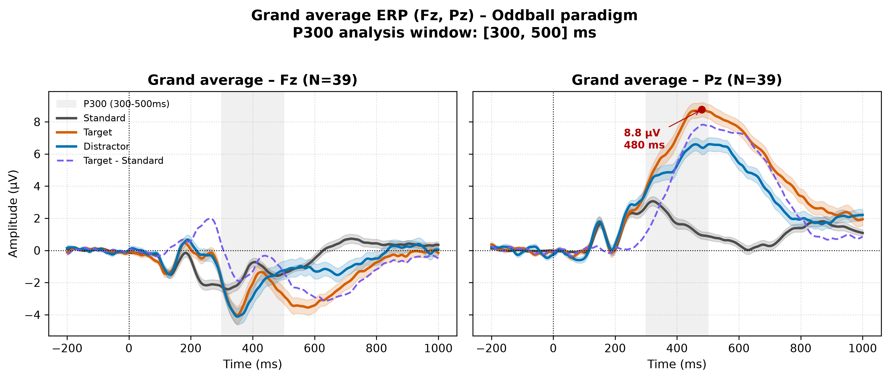
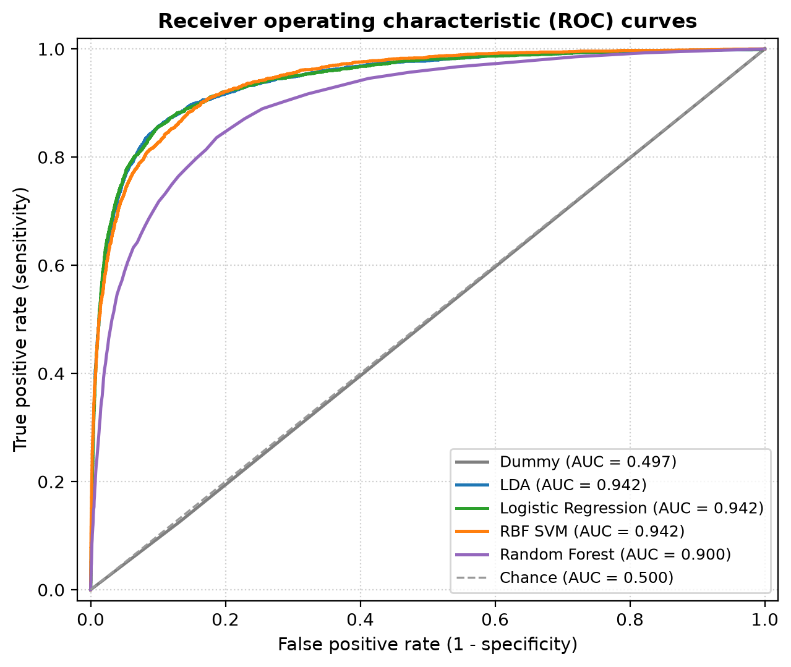
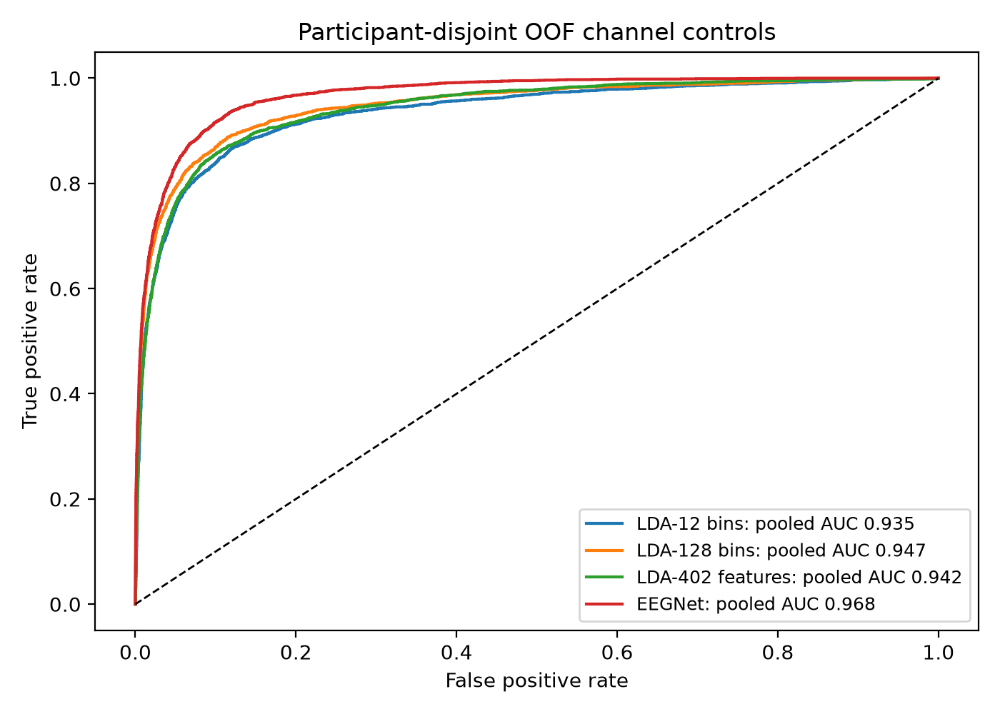
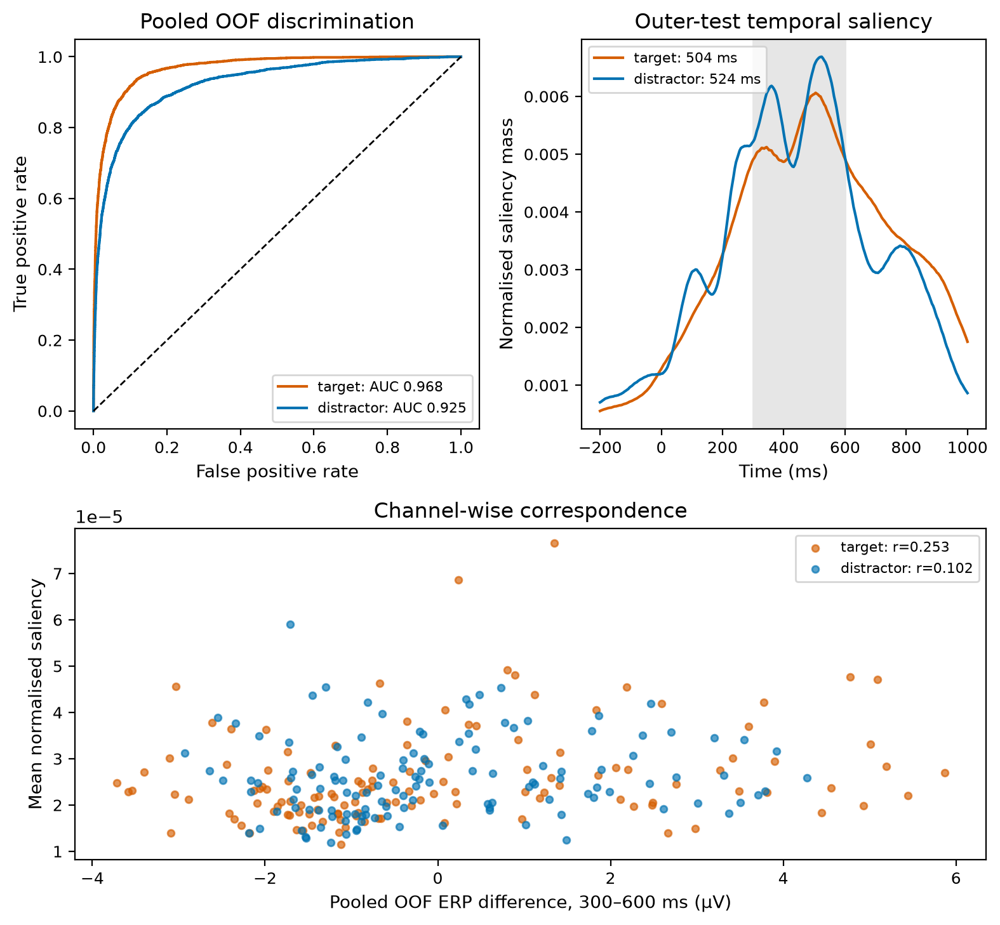
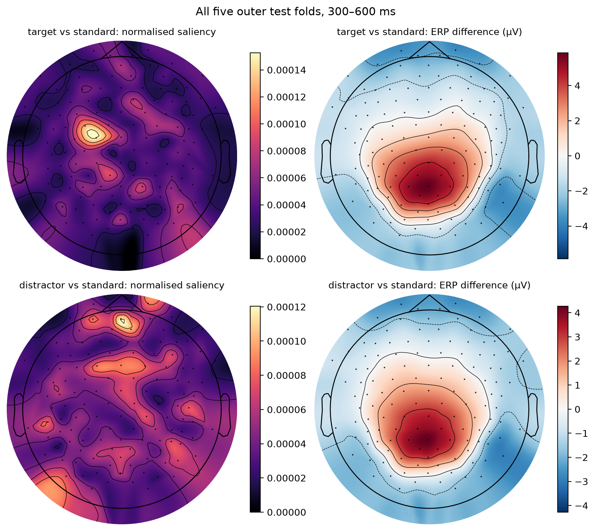

# Single Trial P300 Classification with Machine Learning and EEGNet

Final English submission: [PDF](../docs/EEG_Final_Report_EN.pdf) and [LaTeX](../docs/EEG_Final_Report_EN.tex). Updated 23 November 2026. All EEGNet values below use the final five-fold run.

## Abstract

On 21,878 correct standard/target trials from 39 task-compliant participants, EEGNet achieves balanced accuracy 0.903 ± 0.021, ROC-AUC 0.970 ± 0.013 and average precision 0.865 ± 0.045. It exceeds 128-channel LDA (ROC-AUC 0.949 ± 0.022). A no-button distractor–standard control reaches ROC-AUC 0.926 ± 0.015. Saliency evaluated only on positive outer-test inputs has a target peak at 504 ms, 40.7% mass in 300–600 ms and pooled spatial r = 0.253. These controls support stimulus discrimination with partial physiological interpretability; target-specific motor contributions remain unresolved.

## 1. Research questions

- RQ1: What is the best single-trial standard–target performance on unseen participants?
- RQ2: Does EEGNet outperform the tested standard ML pipelines?
- RQ3: Can model sensitivity be explained in relation to the P300?

## 2. Dataset and preprocessing

Nencki–Symfonia visual oddball data (GigaDB 100990) contain 42 participants. Standards, targets and distractors use markers 5, 6 and 7; only targets require a button press. The primary cohort excludes sub-02, sub-14 and sub-17 for task misunderstanding, independently of EEG or classifier results. Only correct retained trials are classified: 18,927 standards and 2,951 targets (13.49%, rounded 13.5%). The distractor control also uses correct trials, and both its classes have no response, verified from metadata.

The preprocessing notebook adds FCz (128 channels), harmonises order, assigns the Colin27 montage, crops task periods, marks segment boundaries, detects/interpolates bad channels and applies an average reference. Extended Picard ICA uses 40 components, seed 97 and ICLabel eye/heart/muscle probability ≥0.8, with three documented manual exclusions. Analysis filtering is zero-phase 0.5–40 Hz. Epochs cover −200 to +1000 ms, with −200–0 baseline before decimation to 250 Hz and rejection above 150 µV peak-to-peak. The stored shape is 128 × 301. Raw epochs means preprocessed samples before feature extraction.

The epoch audit passed for all 42 files and 27,034 retained epochs, including label, montage, reference and feature alignment checks. Original raw-data cleaning and ICA were not repeated. Residual baseline means are recorded because correction preceded decimation.

## 3. ERP and feature results

Correct-trial ERPs are averaged within people, then with equal weights across 39 people. The primary window is 300–500 ms. Mean Pz target amplitude is 6.97 ± 2.74 µV and standard amplitude 1.92 ± 1.49 µV; their paired difference is **5.05 ± 2.28 µV**, t(38)=13.82, p=2.14×10⁻¹⁶, dz=2.21. Project-defined checks require target Pz>Fz, Pz target–standard ≥1.5 µV and a positive maximum accepted at 300–500 ms after an independent 200–800 ms search. All three pass in 22/39 people, or 32/39 when mean and latency-acceptance windows are widened to 300–600 ms. These are operational project thresholds, not diagnostic criteria prescribed by Polich.

Distractor–standard contrasts in 300–500 ms are −1.06 ± 1.94 µV at Fz, +0.71 ± 1.54 µV at Cz and +3.54 ± 1.67 µV at Pz. The relative frontal contrast `(D_Fz − D_Pz) − (T_Fz − T_Pz)` is +1.43 ± 2.46 µV and positive in 26/39 people. This is a relative shift compared with targets; the absolute response in this window remains predominantly parietal and does not establish a canonical frontal P3a.




The 402 single-trial features use Fz, FCz, Cz, CPz, Pz, Oz, F3/F4, C3/C4 and P3/P4. They include window means/SD (120), P300 peaks/area (36), early peaks (18), peak-to-peak range (12), Hjorth (36), Welch summaries (132) and db4 wavelet summaries (48). Feature windows cover 100–200, 250–400, 400–600, 300–600 and 600–800 ms. Spectral/Hjorth summaries use the whole epoch; wavelet summaries retain the P300 window. Peak detection uses local extrema with a near-zero-derivative fallback.

Exploratory AUC ranking averages AUC within participants, then uses max(A,1−A). All 402 features enter CV; ranking does not select features. The strongest is `Pz_p3b_mean` (0.836), followed by `CPz_p3b_mean` (0.818). There are 32 features with rounded strength ≥0.7 (31 before three-decimal rounding) and 156 with strength ≥0.6. All rounded rankings were reproduced.

## 4. Models and evaluation

Five-fold GroupKFold keeps participants disjoint in outer training and test. Original target-task test participant groups are reused for the distractor task. Scalers are fitted only on training folds. Models: stratified Dummy; LDA with lsqr/automatic shrinkage and empirical priors; L2 logistic regression with balanced weights; probability RBF SVM with balanced weights; and a 100-tree forest with balanced_subsample. SVM's internal probability fitting is not explicitly participant-grouped.

EEGNet-8,2 uses eight temporal kernels of length 125, a 128-channel depthwise spatial convolution (multiplier 2), a separable temporal/pointwise block, pooling 4 and 8, dropout 0.5 and two output logits. It has 3,930 trainable parameters. Spatial/classifier max-norm limits are 1.0/0.25. Adam uses learning rate 0.001, class-weighted cross-entropy, batch 64, at most 50 epochs, patience 15 and seeds 42–46. The 15% inner validation split is trial-stratified, not participant-disjoint. Scaling is a global SD from the optimisation subset. Training uses RTX 3050 Ti 4 GB with PyTorch 2.6.0+cu124; validation inference also uses batch 64.

Threshold metrics use probability ≥0.5. AP is sklearn average_precision_score rather than trapezoidal PR integration. Reported means/SDs are unweighted fold means and sample SDs, not confidence intervals; pooled OOF scores combine all test predictions.

## 5. Final classifier results

| Model | Balanced accuracy | ROC-AUC | AP | Macro-F1 |
| --- | --- | --- | --- | --- |
| Dummy | 0.497 ± 0.005 | 0.497 ± 0.005 | 0.134 ± 0.004 | 0.497 ± 0.005 |
| LDA | 0.815 ± 0.060 | 0.947 ± 0.022 | 0.791 ± 0.075 | 0.835 ± 0.045 |
| Logistic Regression | 0.875 ± 0.037 | 0.946 ± 0.021 | 0.791 ± 0.073 | 0.817 ± 0.029 |
| RBF SVM | 0.799 ± 0.056 | 0.946 ± 0.016 | 0.791 ± 0.045 | 0.824 ± 0.043 |
| Random Forest | 0.638 ± 0.041 | 0.907 ± 0.025 | 0.652 ± 0.046 | 0.678 ± 0.053 |
| EEGNet | 0.903 ± 0.021 | 0.970 ± 0.013 | 0.865 ± 0.045 | 0.852 ± 0.030 |

Sensitivity is 0.880, specificity 0.927. Pooled OOF balanced accuracy, AUC and AP are 0.904, 0.968 and 0.853.




| Fold | People | Test trials | Epochs | Balanced accuracy | ROC-AUC | AP |
| --- | --- | --- | --- | --- | --- | --- |
| 1 | 7 | 4,033 | 50 | 0.884 | 0.971 | 0.870 |
| 2 | 8 | 4,269 | 50 | 0.927 | 0.981 | 0.908 |
| 3 | 8 | 4,527 | 50 | 0.909 | 0.974 | 0.881 |
| 4 | 8 | 4,523 | 50 | 0.919 | 0.975 | 0.875 |
| 5 | 8 | 4,526 | 47 | 0.878 | 0.947 | 0.788 |

### Channel control

LDA represents each channel by twelve fixed 100 ms mean bins covering the full epoch. The final bin includes 1000 ms. The same five test participant groups, training-fold standardisation, empirical priors and threshold 0.5 are used, with no bin-width or hyperparameter search.

| Model | Balanced accuracy | ROC-AUC | AP |
| --- | --- | --- | --- |
| LDA 12 channels, 144 features | 0.804 ± 0.045 | 0.937 ± 0.025 | 0.774 ± 0.072 |
| LDA 128 channels, 1,536 features | 0.830 ± 0.054 | 0.949 ± 0.022 | 0.821 ± 0.059 |
| EEGNet 128 channels | 0.903 ± 0.021 | 0.970 ± 0.013 | 0.865 ± 0.045 |

EEGNet leads 128-channel LDA by 0.021 ROC-AUC. Electrode count alone does not explain the advantage, while time representation and optimisation remain different.



### Participant consistency

| Baseline | Metric | Median gain | People higher | Wilcoxon p |
| --- | --- | --- | --- | --- |
| LDA | ROC-AUC | +0.023 | 35/39 | 5e-10 |
| LDA | Bal. accuracy | +0.081 | 34/39 | 1.6e-08 |
| Logistic Regression | ROC-AUC | +0.023 | 35/39 | 3.2e-10 |
| Logistic Regression | Bal. accuracy | +0.020 | 31/39 | 0.00018 |

Participant scores are paired, but people share fitted models and fold training sets overlap. These are exploratory unadjusted comparisons.

## 6. No button control and outer test explanations

| Task | Trials | Balanced accuracy | ROC-AUC | AP |
| --- | --- | --- | --- | --- |
| Target–standard | 21,878 | 0.903 ± 0.021 | 0.970 ± 0.013 | 0.865 ± 0.045 |
| Distractor–standard | 21,748 | 0.855 ± 0.020 | 0.926 ± 0.015 | 0.745 ± 0.048 |

The distractor task includes 2,821 distractors and 18,927 standards, all correct and without responses. Successful decoding shows that EEGNet can discriminate the rare stimulus without a button-press contrast. Differences from target decoding also include stimulus identity, relevance and ERP morphology, so the AUC gap is not a motor-effect estimate.

Saliency is the mean absolute gradient of the positive logit with respect to the scaled input, evaluated only on that model's outer-test positives. Each fold map is normalised to total mass one, then pooled with weights proportional to positive test counts. Fold ERP contrasts use only their test data; the pooled contrast uses all OOF trials. The inclusive 300–600 ms window has 76/301 samples (25.25%).

Spatial r uses saliency averaged over the entire epoch at each channel and the 300–600 ms ERP contrast. Saliency topographies show the 300–600 ms window average instead.

| Task | Positive trials | Peak ms | Mass 300–600 ms | Spatial r | Pz rank |
| --- | --- | --- | --- | --- | --- |
| Target | 2,951 | 504 | 40.7% | 0.253 | 43 |
| Distractor | 2,821 | 524 | 43.9% | 0.102 | 56 |

Target fold spatial r ranges from 0.057 to 0.289 (window-matched 300–600 ms pooled r = 0.203); distractor r ranges from 0.018 to 0.165 (300–600 ms pooled r = 0.048). Target leading channels (C1, FCC3h, C3, Oz, P2) form a left-central sensorimotor cluster near the 542.1 ms mean reaction time; without a button press, this focus disappears and distractor leading channels shift anteriorly (AFz, AFF2h, FC1, Oz, AF3). Gradients quantify sensitivity, which may include noise suppression, rather than activation amplitude or source location.




## 7. Direct answers and limitations

**RQ1:** EEGNet reaches ROC-AUC 0.970, balanced accuracy 90.3% and AP 0.865 on unseen outer-test participants.

**RQ2:** Yes for the tested pipelines, including the 128-channel LDA control. The difference remains a pipeline result because temporal representations and optimisation differ.

**RQ3:** Partly. All-five-fold test saliency gives temporal and partial spatial correspondence with the late response. The no-button distractor control reaches ROC-AUC 0.926. These completed controls support stimulus-related decoding while leaving specific motor contributions to target classification unresolved.

Limits: trial-based inner validation, non-grouped SVM probability estimation, no repeated-seed or nested tuning study, exploratory gradient interpretations and dependent paired tests. Classification is conditional on correct behaviour; raw cleaning/ICA were not repeated. There is no external dataset or online BCI validation. Response-locked analysis, feature interventions, participant-grouped inner validation and independent replication remain useful extensions.

## 8. Contributions and reproduction

| Member | Role | Exact share |
|---|---|---|
| Nguyễn Văn Vũ | Project management and data | 17⅔% |
| Thái Nguyễn Hoàng Bách | Preprocessing and QC | 10⅔% |
| Trương Huy Hoàng | ERP and visualisation | 17⅔% |
| Nguyễn Công Kiên | Feature extraction | 17⅔% |
| Nguyễn Việt Đức | ML baselines | 17⅔% |
| Đồng Minh Đức | EEGNet and interpretability | 18⅔% |
| Total | | 100% |

Shares follow `docs/contributions.md` and sum exactly to 100%. Eleven behavioural tests passed. The final five-fold metrics, participant scores, ERP statistics, feature rankings and saliency pooling were independently checked. Main evidence: `results/tables/eegnet_controls/manifest.json`, task summaries, per-fold records and OOF arrays; canonical `baseline_metrics.csv`, `baseline_oof.npz`, `eegnet_metrics_real.csv`, `eegnet_folds_real.csv`, `eegnet_oof_real.npz`, `eegnet_saliency_real.npz`; `lda_channel_controls.csv`; `ml_vs_dl_per_subject.csv`, `ml_vs_dl_paired.json`; `report_verification.json`.

```bash
python -m src.preprocessing.audit_epochs
python src/ml/train_baseline.py --splits 5
python -m src.ml.report_controls
python -u -m src.dl.report_controls --epochs 50 --batch-size 64
python -m src.dl.finalize_results
python -m src.verify_report
python -m unittest discover -s tests
```

## References

- Ablin P, Cardoso JF, Gramfort A. Faster independent component analysis by preconditioning with Hessian approximations. *IEEE Trans Signal Process* 2018;66(15):4040–4049.
- Blankertz B, Lemm S, Treder M, Haufe S, Müller KR. Single-trial analysis and classification of ERP components — a tutorial. *NeuroImage* 2011;56(2):814–825.
- Dzianok P, Antonova I, Wojciechowski J, Dreszer J, Kublik E. The Nencki-Symfonia electroencephalography/event-related potential dataset: multiple cognitive tasks and resting-state data collected in a sample of healthy adults. *GigaScience* 2022;11:giac015. doi:10.1093/gigascience/giac015
- Gramfort A, Luessi M, Larson E, et al. MEG and EEG data analysis with MNE-Python. *Front Neurosci* 2013;7:267.
- Haufe S, Meinecke F, Görgen K, Dähne S, Haynes JD, Blankertz B, Bießmann F. On the interpretation of weight vectors of linear models in multivariate neuroimaging. *NeuroImage* 2014;87:96–110.
- Hjorth B. EEG analysis based on time domain properties. *Electroencephalogr Clin Neurophysiol* 1970;29:306–310.
- Laton J, Van Schependom J, Gielen J, Decoster J, Moons T, De Keyser J, De Hert M, Nagels G. Single-subject classification of schizophrenia patients based on a combination of oddball and mismatch evoked potential paradigms. *J Neurol Sci* 2014;347:262–267. doi:10.1016/j.jns.2014.10.015
- Lawhern VJ, Solon AJ, Waytowich NR, Gordon SM, Hung CP, Lance BJ. EEGNet: a compact convolutional neural network for EEG-based brain–computer interfaces. *J Neural Eng* 2018;15(5):056013.
- Li A, Feitelberg J, Saini AP, Höchenberger R, Scheltienne M. MNE-ICALabel: automatically annotating ICA components with ICLabel in Python. *J Open Source Softw* 2022;7(76):4484.
- Lotte F, Bougrain L, Cichocki A, Clerc M, Congedo M, Rakotomamonjy A, Yger F. A review of classification algorithms for EEG-based brain–computer interfaces: a 10 year update. *J Neural Eng* 2018;15(3):031005.
- Pion-Tonachini L, Kreutz-Delgado K, Makeig S. ICLabel: an automated electroencephalographic independent component classifier, dataset, and website. *NeuroImage* 2019;198:181–197.
- Polich J. Updating P300: an integrative theory of P3a and P3b. *Clin Neurophysiol* 2007;118:2128–2148.
- Simonyan K, Vedaldi A, Zisserman A. Deep inside convolutional networks: visualising image classification models and saliency maps. *arXiv* 1312.6034, 2013.
