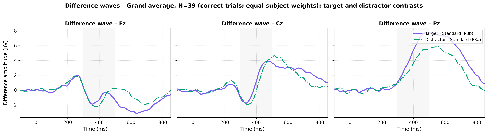
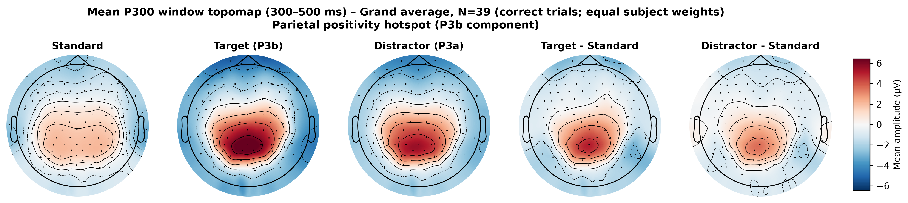
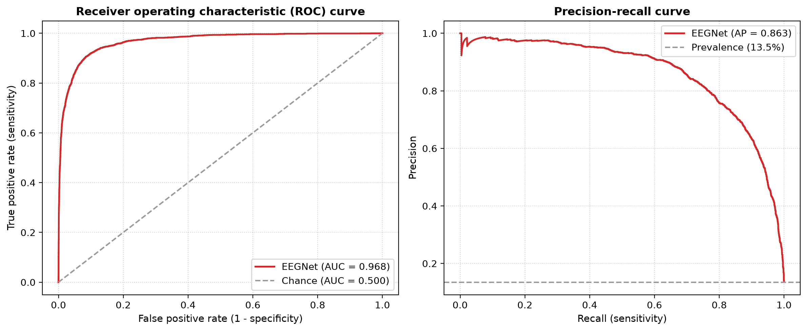

# Single-Trial P300 ERP Classification: Neurophysiological Validation and Benchmark Comparison between Feature-Engineered Machine Learning and Deep Learning (EEGNet)

**Course:** AIT3012 Neuroscience — Mini Project (Prof. Guy Nagels, VUB)
**Dataset:** Nencki-Symfonia EEG/ERP dataset, visual oddball task (GigaDB 100990; Dzianok et al., 2022)
**Team:** Nguyễn Văn Vũ (V1), Thái Nguyễn Hoàng Bách (V2), Trương Huy Hoàng (V3), Nguyễn Công Kiên (V4), Nguyễn Việt Đức (V5), Đồng Minh Đức (V6)

---

## Abstract

We studied the P300 event-related potential (ERP) in a three-stimulus visual oddball task recorded with 128-channel EEG in 42 healthy adults. After a standardised preprocessing pipeline with three manual ICA exclusions (bad-channel interpolation, Picard ICA with ICLabel, 0.5–40 Hz filtering, −200 to +1000 ms epochs at 250 Hz), we first verified the presence and topography of the P300 against the integrative P3a/P3b framework of Polich (2007). We then addressed single-trial classification of standard versus target stimuli in 39 subjects (21,878 correct trials, 13.5% targets) under a common subject-wise evaluation protocol (`GroupKFold`, 5 folds, no subject shared between training and test data). Feature-engineered machine-learning models built on 402 time–frequency features (following Laton et al., 2014) were compared with an end-to-end convolutional network (EEGNet-8,2; Lawhern et al., 2018) trained on raw epochs, and the network's decisions were examined with input-gradient saliency maps.

The included group showed a large parietal oddball effect at Pz in 300–500 ms (target − standard +5.05 ± 2.28 µV, paired t(38) = 13.82, p = 2.14 × 10⁻¹⁶, Cohen’s dz = 2.21). Under the project's operational criteria, 22/39 subjects met all three core P3b checks; 32/39 did so in the secondary 300–600 ms analysis. The best feature-based models were logistic regression (balanced accuracy 0.874 ± 0.037) and shrinkage LDA (ROC-AUC 0.947 ± 0.022). EEGNet outperformed all of them (balanced accuracy 0.907 ± 0.021, ROC-AUC 0.970 ± 0.010, PR-AUC 0.873 ± 0.042), with higher ROC-AUC in 34–35 of 39 subjects (Wilcoxon $p < 10^{-8}$). Saliency maps placed 40% of the model's sensitivity in the 300–600 ms P3b window (peak 504 ms), but emphasised left central rather than parietal electrodes, suggesting that the network may also exploit motor activity related to the button press. Deep learning is therefore more accurate on this dataset, but only partly interpretable in terms of the P300.

---

## 1. Introduction and research questions

The P300 is a positive ERP deflection that peaks roughly 300–600 ms after a task-relevant, infrequent stimulus. It is one of the most robust markers in cognitive neuroscience and the basis of P300 brain–computer interfaces (BCIs), where the key requirement is to detect the response on a **single trial** rather than in an average over many trials.

The project had three components:

1. **Electrophysiological characterisation** of the spatial distribution and time course of the P300 subcomponents (P3a and P3b), interpreted within the framework of Polich (2007).
2. **A standardised preprocessing pipeline** applied identically to all 42 subjects (128 electrodes, Colin27 10-05 montage), combining band-pass filtering, bad-channel interpolation and automatic artefact removal with Picard ICA and ICLabel.
3. **Predictive modelling** of single trials, comparing hand-crafted time–frequency features with standard classifiers (LDA, logistic regression, SVM, random forest) against a dedicated deep-learning model (EEGNet).

The course set three research questions:

- **RQ1.** What is the best single-trial classification performance for frequent (standard) versus target stimuli?
- **RQ2.** Does deep learning outperform standard machine-learning techniques for single-trial classification?
- **RQ3.** Are the features discovered by the deep-learning model interpretable (avoiding a "black box")? If deep learning does not perform better, why not?

---

## 2. Theoretical background: the integrative P300 model of Polich (2007)

Polich (2007), *"Updating P300: An integrative theory of P3a and P3b"*, distinguishes two subcomponents:

| | **P3a** | **P3b** |
|---|---|---|
| Eliciting stimulus | Distractor: task-irrelevant, novel or surprising | Target: task-relevant, requires attention and a response |
| Cognitive process | Involuntary orienting of attention (frontal attention mechanism) | Updating of the working-memory representation of the context ("context updating") |
| Scalp distribution | Fronto-central maximum (Fz, Cz > Pz) | Centro-parietal maximum (Pz > Cz > Fz) |
| Latency | Earlier (~300–450 ms) | Later (~300–600 ms) |
| Other properties | Habituates quickly | Amplitude inversely related to target probability |

**Difference waves.** To reduce shared responses and examine the P300 alongside overlapping early sensory components (P1 ~100 ms, N1 ~150 ms, P2 ~200 ms), condition averages were subtracted:

- $\Delta_{\text{Target}} = \text{Target} - \text{Standard}$ highlights the target-related **P3b**;
- $\Delta_{\text{Distractor}} = \text{Distractor} - \text{Standard}$ highlights the distractor-related **P3a**.

---

## 3. Dataset and preprocessing

### 3.1 Dataset

- Nencki-Symfonia dataset (Dzianok et al., 2022; GigaDB 100990), **visual oddball** task, **42 subjects**.
- BrainVision recordings, 127 electrodes, online reference FCz, sampling rate 1000 Hz.
- A typical session contains 660 stimuli: about 75% standard (marker S5), 12% target (S6) and 12% distractor (S7). Participants pressed a button for targets only (marker S1).
- Four recordings deviate from 660 stimuli: sub-23 (692), sub-38 (775), sub-24 and sub-37 (659). Five recordings consist of several concatenated segments: sub-15, 23, 24, 37 and 38.

### 3.2 Pipeline

The pipeline was implemented in MNE-Python 1.13.2 and applied identically to all 42 subjects (`notebooks/01_preprocessing.ipynb`).

1. **Loading and channel harmonisation.** The reference channel FCz was re-added (128 channels per subject). Channels were reordered to a common order, because the files of sub-13, sub-41 and sub-42 store them differently. Electrode positions were assigned from the `colin27_1005` montage; O9 and O10 take the positions of I1 and I2.
2. **Restriction to the task period.** Recordings were cropped from 5 s before the first stimulus to 5 s after the last epoch. Some recordings continued after the task with artefacts of up to ~3000 µV (cap removal, movement), which corrupt both bad-channel detection and ICA. On average 73 s were removed per subject (range 29–412 s). Segment joins were annotated as `BAD_boundary` so that no filter or epoch crossed them.
3. **Bad-channel detection and interpolation**, performed on a copy downsampled to 200 Hz, filtered 1–40 Hz and median-referenced. A channel was flagged if it met at least one criterion:
   - *Noisy or flat:* robust z-score (median/MAD) of the log inter-quartile range with absolute value > 4. The IQR is less sensitive to blinks than the standard deviation, so Fp1/Fp2 were not removed before ICA could correct blinks.
   - *Uncorrelated:* median correlation with the 6 nearest neighbours < 0.4.
   - *Anti-correlated:* correlation with a neighbour < −0.8, typically indicating poor electrode contact.

   Bad channels were interpolated with spherical splines and the data were re-referenced to the **average reference**.
4. **ICA and ICLabel.** ICA was fitted on a copy filtered 1–100 Hz and downsampled to 250 Hz (the range on which ICLabel was trained), using extended Picard (`ortho=False`), 40 components, `random_state=97`. ICLabel (Pion-Tonachini et al., 2019; mne-icalabel 0.10.0) labelled each component; components labelled **eye blink**, **heart beat** or **muscle artifact** with probability ≥ 0.8 were removed — the same three artefact classes removed in the dataset paper. *Line noise* and *channel noise* components were kept: line noise is removed by the 40 Hz low-pass, bad channels were already interpolated, and in some subjects (e.g. sub-30) these components contained part of the P3. **Three manual exceptions:** in sub-13, sub-14 and sub-36, a blink component scored only 0.78, 0.70 and 0.59. After inspecting the component topography and its correlation with Fp1, one additional component was removed per subject; Fp1 amplitude in the epochs dropped from 215, 171 and 131 µV to 22, 69 and 31 µV.
5. **Band-pass filtering, 0.5–40 Hz**, on the original 1000 Hz data (as in the dataset paper): zero-phase FIR, Hamming window, 6601 taps; transition bandwidth 0.5 Hz at the lower edge (−6 dB at 0.25 Hz) and 10 Hz at the upper edge (−6 dB at 45 Hz). The ICA solution from step 4 was then applied.
6. **Epoching** from −200 to +1000 ms around each stimulus with baseline correction (−200 to 0 ms), decimation by 4 (1000 → 250 Hz; safe after the 40 Hz low-pass). Epochs with a peak-to-peak amplitude above **150 µV** on any channel, or overlapping a segment join, were rejected. Each epoch contains 128 channels × 301 samples, stored as float32.
7. **Labels and behaviour.** Each epoch carries metadata `condition` (standard/target/distractor), `responded`, `rt_ms` and `correct`. A target is *correct* if a button press occurred 100–1400 ms after onset (earlier presses are anticipations; 1400 ms is the stimulus duration plus the shortest inter-stimulus interval, as in the dataset paper). Standards and distractors are correct if no press occurred.

### 3.3 Quality control

The pipeline writes a QC file per subject and a summary table (`derivatives/v1/qc_summary.csv`). Across 42 subjects:

| Measure | Mean ± SD | Range |
|---|---|---|
| Interpolated bad channels | 2.9 ± 3.4 | 0–14 (≥ 1 in 30/42 subjects) |
| ICA components removed (of 40) | 15.0 ± 4.7 | 6–25 |
| Fp1 before ICA (99th percentile of \|amplitude\|, µV) | 214 ± 91 | 78–505 |
| Fp1 after ICA (µV) | 39 ± 49 | 12–322 |
| Rejected epochs (%) | 3.0 ± 7.8 | 0–49.5 |

- **Bad channels:** 122 in total. The "uncorrelated" criterion fired most often (100), followed by "noisy or flat" (26) and "anti-correlated" (7); a channel may meet several criteria.
- **Removed ICA components:** on average 12.0 muscle, 2.8 ocular and 0.2 cardiac components per subject.
- **Epochs:** **27,034 of 27,865 epochs (97.0%)** were retained: 20,375 standard, 3,326 target and 3,333 distractor.
- **Classification set:** 39 subjects (three subjects who misunderstood the task were excluded, see §3.4), correct standard and target trials only: **21,878 trials** (18,927 standard, 2,951 target; **13.5% targets**).

**Validation of event decoding.** Behavioural measures recomputed from the markers match Table 5 of the dataset paper (same 39 subjects):

| Measure | Recomputed | Dataset paper |
|---|---|---|
| Target reaction time (ms) | 542.1 ± 65.5 | 542.1 ± 65.5 |
| Target omissions (%) | 5.60 ± 8.48 | 5.60 ± 8.33 |
| False alarms to distractors (%) | 9.63 ± 9.28 | 9.52 ± 8.90 |
| False alarms to standards (%) | 0.27 ± 0.53 | 0.24 ± 0.46 |

**Validation of the P300 signal.** Mean Pz amplitude in the 300–600 ms window (39 subjects, all retained epochs): target **7.1 ± 2.5 µV**, distractor 5.8 ± 2.3 µV, standard 1.5 ± 1.3 µV. The ordering target > distractor > standard is the one expected in an oddball design.

### 3.4 Subjects requiring attention

- **Excluded from group analyses:** sub-02, sub-14 and sub-17 misunderstood the task (button presses to 77–99% of distractors), as also reported and excluded in the dataset paper. Their epochs are exported and flagged `task_misunderstood` in the QC.
- **Residual ocular artefacts:** Fp1 after ICA remains high in sub-40 (322 µV) and sub-30 (112 µV). Pz is little affected, but frontal analyses of these subjects should be interpreted with care.
- **Many rejected epochs:** sub-07 lost 49.5% of epochs at the 150 µV threshold but still has 37 correct targets; sub-14 lost 12.6%.
- **Irregular recordings or high impedance:** QC flags `irregular_recording` for sub-13, 15, 23, 24, 37 and 38; the dataset paper reports high impedance for sub-23, 24 and 32.

### 3.5 Deviations from the dataset paper's pipeline

To run one automated, reproducible pipeline on all 42 subjects, we added or changed: (1) cropping of non-task recording periods before processing; (2) automatic detection and interpolation of bad channels; (3) ICLabel-threshold component rejection, plus the three manually removed blink components; (4) automatic epoch rejection at 150 µV peak-to-peak; (5) downsampling to 250 Hz (≈ 3.6 GB for 42 subjects), which loses no information after the 40 Hz low-pass.

---

### 3.6 Audit of the supplied epoch/feature hand-off

`python -m src.preprocessing.audit_epochs` checked all **42 files (27,034 epochs)**,
including 128-channel order and montage, 301 samples at 250 Hz, filter and baseline
metadata, finite samples, average reference, the 150 µV rejection threshold, event and
behavioural labels, and agreement with QC counts and 300–600 ms amplitudes. For all
39 classification subjects, feature trial order, labels, RT and recomputed `Pz_p3b_mean`
matched the 21,878-row feature matrix. All implemented checks passed; this does not
independently validate every one of the 402 features or the raw-data ICA decisions.

Baseline correction precedes decimation in MNE: it was applied at 1000 Hz, whereas the
stored epochs contain every fourth sample. The 250 Hz baseline sample mean need not be
exactly zero; the audit records residuals rather than altering epochs or existing features.
Maximum absolute baseline means per subject ranged from **0.193 to 1.006 µV**. The detailed
checks and limits are stored in `results/tables/v2_epoch_audit.json`.

## 4. P300 verification criteria

ERP analyses use **correct retained trials**, averaged within each subject and then with
**equal weights across the 39 included subjects**. The three task-misunderstood subjects
are retained in the diagnostic table only. No additional participant is excluded from
ML/DL on the basis of an ERP amplitude or latency check.

The following are **project-defined operational checks inspired by the P3a/P3b framework**,
not a diagnostic standard or numerical thresholds prescribed by Polich (2007):

1. **Parietal gradient:** mean target Pz > Fz in **300–500 ms**.
2. **Oddball effect:** mean target − standard at Pz ≥ **1.5 µV** in the same window.
3. **Latency:** the positive target Pz maximum is found over **200–800 ms**, independently
   of the acceptance window; it must fall in **300–500 ms**. Searching only within the
   acceptance window would make the check circular. This is an ERP-window maximum,
   not the single-trial local-peak method used for feature extraction.
4. **Relative frontal tendency (descriptive):** distractor (Fz − Pz) > target (Fz − Pz)
   in 300–500 ms. This is separate from the three core P3b checks.

`p300_detected` requires checks 1–3. `p300_verified` additionally requires that the subject
is not in the predeclared task-misunderstood group. It is therefore important to distinguish
a physiological check from eligibility for the classification task. Calculations use full
precision; rounding is for display only.

A **secondary 300–600 ms analysis** recomputes the mean-amplitude checks and widens latency
acceptance to 300–600 ms, while keeping the same 200–800 ms peak search. The original V2
QC amplitudes also cover 300–600 ms but include **all retained trials**, including incorrect
ones; they must not be substituted for the correct-trial 300–500 ms ERP results.

## 5. ERP results

### 5.1 Grand-average ERPs and difference waves

For the 39 included subjects, correct-trial Pz mean amplitudes in **300–500 ms** were
**6.97 ± 2.74 µV** for targets and **1.92 ± 1.49 µV** for standards. The paired difference was
**+5.05 ± 2.28 µV**; paired **t(38) = 13.82**, **p = 2.14 × 10⁻¹⁶**, **Cohen’s dz = 2.21**.
SD is the sample standard deviation across subjects; dz is the mean paired difference
divided by the SD of paired differences. All 39 subjects had a positive target Pz > Fz gradient.


*Figure 1. Equal-subject-weight grand averages of correct trials from 39 subjects. Shading
around each waveform is the SEM across subjects, and the grey band marks 300–500 ms.
The dashed curve is target − standard. The marked Pz point is the maximum of the grand
average inside the shaded window; individual latency checks instead search 200–800 ms.*



*Target − standard and distractor − standard at Fz, Cz and Pz, with the same subject weights.
Difference waves reduce shared responses but do not uniquely isolate neural sources.*

### 5.2 128-channel scalp topography




*Figure 2. Correct-trial grand averages over the same 39 subjects, each weighted equally:
(A) scalp potentials at 150, 250, 350, 450 and 550 ms; (B) mean potentials in 300–500 ms.
Both plots include standard, target, distractor and their two difference waves on a common
symmetric colour scale within each figure. These are group maps, not sub-01 examples.*

The maps show a parietal positive target − standard effect. A relative frontal tendency
for distractors was present in 26/39 subjects, so a uniform frontal P3a pattern across the
whole sample should not be claimed. Scalp potentials do not establish source localisation.

### 5.3 Operational verification in 42 subjects

| Check | Included group (N = 39) | Task-misunderstood (N = 3) |
|---|:---:|:---:|
| Target Pz > Fz, 300–500 ms | 39/39 (100.0%) | 3/3 (100.0%) |
| Pz target − standard ≥ 1.5 µV, 300–500 ms | 37/39 (94.9%) | 3/3 (100.0%) |
| Positive Pz maximum in 300–500 ms, searched over 200–800 ms | 22/39 (56.4%) | 2/3 (66.7%) |
| Relative frontal distractor tendency, descriptive | 26/39 (66.7%) | 2/3 (66.7%) |
| All three core P3b checks (`p300_detected`) | 22/39 (56.4%) | 2/3 (66.7%) |
| Core checks plus task eligibility (`p300_verified`) | 22/39 (56.4%) | 0/3 (0.0%) |
| Secondary core checks, 300–600 ms | 32/39 (82.1%) | 3/3 (100.0%) |

Seventeen included subjects had the largest positive response **after 500 ms**, with maxima
between **508 and 748 ms** in the 200–800 ms search. Failure of the narrower operational
window does not establish absence of a P300. ERP criteria were not used to reselect the
classification cohort or to improve its reported performance.

Target RT from the original task QC was **542.1 ± 65.5 ms**, and correlated with the
correct-trial target Pz mean in 300–500 ms: **r = −0.493, p = 0.00144** (39 subjects).
This is an association, not evidence of a causal relation.

The task-misunderstood group had **90.95 ± 12.49%** distractor false alarms, versus
**9.63 ± 9.28%** in the included group. Its correct-trial target Pz mean was
**5.29 ± 2.58 µV**. Only **1, 1 and 19 correct distractor trials** remained in sub-02,
sub-14 and sub-17, so their distractor averages are especially unstable. Their exclusion
is based on task behaviour, not an asserted absence of an ERP response.


*Figure 3. (A) Correct-trial Pz means in 300–500 ms for all 42 subjects; (B) distractor
false-alarm rates from task QC, before rejection; (C) target RT versus the correct-trial
Pz mean in the 39 included subjects. Amplitudes and percentages have separate axes.*

Reproduce with `python src/erp/plot_erp.py --group`. Per-subject values and settings are
in `results/tables/v3_p300_group_results.csv`; statistics are in `v3_p300_summary.json`.
These recomputed results supersede the earlier mixed-window values and 39/39 verification claim.

---

## 6. Feature extraction (following Laton et al., 2014)

### 6.1 Input

- Preprocessed epochs of the **39 included subjects**, correct trials only; two classes, **standard (0)** and **target (1)**: **21,878 trials** (18,927 standard, 2,951 target; 13.5% targets).
- Each trial: 128 channels × 301 samples (−200 to +1000 ms, 250 Hz).
- Features are computed on **single trials**. Laton et al. (2014) computed features on averaged ERPs; we compute them per trial because the task is single-trial classification.

### 6.2 Channels and time windows

- **12 channels:** midline (Fz, FCz, Cz, CPz, Pz, Oz) and lateral (F3/F4, C3/C4, P3/P4), where the P3a (fronto-central) and P3b (parietal) are largest (Polich, 2007).
- **5 time windows:**

| Window | Range (ms) | Meaning |
|---|---|---|
| `early` | 100–200 | Early sensory components (N1, P2) |
| `p3a` | 250–400 | P3a, automatic attention |
| `p3b` | 400–600 | P3b, working-memory updating |
| `p3_window` | 300–600 | Whole P300 |
| `late` | 600–800 | Late tail of the response |

- **Why a 300–600 ms P300 window** (wider than the 300–500 ms window used for the ERP figures): the dataset paper reports P3 peaks within 300–600 ms, and Laton et al. (2014) searched for the visual P300 peak within 350–600 ms. In a check on 10 subjects, the 300–500 ms window truncated the Pz peak in 5/10 subjects (peaks at 560–690 ms); widening it to 600 ms raised the AUC of `Pz_p3_window_mean` from 0.77 to 0.81 (better in 9/10 subjects).

### 6.3 Feature set (402 features per trial)

| Group | Features | Channels | Columns |
|---|---|---|---|
| Window amplitude | Mean and standard deviation in the 5 windows | 12 | 120 |
| P300 peak | Amplitude and latency of the positive peak in 300–600 ms; area under the curve | 12 | 36 |
| Early peaks (Laton et al., 2014) | Amplitude and latency of N100 [50, 200], P200 [150, 300], N200 [200, 400] ms | Fz, Cz, Pz | 18 |
| Peak-to-peak | Max − min in 200–700 ms | 12 | 12 |
| Hjorth | Activity, mobility, complexity (whole epoch) | 12 | 36 |
| Spectral (Welch, whole epoch) | Absolute and relative power in delta (0.5–4), theta (4–8), alpha (8–13), beta (13–30 Hz); θ/α and δ/θ ratios; spectral entropy | 12 | 132 |
| Wavelet (db4, 4 levels) | Energy in 0–8, 8–16, 16–31 Hz within 300–600 ms; mean amplitude of the 0–8 Hz band | 12 | 48 |

**Peak detection** (Laton et al., 2014): a peak is a sample larger (positive peak) or smaller (negative peak) than both neighbours; with several peaks, the most extreme is taken. If the window contains no peak (a monotonic slope), the sample with the derivative closest to zero is used (*force* option). Peaks are therefore not assigned to the window edge while the wave is still rising; at Pz only 2.5% of target trials have their P3 peak at the 600 ms edge.

**Wavelet:** multiresolution analysis with a 4-level db4 wavelet separates frequency bands while preserving time, so that band energy can be measured **within the P300 window**, unlike whole-epoch band power.

### 6.4 Discriminability of individual features

Each feature was scored by the target-versus-standard AUC, computed within each subject and averaged over the 39 subjects (0.5 = no discrimination, 1 = perfect). For features where targets are **lower** than standards (AUC < 0.5), discriminability is reported as 1 − AUC. Full table: `results/tables/v4_feature_auc.csv` (column `auc` = raw AUC, `strength` = discriminability).

| Feature group | Best discriminability | Best feature |
|---|---|---|
| Window amplitude | **0.836** | `Pz_p3b_mean` (Pz, 400–600 ms) |
| Area under the curve | 0.802 | `Pz_p3_auc` |
| Wavelet | 0.802 | `Pz_wav_delta_theta_p3_mean` |
| Hjorth | 0.780 | `Pz_hjorth_complexity` |
| Band power | 0.741 | `CPz_bp_delta` |
| P300 peak amplitude | 0.733 | `CPz_p3_peak_amp` |
| Spectral entropy | 0.679 | `CPz_spectral_entropy` (lower for targets, AUC 0.321) |
| P300 peak latency | 0.624 | `CPz_p3_peak_lat` |
| Peak-to-peak | 0.614 | `Cz_ptp` |
| Early peaks N1/P2/N2 | 0.605 | `Fz_n2_lat` |

32/402 features reach a discriminability ≥ 0.7 and 156/402 reach ≥ 0.6.

**Observations.**

1. **The strongest features are mean parietal amplitudes (Pz, CPz) at 400–600 ms**, matching the spatial and temporal profile of the P3b (Polich, 2007). Mean amplitude is more stable than peak amplitude (0.836 vs 0.733) because single-trial peaks are easily displaced by noise.
2. **Temporal localisation helps:** 0–8 Hz wavelet energy within the P300 window (AUC 0.760 at Pz) outperforms whole-epoch delta power (0.734). Alpha-band (8–16 Hz) energy in the P300 window is **lower** for targets (AUC 0.352), consistent with alpha desynchronisation during focused attention.
3. **Hjorth mobility is lower for targets** (AUC 0.228 at Pz, discriminability 0.772): the slow, large P300 lowers the mean frequency of the signal. Likewise, spectral entropy is lower for targets (AUC 0.321 at CPz) because power concentrates at low frequencies.
4. **Latencies and early peaks discriminate weakly** (AUC ≤ 0.62): single-trial latency is highly variable (as Laton et al. also note for averages), and early sensory components (N1, P2, N2) are nearly identical for the two visual stimuli. These features were nevertheless retained, since weak individual features can be useful in combination (Laton et al., 2014).

**Notes for classification.** (i) Features are not standardised; z-scoring must be fitted inside each training fold (`StandardScaler` within a `Pipeline`). (ii) Splits must be made by subject using the returned `groups`. (iii) Participants pressed the button ~540 ms after targets, inside the `p3b` and `p3_window` windows, so part of the information may be motor (see §11.1). (iv) The AUC table above is computed on all data and must **not** be used to pre-select features, which would leak test information.

---

## 7. Machine-learning baselines

### 7.1 Task definition and class imbalance

- **Single-trial binary classification** of standard (0) versus target (1). Distractors were excluded to focus on the P3b mechanism used in P300 BCIs.
- **Strong class imbalance:** targets make up 13.5% of trials (≈ 1:6.4). A classifier predicting "standard" for every trial would reach 86.5% raw accuracy while detecting no P300, so raw accuracy is not reported.
- **Countermeasures:** `class_weight="balanced"` for logistic regression and the RBF SVM, and `balanced_subsample` for the random forest. Evaluation uses **balanced accuracy**, **ROC-AUC**, **PR-AUC (average precision)**, **F1-macro**, **sensitivity (target recall)** and **specificity**; threshold-dependent metrics use a fixed probability threshold of 0.5.

### 7.2 Leakage-free cross-validation

- **Inside-fold scaling:** `StandardScaler` is part of the scikit-learn `Pipeline`, so its parameters are estimated on the training fold only.
- **Subject-wise splitting:** `GroupKFold(n_splits=5)` grouped by subject, so each test fold contains only subjects never seen during training (**cross-subject generalisation**). Mean ± SD are computed over the 5 folds; out-of-fold (OOF) metrics pool all test predictions.

### 7.3 Models

1. **Dummy** (stratified chance level).
2. **Linear discriminant analysis (LDA)** with the `lsqr` solver and automatic (Ledoit–Wolf) shrinkage — the reference method in P300 BCI research (Blankertz et al., 2011).
3. **Logistic regression** with L2 regularisation and balanced class weights.
4. **RBF support vector machine** with balanced class weights (Platt-scaled probabilities).
5. **Random forest**, 100 trees, `balanced_subsample`.

### 7.4 Results (39 subjects, 21,878 trials, 402 features, GroupKFold)

| Model | Balanced accuracy | ROC-AUC | PR-AUC (AP) | F1-macro | Sensitivity | Specificity |
|---|:---:|:---:|:---:|:---:|:---:|:---:|
| Dummy | 0.497 ± 0.005 | 0.497 ± 0.005 | 0.134 ± 0.004 | 0.497 ± 0.005 | 0.127 ± 0.009 | 0.867 ± 0.002 |
| Random forest | 0.638 ± 0.041 | 0.907 ± 0.025 | 0.652 ± 0.046 | 0.678 ± 0.053 | 0.289 ± 0.087 | **0.988 ± 0.005** |
| RBF SVM | 0.799 ± 0.056 | 0.946 ± 0.016 | **0.791 ± 0.045** | 0.824 ± 0.043 | 0.625 ± 0.120 | 0.973 ± 0.011 |
| LDA | 0.815 ± 0.060 | **0.947 ± 0.022** | **0.791 ± 0.075** | **0.835 ± 0.045** | 0.659 ± 0.126 | 0.971 ± 0.013 |
| **Logistic regression** | **0.874 ± 0.037** | 0.946 ± 0.021 | **0.791 ± 0.073** | 0.816 ± 0.029 | **0.841 ± 0.087** | 0.908 ± 0.027 |


### 7.5 Discussion of the baselines

1. **Regularised linear models perform best.** Logistic regression with balanced class weights reached the highest balanced accuracy (**87.4 ± 3.7%**), with sensitivity **84.1 ± 8.7%** and specificity **90.8 ± 2.7%**. LDA with shrinkage reached the highest ROC-AUC (**0.947 ± 0.022**), PR-AUC 0.791 ± 0.075 and F1-macro 0.835 ± 0.045. In a 402-dimensional, highly correlated feature space, a linear projection with covariance shrinkage is robust to noise and to inter-subject variability.
2. **Ranking quality is essentially identical for the three best models** (ROC-AUC 0.946–0.947; PR-AUC ≈ 0.791, about six times the 13.4% prevalence). Their differences in balanced accuracy, sensitivity and specificity therefore reflect where the 0.5 threshold falls on similar score distributions — LDA and the SVM, which are not class-weighted in the same way, operate at higher specificity and lower sensitivity — rather than different discriminative information.
3. **The random forest loses sensitivity at the default threshold.** It ranks well (ROC-AUC 0.907) and is almost perfectly specific (0.988), but its sensitivity at threshold 0.5 drops to 28.9%. With many redundant, correlated features, random feature sub-sampling at each split dilutes the few strong P300 features (e.g. `Pz_p3b_mean`), and the averaged votes are compressed towards the majority class.


---

## 8. Deep learning: EEGNet on raw epochs

### 8.1 Architecture

**EEGNet-8,2** (Lawhern et al., 2018) was implemented in PyTorch (`src/dl/train_eegnet.py`) to test end-to-end classification without hand-crafted features:

```
Input: raw epoch (B, 1, 128 channels, 301 samples @ 250 Hz)
  │
  ├── Block 1:
  │     ├── Temporal Conv2D: 8 filters (1 × 125, i.e. 500 ms) -> BatchNorm
  │     ├── Depthwise spatial Conv2D: 16 filters (128 × 1, D = 2, max-norm 1.0) -> BatchNorm -> ELU
  │     └── AvgPool2D (1 × 4) -> Dropout (p = 0.5)
  │
  ├── Block 2:
  │     ├── Separable Conv2D: depthwise (1 × 16) + pointwise (16 filters, 1 × 1) -> BatchNorm -> ELU
  │     └── AvgPool2D (1 × 8) -> Dropout (p = 0.5)
  │
  └── Classifier: Flatten -> Linear (max-norm 0.25) -> 2 classes (standard vs target)
```

- The temporal convolution acts as a set of data-driven band-pass filters.
- The depthwise convolution learns, for each temporal filter, a linear combination of the 128 channels — a spatial filter comparable to xDAWN/CSP, but optimised jointly with the temporal filters.
- The network has **3,930 trainable parameters** (128 channels × 301 samples), about 5.6 times fewer than the training trials in a fold, which limits over-fitting on low-SNR EEG.

### 8.2 Training and evaluation protocol

- **Same data and same folds as the baselines:** 39 subjects, 21,878 correct trials (13.5% targets), `GroupKFold(n_splits=5)` by subject. Per-subject trial counts were verified to match the feature matrix row by row, so each test fold contains exactly the same subjects for both approaches. The same metrics and the same 0.5 threshold were used.
- **Optimisation:** Adam (learning rate 10⁻³), batch size 64, at most 50 epochs, early stopping on the validation loss (patience 15) using 15% of each training fold; class-weighted cross-entropy (equivalent to `class_weight="balanced"`); input scaling by the global standard deviation of the training fold (no information from the test fold).
- **Hardware:** NVIDIA RTX 4060 GPU, about 8 minutes per fold.

### 8.3 Results (39 subjects, 21,878 trials, raw epochs)

| Metric | Mean ± SD over 5 folds | Pooled out-of-fold |
|---|:---:|:---:|
| **Balanced accuracy** | **0.907 ± 0.021** | 0.907 |
| **ROC-AUC** | **0.970 ± 0.010** | 0.968 |
| **PR-AUC (average precision)** | **0.873 ± 0.042** | 0.863 |
| **F1-macro** | **0.857 ± 0.028** | 0.856 |
| **Sensitivity** | **0.884 ± 0.060** | 0.886 |
| **Specificity** | **0.930 ± 0.030** | 0.929 |

Per-fold ROC-AUC was 0.968, 0.974, 0.974, 0.980 and 0.954; per-fold balanced accuracy was 0.884, 0.922, 0.915, 0.928 and 0.886 (`results/tables/eegnet_folds_real.csv`). Four of the five folds reached the 50-epoch limit before early stopping triggered, so longer training might improve performance slightly.

A preliminary single-subject run (sub-01, 540 trials, `StratifiedKFold`) had given ROC-AUC 0.890; it is not comparable with the 39-subject baselines and is superseded by the results above.



*Figure 4. Out-of-fold ROC (left) and precision–recall (right) curves of EEGNet over 39 subjects. The dashed line in the PR panel marks the 13.5% target prevalence.*

---

## 9. Interpretability: saliency maps

### 9.1 Method

Saliency was computed as the absolute input gradient of the target logit, averaged over all 2,951 target trials, for a reference model trained on 85% of all trials (Simonyan et al., 2013):

$$S_{c, t} = \frac{1}{N_{\text{target}}} \sum_{i=1}^{N_{\text{target}}} \left| \frac{\partial \hat{y}_i^{(\text{target})}}{\partial X_{i, c, t}} \right|$$

where $\hat{y}_i^{(\text{target})}$ is the target logit and $X_{i, c, t}$ the potential at channel $c$ and time $t$ of trial $i$.


*Figure 5. (Top) Channel × time saliency, temporal saliency profile, and channel-wise saliency versus the P300 effect. (Bottom) Scalp topography of saliency in 300–600 ms (left), topography of the target − standard effect in the same window (centre), and saliency time courses for left-central, right-central and parietal channel groups (right).*

### 9.2 Temporal profile — consistent with the P300

- Mean saliency peaked at **504 ms**, within the P3b window.
- **40.2%** of the total saliency fell within 300–600 ms, a window covering only 24.9% of the epoch (≈ 1.6 times the share expected under a uniform distribution). The pre-stimulus baseline received 3.8% and the first 200 ms 10.7%.
- A further 21.5% fell within 600–800 ms, i.e. the late tail of the response, which overlaps the button press (mean RT ≈ 542 ms).

### 9.3 Spatial profile — only partly consistent with the P3b

- The P300 effect (target − standard, 300–600 ms) was largest at **Pz, PPO1h, P1, CPP1h and CPz**, symmetrically around the parietal midline, as expected for the P3b (Polich, 2007).
- Saliency, in contrast, was highest at **C1, FCC3h, CCP3h, FCC4h, FFC2h, FCz and C3** — **central and fronto-central sites with a left-hemisphere emphasis**. Pz ranked only 37th of 128 channels, and the channel-wise correlation between saliency and the P300 effect was modest (**r = 0.32**).
- Left-central saliency (C3, C1, CCP3h, FCC3h) was about 1.75 times right-central saliency and showed two peaks, near 180 ms and near 460 ms; parietal saliency (Pz, CPz, P1, P2) peaked earlier, near 340 ms.
- The averaged ERP itself was **not** left-lateralised: the target − standard difference at 400–700 ms was 1.81 µV at C3 and 2.04 µV at C4 (paired test over 39 subjects, p = 0.50), compared with 6.96 µV at Pz.

### 9.4 How to read these maps

Input gradients describe the model's **filters** (a backward model), not where the discriminative signal is located (a forward model). Filter weights can be large at channels used to cancel shared noise rather than at the signal source (Haufe et al., 2014). The left-central hotspot therefore has two explanations that the present analysis cannot separate: (1) the network exploits **motor preparation** for the button press, which occurs only on target trials; or (2) it uses these channels as references to denoise the parietal P3b. Section 10.4 discusses the consequences for RQ3.

---

## 10. Machine learning versus deep learning, and answers to the research questions

### 10.1 Head-to-head comparison

Same 39 subjects, 21,878 trials, identical subject-wise folds and threshold (mean ± SD over 5 folds):

| Model | Model type | Input | Balanced accuracy | ROC-AUC | PR-AUC (AP) | Sensitivity | Specificity |
|---|---|---|:---:|:---:|:---:|:---:|:---:|
| Dummy | Chance baseline | Class frequencies | 0.497 ± 0.005 | 0.497 ± 0.005 | 0.134 ± 0.004 | 0.127 ± 0.009 | 0.867 ± 0.002 |
| Random forest | Tree ensemble | 402 features | 0.638 ± 0.041 | 0.907 ± 0.025 | 0.652 ± 0.046 | 0.289 ± 0.087 | **0.988 ± 0.005** |
| RBF SVM | Kernel method | 402 features | 0.799 ± 0.056 | 0.946 ± 0.016 | 0.791 ± 0.045 | 0.625 ± 0.120 | 0.973 ± 0.011 |
| LDA | Shrinkage linear projection | 402 features | 0.815 ± 0.060 | 0.947 ± 0.022 | 0.791 ± 0.075 | 0.659 ± 0.126 | 0.971 ± 0.013 |
| Logistic regression | Class-weighted linear | 402 features | 0.874 ± 0.037 | 0.946 ± 0.021 | 0.791 ± 0.073 | 0.841 ± 0.087 | 0.908 ± 0.027 |
| **EEGNet** | Compact CNN | **Raw epochs (128 × 301)** | **0.907 ± 0.021** | **0.970 ± 0.010** | **0.873 ± 0.042** | **0.884 ± 0.060** | 0.930 ± 0.030 |


*Figure 6. Balanced accuracy, ROC-AUC and PR-AUC (mean ± SD over five subject-wise folds) of the baselines and EEGNet.*

**Paired per-subject comparison.** Because both approaches share the same folds, every subject has out-of-fold predictions from both. Wilcoxon signed-rank tests over 39 subjects (`results/tables/ml_vs_dl_per_subject.csv`):

| Comparison | Metric | Median difference | Subjects where EEGNet is better | p (Wilcoxon) |
|---|---|:---:|:---:|:---:|
| EEGNet vs LDA | ROC-AUC | +0.023 | 35/39 | 1.9 × 10⁻⁹ |
| EEGNet vs LDA | Balanced accuracy | +0.075 | 37/39 | 1.6 × 10⁻⁹ |
| EEGNet vs logistic regression | ROC-AUC | +0.023 | 34/39 | 3.3 × 10⁻⁹ |
| EEGNet vs logistic regression | Balanced accuracy | +0.036 | 31/39 | 2.5 × 10⁻⁴ |

Per-subject ROC-AUC: EEGNet 0.972 ± 0.035 (median 0.986), LDA 0.948 ± 0.048, logistic regression 0.948 ± 0.048.

### 10.2 RQ1 — best single-trial performance for standard versus target

- **Best overall, under cross-subject evaluation** (test subjects never seen in training): **EEGNet** on raw epochs reached a balanced accuracy of **90.7 ± 2.1%**, ROC-AUC **0.970 ± 0.010** and PR-AUC **0.873 ± 0.042** (about 6.5 times the 13.5% prevalence), with sensitivity **88.4%** and specificity **93.0%**.
- **Best among standard machine-learning models:** logistic regression (balanced accuracy 87.4 ± 3.7%) and shrinkage LDA (ROC-AUC 0.947 ± 0.022).
- **Significance:** this performance was obtained **without any subject-specific calibration**, far above chance (50%; AUC 0.50). Single-trial detection is reliable enough for BCI use, subject to the caveat on motor activity in §10.4.

### 10.3 RQ2 — does deep learning outperform standard machine learning?

- **Answer: yes, on this dataset and under an identical evaluation.** EEGNet outperformed every baseline in balanced accuracy (+3.3 points over logistic regression), ROC-AUC (+0.023 over LDA) and PR-AUC (+0.082), with smaller fold-to-fold variability. The advantage is consistent across subjects (higher ROC-AUC in 34–35 of 39 subjects, p < 10⁻⁸).
- **The gain in ROC-AUC is moderate** (0.947 → 0.970): most of the discriminative information lies in the parietal P3b, which the hand-crafted features already capture well. The advantage of EEGNet is larger in PR-AUC and balanced accuracy, i.e. on the harder, low-amplitude target trials.
- **Why deep learning helps here:**
  1. **Full spatial information.** The hand-crafted features use 12 channels; EEGNet uses all 128 and learns spatial filters that can cancel noise shared across channels, which per-channel features cannot do.
  2. **Finer temporal information.** The features summarise the signal as means over five fixed windows; EEGNet learns temporal filters over the whole epoch and can use both early responses (~180–340 ms) and the late tail (600–800 ms).
  3. **Enough data for a small model.** With about 14,900 training trials per fold and only 3,930 parameters, EEGNet does not over-fit. With a single subject (~430 training trials) it reached only ROC-AUC 0.890: the advantage of deep learning depends strongly on the amount of training data.
  4. **Costs.** EEGNet needs a GPU (about 8 minutes per fold, versus seconds for LDA) and is harder to interpret (§10.4), whereas LDA and logistic regression on physiological features still reach ROC-AUC 0.947 and can be read directly through features such as `Pz_p3b_mean`.

### 10.4 RQ3 — are the features discovered by deep learning interpretable?

- **Answer: partly.**
- **Consistent with the P300 (Polich, 2007):**
  1. **Time:** saliency is concentrated in the P3b window (40.2% within 300–600 ms, ≈ 1.6 times the uniform share; peak at 504 ms) and is very low before stimulus onset (3.8%). The network does not rely on baseline noise.
  2. **Parietal contribution:** saliency over Pz, CPz, P1 and P2 peaks near 340 ms, inside the P3 window, and saliency correlates positively with the channel-wise P300 effect (r = 0.32).
- **Not (yet) explained:**
  1. The saliency hotspot lies over **left central and fronto-central sites** (C1, FCC3h, CCP3h, C3) rather than at Pz, where the P300 effect is maximal, and it peaks near 460 ms, just before the button press (RT ≈ 542 ms). These sites overlie the motor cortex, so the hypothesis that the network uses **motor-preparation activity** — present only on target trials, since only targets require a response — must be taken seriously.
  2. On the other hand, the averaged ERP shows no C3 versus C4 asymmetry (p = 0.50), and gradients reflect filter weights rather than source locations (Haufe et al., 2014); the hotspot may therefore be a denoising reference.
  3. In the preprocessing control (§11.1), distractor-versus-standard classification with features — where neither class involves a button press — still reached AUC 0.90, against 0.95 for target versus standard. The P300 is therefore the main source of information for the feature-based models, but the remaining margin may be motor-related, and this may apply more strongly to EEGNet.
- **Conclusion:** EEGNet is **not a pure black box** — its temporal profile matches the P3b window — but its spatial profile does **not simply reproduce** the parietal P3b topography, and part of its advantage over standard machine learning may come from non-P300 (motor) information. Three analyses would settle the question: (1) training EEGNet on distractor versus standard (a P3 without a button press); (2) computing activation patterns (Haufe et al., 2014) instead of raw gradients; (3) response-locked saliency analysis.

---

## 11. Limitations, conclusion and author contributions

### 11.1 Limitations

- **Button-press and blink confound.** Participants pressed a button about 540 ms after targets, and many blinked right after the press. Motor activity and residual ocular artefacts may therefore co-vary with the target class. Distractor-versus-standard classification with features (no button press in either class) still reached AUC 0.90, against 0.95 for target versus standard, so the P300 remains the main source of information for the feature-based models; for EEGNet see §10.4.
- **Extensive muscle-component removal.** On average 12 muscle components were removed per subject. Some high-frequency brain activity may have been removed as well, which matters little for the P300 (mainly below 8 Hz).
- **No information above 40 Hz** (no gamma analysis). Epochs last 1.2 s, so whole-epoch spectra have a frequency resolution of about 1 Hz.
- **Manual ICA decisions** are valid only for the fitted ICA solution. Raw recordings and per-subject ICA models are not available in this working copy, so the present V2 audit validates the epoch/feature hand-off rather than rerunning ICA.
- **Training budget.** Four of five EEGNet folds reached the 50-epoch limit; no hyper-parameter search was performed for either approach, and both were evaluated at a fixed 0.5 threshold.
- **Saliency is a backward-model explanation** and cannot by itself localise the signal (§9.4).

### 11.2 Conclusion

The visual oddball data show a large group-level parietal target − standard effect (+5.05 µV in 300–500 ms, Cohen’s dz = 2.21). All 39 included subjects had a Pz > Fz gradient; 22/39 met the strict project-defined core P3b checks, increasing to 32/39 in the secondary 300–600 ms analysis. On single trials and across subjects, regularised linear models on 402 physiologically motivated features reached ROC-AUC 0.947, and a compact CNN on raw epochs reached ROC-AUC 0.970 and balanced accuracy 90.7%, a small but consistent and statistically significant improvement. The network's decisions are concentrated in the P3b time window, but its spatial emphasis on left central sites indicates that it may also exploit response-related activity; separating these contributions is the main open question.

### 11.3 Author contributions

Following the course requirements (slide 143), contributions are reported per member and sum to 100%. The team agreed on equal shares.

| Code | Member | Role | Contribution |
|:---:|:---|:---|:---:|
| V1 | Nguyễn Văn Vũ | Project management and data management | 16.7% |
| V2 | Thái Nguyễn Hoàng Bách | Preprocessing | 16.7% |
| V3 | Trương Huy Hoàng | Visualisation and ERP analysis | 16.7% |
| V4 | Nguyễn Công Kiên | Feature extraction | 16.7% |
| V5 | Nguyễn Việt Đức | Machine-learning baselines | 16.7% |
| V6 | Đồng Minh Đức | Deep learning and interpretability | 16.7% |
| | **Total** | | **100%** |

*Each member contributed exactly one sixth (≈ 16.67%); values are rounded to one decimal place.* A detailed work log per member is given in `docs/contributions.md`.

---

## References

- Ablin P, Cardoso JF, Gramfort A. Faster independent component analysis by preconditioning with Hessian approximations. *IEEE Trans Signal Process* 2018;66(15):4040–4049.
- Blankertz B, Lemm S, Treder M, Haufe S, Müller KR. Single-trial analysis and classification of ERP components — a tutorial. *NeuroImage* 2011;56(2):814–825.
- Dzianok P, Antonova I, Wojciechowski J, Dreszer J, Kublik E. The Nencki-Symfonia electroencephalography/event-related potential dataset: multiple cognitive tasks and resting-state data collected in a sample of healthy adults. *GigaScience* 2022;11:giac015. doi:10.1093/gigascience/giac015
- Gramfort A, Luessi M, Larson E, et al. MEG and EEG data analysis with MNE-Python. *Front Neurosci* 2013;7:267.
- Haufe S, Meinecke F, Görgen K, Dähne S, Haynes JD, Blankertz B, Bießmann F. On the interpretation of weight vectors of linear models in multivariate neuroimaging. *NeuroImage* 2014;87:96–110.
- Hjorth B. EEG analysis based on time domain properties. *Electroencephalogr Clin Neurophysiol* 1970;29:306–310.
- Laton J, Van Schependom J, Gielen J, Decoster J, Moons T, De Keyser J, De Hert M, Nagels G. Single-subject classification of schizophrenia patients based on a combination of oddball and mismatch evoked potential paradigms. *J Neurol Sci* 2014;347:262–267. doi:10.1016/j.jns.2014.10.015
- Lawhern VJ, Solon AJ, Waytowich NR, Gordon SM, Hung CP, Lance BJ. EEGNet: a compact convolutional neural network for EEG-based brain–computer interfaces. *J Neural Eng* 2018;15(5):056013.
- Li A, Feitelberg J, Saini AP, Höchenberger R, Scheltienne M. MNE-ICALabel: automatically annotating ICA components with ICLabel in Python. *J Open Source Softw* 2022;7(76):4484.
- Lotte F, Bougrain L, Cichocki A, Clerc M, Congedo M, Rakotomamonjy A, Yger F. A review of classification algorithms for EEG-based brain–computer interfaces: a 10 year update. *J Neural Eng* 2018;15(3):031005.
- Pion-Tonachini L, Kreutz-Delgado K, Makeig S. ICLabel: an automated electroencephalographic independent component classifier, dataset, and website. *NeuroImage* 2019;198:181–197.
- Polich J. Updating P300: an integrative theory of P3a and P3b. *Clin Neurophysiol* 2007;118:2128–2148.
- Simonyan K, Vedaldi A, Zisserman A. Deep inside convolutional networks: visualising image classification models and saliency maps. *arXiv* 1312.6034, 2013.

